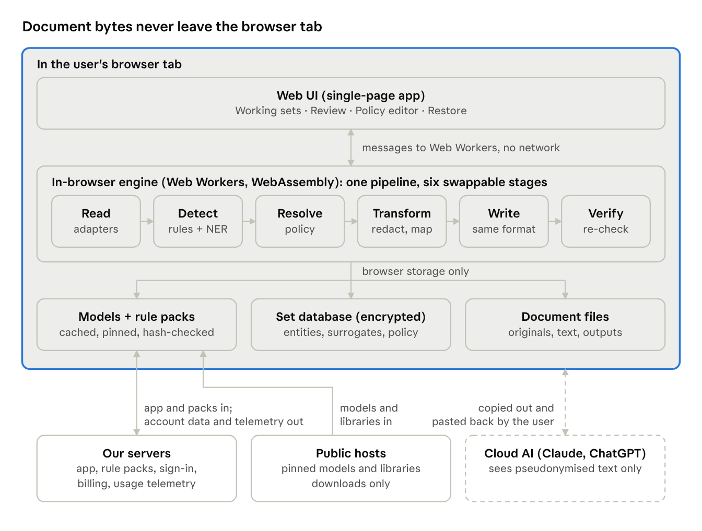

# Redactorator HLD

Nov 15, 2026 · @Sahil Chaddha

Redactorator is a hosted single-page web app that does all document work in the browser. Our servers deliver the app and rule packs and run sign-in, billing and usage telemetry; models and libraries may come from their public hosts. No server ever receives a document. Each stage of the work (read, detect, decide, transform, write, verify) sits behind a small contract, so a format, a detector or the implementation language can change without touching the rest. Nothing from the earlier Python POC is used: not its code, tests, fixtures or measured figures. This HLD is a draft for partner review. It pairs with the [PRD](PRD.md), and the order of work is in the [Implementation Plan](Implementation-Plan.md).

**Confirmed on 15 November 2026.** "Hosted" means hosted delivery with processing in the browser. Documents are never processed on our servers, which is what lets the requirement that no private data reaches our cloud hold.

## Design principles

Seven rules decide most questions in this design.

1. **Document bytes stay in the browser.** The app comes from our servers, but reading, detecting, transforming and verifying all run in the user's browser. No request carries document content, and no endpoint exists that would accept it.
2. **One intermediate model.** Every format is converted to the same text-plus-anchors model. Detectors and policy never see a file format.
3. **Detect, decide and transform are separate.** Detectors propose, policy and the user decide, transformers execute. That separation is what makes review, auto mode and pivots possible.
4. **Outputs are derived, never edited.** An output is a pure function of the original, the decisions and the policy. Changing a decision means re-running the function, not patching a file.
5. **Redaction destroys, pseudonymisation maps.** They are different code paths. A redacted value never reaches the vault.
6. **Fail closed.** An output that fails verification is not released.
7. **Proven parts, plugged in by name.** Adapters, detectors and surrogate generators are registry entries configured by data, behind contracts that assume no language. No custom parsers, no custom cryptography.

## Architecture at a glance



Everything inside the box runs in the user's browser tab. Things outside it: our servers, which send the app and rule packs, handle accounts and receive usage telemetry; the public hosts that serve pinned models and libraries; and the cloud AI, which only sees pseudonymised text the user copies out.

## Component contracts

Six stage contracts and one helper make up the engine. Each has one job and a typed input and output.

| Stage | Takes | Returns | First implementations |
| --- | --- | --- | --- |
| Reader (format adapter) | File bytes | `DocumentModel`: ordered text blocks with every character anchored to a native location, plus side channels (metadata, comments, fields) | PDF, text, image; then DOCX |
| Detector | A text block and its context | `Finding[]`: span, type, score, detector id | Regex packs, GLiNER2-PII, Privacy Filter, term lists, working-set matcher |
| Resolver | Findings, the entity registry, the policy | `Decision[]`: entity, action, confidence band | Merge overlaps, link to entities, apply thresholds and lists, propagate repeats |
| Transformer | Decisions | `Edit[]`: an anchor range plus removal or replacement text | Redactor, Pseudonymiser, Restorer |
| Writer (format adapter) | Original bytes and edits | New bytes in the same format, side channels scrubbed | PDF, text, image; then DOCX |
| Verifier (format adapter) | Output bytes and the removed values, held in memory | A certificate, or a failure that blocks release | PDF, text, image; then DOCX |
| Surrogate generator | Entity type and id | A surrogate string | Counter placeholders; then realistic fakes |

Boxes use one convention everywhere: points in MuPDF's page space, origin top-left. An `Edit` is either a text range or a free box with no text behind it.

A format adapter is three functions and a detector is one. The notation stays neutral so the contracts read the same in any language; the implementation is TypeScript (D1):

```text
FormatAdapter
  formats                        names it handles: "pdf", or "png", "jpg", "webp"
  read(bytes)                    -> DocumentModel
  write(bytes, edits, options)   -> bytes
  verify(bytes, removedValues)   -> checks

Detector
  id                             "regex:us_ssn", "gliner2@1cb4166"
  detect(text, context)          -> findings
```

Every contract is data in, data out, with no shared state. A stage can therefore be written in another language and compiled to WebAssembly, and stages talk across Web Workers by message.

Restore is not a special case. It is the same pipeline with the vault as the only detector and the Restorer as the transformer, so it works on any format that has an adapter.

This is what a pivot reuses:

| If the product becomes | It reuses | It adds |
| --- | --- | --- |
| A command-line or batch tool | The engine, if its language also runs outside a browser (D1) | A CLI front end |
| A proxy that pseudonymises prompts to an AI API and restores replies | Text adapter, detectors, Pseudonymiser, Restorer, vault | An HTTP proxy front end |
| A library inside another product | The engine as a package or WebAssembly module | Packaging only |
| A tool for another domain (source code secrets, chat logs) | Pipeline, review UI | A detector pack and, if needed, an adapter |

## Format adapters

Each format gets one adapter that knows how to read it, how to remove content from it, and where it hides copies of data. All four adapters are still to be built for the browser.

| Format | Read | Redact (remove for good) | Pseudonymise | Hidden carriers to scrub | Browser building block (candidate) |
| --- | --- | --- | --- | --- | --- |
| PDF, text-based | Glyph-level text with a box per character, all layers on, no clipping | Delete glyphs from the content stream, blank image pixels under the box, full rewrite of the file. Glyphs outside each box stay where they were | Remove as for redaction, then draw the surrogate fitted into the box with a fallback font | Our PDF leak-vector list (Implementation Plan, phase 3): metadata, XMP, annotations, form values, bookmarks, attachments, scripts, thumbnails, structure tree, ActualText, old revisions | MuPDF.js (MuPDF compiled to WebAssembly); PDF.js as an independent cross-check |
| Image (PNG, JPEG, WebP; TIFF if MuPDF.js decodes it) and scanned PDF | OCR to words with boxes | Overwrite the pixels, re-encode from the pixel buffer, drop any OCR text layer under the box | Paint the box, draw the surrogate on it | EXIF, XMP, embedded thumbnails, trailing data after the image end marker | Tesseract.js for OCR; canvas for pixels |
| DOCX | Walk the OOXML parts and map runs to character offsets: body, tables, headers, footers, footnotes, text boxes, comments | Rewrite run text in the XML; resolve tracked changes; drop comments and document properties | Replace run text, keeping the run's formatting | Core, app and custom properties; comments; tracked insertions and deletions; hidden text; field codes; hyperlink targets; alt text; custom XML; embedded objects; thumbnails; revision ids | A zip library and the browser's XML parser |
| Text and Markdown | Read as is | Replace the span | Replace the span | None | None needed |

Three notes on the unbuilt adapters:

- **DOCX has the largest unproven leak surface.** Before writing its adapter we write its leak-vector list and fixtures, as phase 3 of the Implementation Plan does for PDF. Images embedded in a DOCX are handed to the image adapter.
- **OCR quality bounds image safety.** A word the OCR misses cannot be detected. Image pages default to the review band, low-confidence OCR regions are flagged, and box-drawing by hand is always available.
- **Pseudonyms in PDFs and images are approximate.** The surrogate is fitted into the space of the original; text outside that box does not move.

### How OCR output maps back to the image

OCR engines return every word with a box in the pixel coordinates of the image they were given. Mapping back is bookkeeping: record each transform applied before OCR, then invert it. A local spike with Tesseract 5.5.1 and PyMuPDF 1.27.2.3 ran the path end to end.

1. **Render or load.** A scanned PDF page is rendered at 300 dpi through a known matrix. An image file is loaded with its EXIF orientation applied. Any deskew or rescale before OCR is recorded as one more matrix.
2. **OCR to words.** Tesseract's TSV output has one row per word: `left`, `top`, `width`, `height` in pixels from the top-left corner, a 0-100 confidence, and the text ([TSV and hOCR output](https://tesseract-ocr.github.io/tessdoc/Command-Line-Usage.html)).
3. **Build the text with an index.** The adapter joins the words in reading order into the page text. For every character offset it records the word it came from. This is the same `DocumentModel` the PDF adapter fills from glyph boxes, so detectors do not change.
4. **Finding to boxes.** A finding is a character span. The words it touches supply the boxes, merged per line. A match inside a word takes the whole word's box.
5. **Back to the source.** Boxes pass through the inverse matrix: pixels to page points for a PDF, deskewed pixels to original pixels for an image. A box that comes back rotated is widened to its enclosing rectangle.
6. **Remove the pixels.** For a PDF, `apply_redactions` with `PDF_REDACT_IMAGE_PIXELS` blanks the pixels inside the embedded scan ([PyMuPDF Page](https://pymupdf.readthedocs.io/en/latest/page.html)). For an image file, the box is painted into the pixel buffer and the file re-encoded.

The spike ran in Python. The browser build uses the same engines compiled to WebAssembly: [Tesseract.js](https://github.com/naptha/tesseract.js) for word boxes and confidences, and [MuPDF.js](https://github.com/ArtifexSoftware/mupdf.js) for `applyRedactions`. Two things to check when the spike is repeated in a browser: Tesseract.js switches every output except plain text off by default since version 6, and MuPDF.js must expose the image-pixel option.

| Spike check | Result | Design consequence |
| --- | --- | --- |
| Box tightness, upright page at 100, 200, 300 dpi | Boxes hug the ink: 0.3% to 7% of a word's ink pixels, the anti-aliased fringe, fell outside the raw box. 1 px of padding covered all of it. | Pad every OCR box before redacting. Start at 10% of line height, minimum 2 px, and tune on real scans. |
| Redact with the raw OCR box | A second OCR pass no longer read the value, but faint glyph-edge pixels stayed in the embedded image. | The certificate checks pixels in the padded box, not just a second OCR pass. |
| 2 degree skew | All four test values read. Boxes grew to cover the slanted word (44 to 71 px tall for the email). | Small skew needs no special handling. |
| 5 degree skew | The email address was misread, so it would not have been detected. | Deskew before OCR, then map boxes back through the inverse rotation (step 5). |
| Both PDF paths | Direct TSV and `get_textpage_ocr` each returned the four test values with usable boxes. | Either works; TSV is chosen for its confidence values. |

The spike used a clean synthetic page in one 11 pt font. Noisy scans, stamps and handwriting are not covered; that is the D6 benchmark.

If D6 swaps the engine, only step 2 changes, because the adapter normalises every engine to pixel rectangles:

| Engine | Smallest box | Coordinates | Confidence |
| --- | --- | --- | --- |
| [Tesseract 5](https://tesseract-ocr.github.io/tessdoc/Command-Line-Usage.html) | Word (TSV, hOCR) | Pixels, top-left origin | Per word, 0-100 |
| [docTR](https://mindee.github.io/doctr/using_doctr/using_models.html) | Word, nested in page, block, line | Relative 0-1 corner pairs; polygons when pages are not assumed straight | Per word, plus an objectness score |
| [PaddleOCR](https://www.paddleocr.ai/latest/en/version3.x/pipeline_usage/OCR.html) | Line by default; words with `return_word_box` | 4-point polygons and `[x_min, y_min, x_max, y_max]` rectangles | Per line |

Two limits follow. An engine that returns text without per-word boxes cannot locate anything, however accurate its text. PaddleOCR's docs do not say which image its boxes refer to when its own orientation or unwarping steps run, so that needs a test before use.

For scans that already carry an invisible OCR layer, the layer's text is detected and the pixels under it are blanked. That layer came from unknown software, so image pages are also OCRed by us and the findings merged. Tesseract reads best at 300 dpi or more ([Tesseract: improving quality](https://tesseract-ocr.github.io/tessdoc/ImproveQuality.html)), which sets the render resolution in step 1.

## Detection stack

Detection is a union of four detector families, merged by the resolver. Patterns give precision on structured identifiers; ML models find the names and addresses patterns cannot.

1. **Working-set matcher.** Finds every known spelling of entities already in the set. This is what makes a decision carry to the next document.
2. **Term lists.** The user's always-hide terms.
3. **Rule packs.** Regex plus a validator and context words, grouped by country or theme.
4. **NER models.** Run in the browser on ONNX Runtime through [Transformers.js](https://huggingface.co/docs/transformers.js/index), on WebGPU where the device has it and WebAssembly otherwise, pinned by revision and cached after first load. The [OpenAI Privacy Filter](https://huggingface.co/openai/privacy-filter) model card shows a browser example. GLiNER2-PII in the browser is unproven: community ONNX exports exist but need the spike. Which models run depends on the device's detection level, below.

**Detection levels by device (D5).** On first run the app checks the device: a WebGPU adapter and its limits, memory where the browser reports it, and a short timed test run. It then picks a level:

| Level | Detectors | Typical device |
| --- | --- | --- |
| Full | Patterns, validators, the smaller model and the larger model | WebGPU and ample memory |
| Standard | Patterns, validators and the smaller model | Most laptops, WebAssembly only |
| Basic | Patterns and validators only, plus the working-set matcher and manual marking | Low-memory or old devices |

The level is never silent. The app shows it in a banner ("Basic detection on this device: names and addresses are not detected automatically; review each page"), in the review view and on each document's certificate. The user can choose a higher level and accept the slowdown. Each document records the level it was cleaned at, so it can be re-checked later on a stronger device. The NER spike (Implementation Plan, spike track) compares candidate models and decides which fills each slot, and sets the thresholds (D10).

### Open-source rule sets to combine

Three sources cover most of what we need: Presidio for personal identifiers by country, python-stdnum for checksums, gitleaks for secrets. The rest fill gaps or serve as cross-checks.

| Source | What it offers | Licence | How we use it |
| --- | --- | --- | --- |
| [Microsoft Presidio](https://github.com/microsoft/presidio) | [99 predefined entity types](https://presidio.dataprivacystack.org/supported_entities/) in 20 groups: global, 18 countries, and medical. Most are a regex with context words, many with a checksum | MIT | Primary source for country packs. Port patterns and context words into our pack format; skip its NER-based types, which our models cover |
| [python-stdnum](https://arthurdejong.org/python-stdnum/) | Validators for 200+ number formats (tax, identity and company numbers, IBAN) with Luhn, Verhoeff and ISO 7064 check digits | LGPL-2.1+ | Reference for check-digit rules. Used directly only if the engine is Python; otherwise the validators we need are written from the public specifications and tested against it |
| [gitleaks](https://github.com/gitleaks/gitleaks) | Secret-detection rules in TOML: regex, keywords, entropy threshold, allowlists. Roughly 150 rules by third-party counts | MIT | Source for the secrets pack. Its keywords map directly to our context words |
| [OpenRedaction](https://github.com/sam247/openredaction) | 570+ regex patterns in TypeScript; government IDs for 50+ countries; compliance presets | MIT | Mine for countries Presidio lacks. Each pattern is ported and must pass fixtures before it is enabled |
| [detect-secrets](https://github.com/Yelp/detect-secrets) | Regex plugins plus entropy and keyword detectors | Apache-2.0 | Reference for a generic high-entropy secret detector |
| [secrets-patterns-db](https://github.com/mazen160/secrets-patterns-db) | 1,600+ secret regexes graded by confidence, with a converter to gitleaks format | CC BY-SA 4.0 per the repo; the README says CC BY 4.0 and marks its TruffleHog-derived data AGPL | Optional extended pack, high-confidence rules only, after the licence is clarified |
| [DataFog](https://github.com/datafog/datafog-python) | Offline regex engine for email, phone, SSN, card, IP, date, ZIP, plus a German locale | MIT | Cross-check only; it overlaps the country packs |

Not used: TruffleHog's detectors, which third-party listings give as AGPL-3.0 and which lean on live credential verification, a network call we do not make.

### How the sets become one

- **One pack format.** A pack is a YAML file of rules, compiled to JSON at build time so the app needs no YAML parser. Each rule records its source and licence, so attribution and audits are mechanical.
- **Converters, not copies.** One script per source (Presidio recognisers, gitleaks TOML) regenerates our packs, so upstream fixes can be pulled.
- **Fixtures gate every rule.** A rule ships only with positive and negative examples that pass. Regex dialects differ between Go, JavaScript and Python, so ported patterns are tested, not trusted.
- **Validator beats pattern.** When two sources cover one identifier, we keep the rule with a checksum. Rules with no validator must have context words nearby.
- **User patterns are sandboxed.** Custom regexes run in a separate worker that is stopped when it passes a time limit, so a bad pattern cannot hang the engine.

```yaml
pack: in-identifiers
version: 1
rules:
  - id: in_pan
    type: GOV_ID
    pattern: '\b[A-Z]{5}[0-9]{4}[A-Z]\b'
    validator: stdnum.in_.pan
    context: [pan, permanent account]
    confidence: 0.9
    source: presidio
    licence: MIT
```

## Pseudonymisation and the vault

A surrogate is assigned once per entity per working set and stored in the working set's store on the user's device; restoring is a lookup in the other direction.

**Making surrogates**

- The MVP generator is a counter per type: `PERSON_1`, `PERSON_2`, `ORG_1`. It is deterministic, cannot collide, and is the easiest form for an AI model to carry through unchanged.
- The v1 generator produces realistic fakes with a Faker-style library, seeded per entity so the same person always gets the same fake.
- The v1 generator never gives two entities in one working set the same first or last name, and never picks a fake that matches a value already in the working set, such as a real person's name or a street name.
- Both sit behind the surrogate-generator contract. The pseudonymiser does not know which one it is calling.

**Restoring**

- The Restorer builds one matcher from the vault's surrogates. It ignores case and tolerates brackets, quotes, markdown emphasis, a trailing possessive and a line break inside a token.
- A token that looks like a surrogate but is not in the vault is reported, never guessed.
- For realistic fakes, the vault also stores the parts of each surrogate (first name, last name), so "Ms Keller" restores when the full fake was "Maria Keller".
- Realistic fakes change what restore can check. A name the AI invents looks like any real name, so it is left as it is; the not-in-the-vault check above works only for placeholders such as `PERSON_3`.
- A name part that fits more than one entity is flagged as ambiguous, never guessed.
- A fragment of a vault fake left in the text after restoring ("M. Keller", "Maria K.") is highlighted as possibly not restored.
- The restore view highlights every replacement, so the user can check each one.
- Placeholders restore safely and checkably. Realistic fakes read better to the AI but restore best-effort, with these flags. Placeholders are the default; realistic fakes are an option per working set.

**The vault**

- The vault is the surrogate-to-original columns of the working set's entity registry, not a separate store. The registry is a JSON file in the working set's folder (see Data model and storage).
- v1 does not encrypt it, and has no vault passphrase (decided 21 Nov 2026). A forgotten passphrase would lose every set with no way back, and the folder sits with the user's other files, or in browser storage private to our site.
- Purging a working set deletes its folder. Exporting a set is copying that folder.
- Browser storage can be cleared by the user or evicted by the browser, and a lost vault cannot be rebuilt. The sets can live in a folder on the user's disk instead; until one is picked the app asks for persistent storage, and prompts for a vault backup after pseudonymising.

**What is stored for redacted entities** is decided (D3). Carrying a redaction to the next document needs something to match on, so the normalised value is kept in the registry with no surrogate, because the originals sit in the same store anyway. The stricter alternative, a keyed hash only, was rejected: it limits matching to exact repeats and rules out linking spellings.

## Working sets

Consistency across documents comes from one mechanism: decisions attach to entities, not to places in files, and every document is rendered from the same entity registry.

**Example: a manual redaction spreads to the whole set.** No detector flagged "Project Falcon". The user selects it in the third contract, marks it redacted and approves the contract. From then on it is redacted in every document of that working set: the ones already imported and any imported later. The review list shows each place it was found. A detection spreads the same way once the user approves it and its document; until then it stays in its own document.

1. **Import.** The reader produces the document model. Detectors run, including the working-set matcher, which finds every known spelling of approved entities.
2. **Link.** The resolver ties each finding to an entity by normalised value (case, spacing and number formatting ignored), matched at word boundaries. An unknown value becomes a new entity with the policy's default action, pending until the user approves it.
3. **Decide.** The user approves a detection, changes an action on an entity, or marks text by hand in any document, or the policy sets it. The change is one row in the registry, and its document goes to In review. Each document is Not started, In review or Approved.
4. **Spread on approval.** When the user approves a document, after a heads-up naming the documents it will change, its decisions (marks, values it stopped hiding, approved detections) become the set's, and the working-set matcher searches every other document for their occurrences. Nothing spreads before approval. The search runs in the worker against each document's stored text model, so no file is parsed again. A document the spread changes goes back to In review, and opening it offers a review of only what the spread brought in.
5. **Render.** Any document with an occurrence of that entity is now stale ("Changed since download"). Its output is rebuilt from the original when it is next viewed or saved.

Because outputs are derived (principle 4), "redacted in one document means redacted in all" needs no code that patches outputs: the registry changed, the matcher found the occurrences, and the outputs follow.

Limits to be honest about:

- **Linking spellings** ("J. Roe" to "Jane Roe") is rule-based in v1: shared surname plus matching initial is suggested, and the user confirms. Automatic linking of normalised matches is in the MVP.
- **Only approved entities spread across documents.** A detection the user has not approved stays in the document where it was found. It is redacted there by default, failing toward privacy, but touches no other document. Within that document, only values that are validated or found by two detectors spread to repeats, so "Bill" does not redact every "bill".
- **Approving the document spreads it to the whole set.** Its values then spread to every normalised match at word boundaries in the set, even when short. The review list shows each match, so a wrong hit can be undone.
- **A box over an image** (a logo, a pasted signature) is kept as drawn, measured in the image's own frame. On approval it spreads to the same image, or a near-identical copy found by a visual fingerprint, in other documents, covering the same part of the image at whatever size or rotation it is drawn there. The fingerprint is a 64-bit difference hash of a small grey copy of the image, or of its soft mask when the colour alone is plain; a copy differs in at most 10 bits. A box spreads only when at least half of it lies on one image, and images too small, too plain, page-sized (a scan) or of another shape are never matched (decided 22 Nov 2026).
- **Other boxes stay in their document:** vector drawings, whether inline in a page's content (where the same logo can be drawn with different commands) or stored once as a reusable object (MuPDF.js does not report where it is placed, and a box over part of a drawing leaves the drawing in the file, so spreading would copy that leak), and scanned pages, where a logo is part of the page picture, need visual search (Implementation Plan, phase 7). A box with nothing behind it applies only to its own document.

## Irreversibility and verification

Redaction is trusted only after the written file is re-opened and searched for what was removed. Each adapter brings its own checks before it ships.

| Format | How content is destroyed | What the verifier checks on the written bytes |
| --- | --- | --- |
| PDF | Glyphs deleted from content streams, image pixels blanked, file fully rewritten as a single revision | No text under any box; removed values absent from two independent text extractors, metadata, links, annotations, form values, bookmarks and every raw object; no scripts, attachments or thumbnails; pattern detectors find nothing |
| Image | Pixels overwritten, image re-encoded from the pixel buffer | Redacted regions are uniform; no metadata blocks; no bytes after the image end marker; a second OCR pass finds no removed value |
| DOCX | Run text rewritten, tracked changes resolved, comments and properties dropped, package rebuilt | Removed values absent from every XML part, relationship and binary part of the package; no comment or revision parts; pattern detectors find nothing |
| Text | Span replaced | Removed values absent from the output |

Rules that hold for every format:

- The file is always written fresh. No incremental save, no undo data, no previous revision.
- Removed values are held in memory only for the check. Reports carry a salted hash, and the salt is discarded, so a low-entropy value such as an ID number cannot be brute-forced from a report.
- A failed check blocks the export and is shown to the user with the failing check's name.

What the certificate does not claim: that nothing was missed by detection, or that a black box hides the length of what it covers.

## Hosted delivery and the privacy boundary

The browser loads the app from our servers, then does all document work itself. Our servers deliver the app and rule packs, run accounts and receive usage telemetry; models and libraries may come from their public hosts. No server has a route that accepts a document. The principle is that no document is uploaded without the user's consent; downloads from public hosts carry no document content.

**How it runs**

- The app is a single-page web app on our origin. A service worker caches the app, models and packs, so later visits start fast and work offline.
- The engine runs in Web Workers, off the UI thread. The heavy parts (PDF, OCR, models) are WebAssembly modules, and models use WebGPU where the device has it.
- Files are opened with the file picker or by drag and drop and are read inside the page. Cleaned outputs are saved back as ordinary downloads; the working set keeps no copy.
- Working sets persist as files: in a folder on the user's disk, or in the browser's origin-private storage until one is picked (see Data model and storage). v1 supports Chrome only.

**What keeps data in**

| Control | What it stops |
| --- | --- |
| No upload route: the accounts API has no endpoint that takes document bytes, text or findings | A code change that quietly sends content, because there is nowhere to send it |
| Content Security Policy: scripts and connections are limited to our own hosts and the named public hosts that serve models and libraries | A library or injected script sending data to an unlisted host |
| Every model and library pinned to an exact revision, and each downloaded file's hash checked before use | A host swapping a file |
| A network test that fails on any request to a download host that is not a plain download | A regression that sends data through an allowed host. It cannot stop a compromised library in a user's browser; that risk is accepted |
| A fixed, published list of fields that account calls may send, with a test that fails on any other request | Usage or content leaking through account calls |
| The whole pipeline is tested with the network blocked | A regression that makes document work depend on a server |
| The loaded app keeps working with the network disconnected | Gives users and auditors a simple way to check the claim |

**What a hosted app cannot promise.** A browser runs whatever code our servers send on each visit. "Nothing leaves" therefore rests on our release process, where an installed app would rest it on the user's machine. This is the main cost of hosting, settled in D9: the source is public (D2), builds are reproducible, each release's hash is signed and published in a public log, and the app shows its own release hash. In v1 a small browser extension checks the served files against that log.

**What our servers do**

They host the app and rule packs, each pinned by hash; models and libraries come from our servers or their public hosts, pinned by revision and hash-checked. They also run sign-in, plans and billing, described in the next section. They never receive a document: the app's only calls are asset downloads, account requests and usage telemetry. Telemetry carries counts and events, never document content (see Accounts, plans and billing).

**Deployment.** Static assets sit behind a content delivery network on our own domain. The accounts API is a separate small service, beside the telemetry endpoint and its analytics store. Nothing else runs server-side.

**What moved out of scope** is a locally installed engine, the first draft's recommendation. It allowed full-size models, at the price of an install step. The hosted app trades those for no install and one code base to update.

## Accounts, plans and billing

Sign-in, plans and billing are ordinary web-app features here, with one rule added: nothing about a document reaches them. A plan is a number of document redactions. Our server keeps each user's balance, and the app spends one credit per new document, so the plan is enforced without seeing any document.

**What runs where**

| Piece | Where | Does | Holds |
| --- | --- | --- | --- |
| Identity provider | Cloud, bought | Auth0. Sign-up and sign-in by emailed one-time code, Google or Microsoft, with optional passkeys; no passwords. Enterprise single sign-on arrives with team plans | Email and linked Google or Microsoft identities |
| Stripe | Cloud, bought | Checkout page, invoices, card storage, customer portal | Payment details |
| Accounts API | Our cloud: one small service and a database | Keeps the session, maps a user to a plan, receives Stripe webhooks, keeps the document balance and hands out credits | User id, email, plan, Stripe customer id, balance and a ledger of spent credits |
| Web app | Browser | Shows the balance and spends a credit before a new document's first cleaned output | A session cookie, a cached copy of the plan and a small batch of credits |

**Sign-in**

1. The user chooses Sign in. The browser goes to the identity provider (OpenID Connect, authorisation-code flow) and returns to our origin.
2. The Accounts API sets a session cookie that scripts cannot read.
3. The app asks the API for the user's plan and balance, and takes a small batch of credits so a loaded app keeps working offline.

**Upgrade and billing**

1. Upgrade sends the browser to Stripe's hosted Checkout page. Our pages never show a card form.
2. Stripe notifies the Accounts API by webhook: `checkout.session.completed`, then `invoice.paid` or `invoice.payment_failed` each period. The API updates the plan ([Stripe subscriptions guide](https://docs.stripe.com/billing/subscriptions/build-subscriptions)).
3. The app reads the new plan when the user returns. Card changes and cancellation go through Stripe's customer portal.

**How the plan is enforced**

| Layer | How | Strength |
| --- | --- | --- |
| Document quota (the only one) | Before a document's first cleaned output, the app spends one credit. The request carries the session and a random id for that document, so a retry is not charged twice. Re-exports of the same document, such as after a new decision in the set, are free. Pasted text spends characters from its own allowance | The balance lives on our server, but a modified app could skip the call |
| Offline batch | The app holds a small batch of credits so new documents can be cleaned offline, and reports what it spent at the next sync. With none left, a new document waits for a connection | The batch size caps how far offline use can run ahead of the server |
| Asset gating (dropped) | Paid modules released only to paid sessions | Not needed while plans differ only by the number of documents |

**What crosses the boundary**

| Sent to our cloud | Never sent |
| --- | --- |
| Email and the session cookie | File names, document text, page images |
| Plan and billing requests; one credit request per new document, carrying a random id and nothing about the file, and the character count of each pasted text | Findings, entity values, surrogates |
| Requests for app modules, models and packs, which show what a user downloaded | Working-set names |
| App version | Hashes or other fingerprints of a document's contents |
| Usage telemetry: counts of documents, pages and working sets, which features were used, timings, error codes, browser and device class | Error messages or anything the user typed, since either can hold document text |

**Telemetry.** The app sends usage events, batched, to our own endpoint, tagged with the account id. Every event follows a fixed schema of numbers, enums and identifiers we define. There is no free-text field, so document text has nowhere to go. An error is reported as a code and its stack frames, never its message. The schema is published and a test fails on any field outside it. Telemetry is on by default, and users can switch it off or on in settings. The events land in a self-hosted analytics store; no third-party script runs in the app.

**The free plan.** 10 document redactions a month, plus 20,000 characters of pasted text a month counted separately; paid plans raise both. Every feature is on every plan, and restoring an AI reply never spends anything. Before signing up, a visitor can clean one document. That count lives in the browser, so clearing storage resets it; this is accepted for a trial.

**Rules the design keeps**

- **A lapsed plan never locks data.** Opening a set, exporting, backing up the vault, purging and restoring existing pseudonyms work on every plan and with a balance of zero. The vault is the user's data, not a paid feature.
- **D2 is a pricing decision too.** Under the AGPL route the app's source is public and anyone can host it without the quota. A paid plan then rests on the hosted service, updates, support and team features.
- **Build order.** Accounts touch no pipeline code and can be built beside the engine.

## Implementation language and building blocks

The language is TypeScript (D1, decided); the table below records the options that were weighed. The platform is fixed: a browser, Web Workers and WebAssembly. Every heavy part already exists as a WebAssembly build, so the language choice covers only the engine's own logic: the pipeline, rules, resolver and storage.

| Concern | Candidate | Why | To confirm |
| --- | --- | --- | --- |
| PDF read, redact, rewrite | [MuPDF.js](https://github.com/ArtifexSoftware/mupdf.js) | Official WebAssembly build of MuPDF; has `applyRedactions` | The image-pixel redaction option; results on our PDF leak suite; the licence, below |
| PDF cross-check | PDF.js text extraction | An independent second reader for the verifier |  |
| OCR | [Tesseract.js](https://github.com/naptha/tesseract.js), Apache-2.0 | The engine used in the OCR spike, in WebAssembly | Speed and accuracy on real scans (D6) |
| NER models | [Transformers.js](https://huggingface.co/docs/transformers.js/index) on ONNX Runtime; WebGPU with a WebAssembly fallback | Runs models in the browser with no server; quantised weights cut the download | Which models fit a browser (D5) |
| DOCX | A zip library and the browser's XML parser | A DOCX is a zip of XML parts | Leak-vector list comes first |
| Images | Canvas | Built in | That re-encoding drops metadata, per format |
| Storage | JSON files and originals behind one storage interface: the File System Access API for a folder on the user's disk, the origin-private file system until one is picked; both are directory handles in Chrome, so one backend serves both | No database engine to ship; the user can browse their own folder; another backend fits the same interface | Eviction rules, under Data model and storage |
| Encryption | None at rest in v1 | Decided 21 Nov 2026 |  |
| UI | A mainstream single-page framework with TypeScript | Easy to hire for | The team's choice |
| Sign-in | A bought identity provider that speaks OpenID Connect | No password storage or home-made auth | Vendor (D8) |
| Billing | Stripe Billing: hosted Checkout, customer portal, webhooks | Card data never reaches us; the least code |  |
| Accounts API | One small service with a relational database | Holds a few rows per user | Language follows the team |
| Tests | Unit tests and Playwright browser tests run locally with one command; our own leak-vector lists and fixtures; a stand-alone outside checker (pdfminer.six and a raw object scan) | Leaks are checked on the written file by a reader the app does not use |  |

**Language options for the engine**

| Option | Reuses | Costs |
| --- | --- | --- |
| TypeScript, calling the WebAssembly modules | One language with the UI; every building block above has a JavaScript API | Rules and validators are rewritten; outside a browser it runs only on JavaScript runtimes |
| A Rust core compiled to WebAssembly | One core for the browser, a command line and a server later; predictable speed and memory | A second language beside the UI's; calling MuPDF and Tesseract from inside WebAssembly is more work than from JavaScript |
| Python in the browser through Pyodide | python-stdnum and Presidio's patterns as they are | A large runtime to download; a browser build of PyMuPDF that is not a standard package; models still run through Transformers.js |

The contracts keep the choice reversible. Stages pass messages, so an engine that starts in one language can swap a single stage for a module built in another.

**The licence item.** MuPDF.js carries MuPDF's terms: AGPL, or a commercial licence from Artifex for proprietary and SaaS products ([MuPDF.js repository](https://github.com/ArtifexSoftware/mupdf.js)). A hosted app sends MuPDF.js to every visitor. On the usual reading the AGPL route then means publishing the source of the web app that uses it; confirm with counsel. There are two clean ways through; D2 chose the first, keeping the Accounts API and billing closed as separate programs:

- **Open-source the app under AGPL.** This fits a privacy product, since anyone can audit the "nothing leaves" claim, which also answers D9. Revenue then rests on the hosted service, not on closed code.
- **Buy the commercial licence** and keep the code closed. Pricing is by quote.

Replacing the PDF engine is a third route we do not recommend: a first search turned up no permissive library with equivalent true-redaction support (a short spike would confirm), and the PDF leak suite would have to pass again on the new engine.

## Data model and storage

Each working set is a folder: its originals under their own names, and its records as JSON files in a hidden `.redactorator/` folder. The folder lives on the user's disk, through the File System Access API, or in the origin-private file system until the user picks one. v1 supports Chrome only; Safari and Firefox, which cannot save into a picked folder, would each need a backend of their own behind the same interface. Nothing is encrypted in v1. Rule packs and models are cached by the service worker and hold no user data. The app reaches storage through one interface (read, write, list and delete files), so a later backend, such as a cloud store, changes no app code.

```text
Folder the user picked, or the origin-private file system
  .redactorator/settings.json   global policy (thresholds, bands, term lists, custom patterns, appearance)
  <working set name>/
    <original>.pdf              imported files, under their own names
    .redactorator/
      project.json              entities, aliases, document states, every document's occurrences, the set's policy, exports
      text/<document id>.json   each document's extracted text model
Service worker cache
  app, rule packs, pinned models
```

A set is read into memory when it opens. `project.json` is one file so that an approval, which changes many documents, is saved whole; Chrome swaps a written file in only when the write completes. Dot folders are hidden on macOS and Linux; Windows shows them, since a web page cannot set Windows' hidden attribute.

| Table | Holds | Notes |
| --- | --- | --- |
| `document` | File name, format, content hash, import time, status | Points at its file in `originals/` and its text model in `text/` |
| `entity` | Type, canonical value, action, surrogate (if pseudonymised) | The surrogate map is this table; there is no separate vault store |
| `alias` | Entity id, normalised spelling | What the working-set matcher searches for |
| `occurrence` | Document id, anchor, entity id, detectors, score, band, status | One row per finding; manual marks are occurrences with detector `user` |
| `policy` | The set's overrides as one JSON document | Merged over the global policy at run time |
| `export` | Document id, output hash, certificate, policy hash, stale flag | Lets SET-6 detect outdated downloads; the output itself is not kept |
| `audit` | Time, actor (user or policy), action, entity id | No raw values |

A browser cannot reopen a file by its path later, so the working set's folder holds copies of the originals (D4, decided). Asking the user to pick the file again for every re-export was rejected.

**Storage limits that shape the design** ([MDN: storage quotas and eviction](https://developer.mozilla.org/en-US/docs/Web/API/Storage_API/Storage_quotas_and_eviction_criteria)):

- Quota is large: about 60% of the disk per origin in Chrome and Safari, and the smaller of 10% of the disk or 10 GiB in Firefox by default.
- Storage is best-effort unless the browser grants persistence through `navigator.storage.persist()`. Chrome and Safari decide that without asking the user.
- Safari deletes script-written data for a site the user has not interacted with in seven days of browser use, when tracking prevention is on.
- So the browser is never the only copy of a vault. The working sets can live in a folder on the user's disk, out of reach of eviction. A set moves to another device as a copy of its folder, imported on the other side.

## The POC and the order of work

Nothing from the earlier Python POC is used: not its code, `verify.py`, leak-vector list, fixtures, labels or measured figures. The product is specified and tested on its own terms. The PDF leak-vector list is written fresh from the PDF specification, the outside test checker is stand-alone, and the spikes compare candidates with each other on our own dataset.

The order of work, the dataset track and the spikes are in the [Implementation Plan](Implementation-Plan.md).

## Risks and open decisions

Nine decisions are open; the first two shape everything else and are worth settling before any build work.

- [ ] **D10. NER models for each detection level.** Open until the spike. The spike compares candidate models: the OpenAI Privacy Filter, GLiNER2-PII, other GLiNER PII models, and DeBERTa- or BERT-based PII taggers with ONNX exports. Each is measured on recall for names and addresses on the launch-country test set (overall and per name-origin group), download size, memory, and speed with WebGPU and with WebAssembly. Each model's licence must allow commercial use. The results fill the Full and Standard slots.
- [ ] **D6. OCR engine.** Open until the spike, like D10. The spike compares Tesseract.js, PaddleOCR PP-OCRv5 and docTR on real scans from target users. It measures text accuracy, how tightly the word boxes cover the ink, download size and speed. Tesseract.js is the fallback if no engine clearly wins.

**Decided**

- **D3. Redacted values in the registry:** stored normalised in the set's store, so later documents match and spellings can be linked.
- **D4. Originals:** each working set keeps copies in its folder, so outputs rebuild when a decision spreads. The copies are part of set export and backup.
- **Launch scope:** English, with country packs for the US, UK, Canada, Australia, New Zealand and Ireland in the MVP (Implementation Plan, phase 4). India comes later.
- **PRD decisions (18 Nov 2026):** realistic surrogates (PSE-9) and restore into DOCX (PSE-14) are v1. MVP image formats are PNG, JPEG and WebP; TIFF joins if MuPDF.js decodes it; HEIC, GIF and BMP are v1. Telemetry starts on, and users can switch it off. Models and libraries may load from public hosts, pinned and hash-checked.
- **D7. Free plan:** 10 documents and 20,000 characters of pasted text a month, each resetting monthly. One document before sign-up, counted in the browser.
- **D8. Identity provider:** Auth0 through standard OpenID Connect, with no passwords (emailed code, Google, Microsoft, optional passkeys). With no password hashes to export, moving provider later is an export of emails and ids, plus passkey re-enrolment. Enterprise single sign-on comes with team plans.
- **D2. PDF engine licence:** the browser app (UI and engine) is published under the AGPL. The Accounts API, billing and telemetry store are separate programs and stay closed. To be confirmed with counsel before launch.
- **D9. Trust in served code:** MVP has public source, reproducible builds, a signed hash per release in a public log, and the release hash shown in the app. v1 adds a browser extension that checks served files against the log. An installable pinned build is not planned.
- **D1. Implementation language:** TypeScript for the UI and the engine, calling the WebAssembly modules through their JavaScript APIs. The spikes measure speed and memory; they do not choose the language.
- **D11. Working-set storage (21 Nov 2026):** JSON files and originals in a folder per set, behind one storage interface; a folder on the user's disk, the origin-private file system until one is picked; Chrome only in v1; no database engine; no encryption at rest and no vault passphrase in v1. Shown in the app as projects. Decisions spread when a document is approved.
- **D5. Models in the browser:** chosen per device as Full, Standard or Basic detection (see Detection stack). The level is always shown to the user, who can choose a higher one. Which models fill the levels is still open (D10).

| Technical risk | Effect | Mitigation |
| --- | --- | --- |
| Hosted code can change on any visit | The privacy claim rests on our release process | D9; no upload route; a strict Content Security Policy; a claim users can test offline |
| A vector drawing only partly under a box stays in the file | MuPDF removes a path only when the box covers all of it (`REDACT_LINE_ART_REMOVE_IF_COVERED`, used since phase 1), so a box over most of a vector logo hides it on screen while its drawing commands remain under the box | A leak fixture in phase 3; then cut paths at the box edge, or remove every path the box touches and check what else that removes |
| MuPDF.js leaves content behind or moves text after redaction | Redaction or scrubbing gaps; shifted layout | Our PDF leak suite (Implementation Plan, phase 3); a glyph-position test from phase 1; MuPDF.js pinned to an exact version |
| Models are heavy for a browser | Slow first load, memory limits, weak devices without WebGPU | Patterns work at once; quantised models cached after first load; a device check picks the detection level and the app shows it |
| Large files in a browser tab | Memory pressure or a crashed tab on long PDFs | Page-at-a-time processing in workers; progress saved per page |
| Browser storage is cleared or evicted | A lost vault makes its pseudonyms unrecoverable | Request persistent storage; backup prompt; working-set export and import |
| DOCX leak surface is unproven | A missed carrier is a silent leak | Leak-vector list and fixtures come before the adapter (v1) |
| OCR misses text in images | Undetected data stays visible | Image pages default to review; low-confidence regions flagged; manual box drawing |
| Ported regexes behave differently in the new language | False matches or silent misses | Fixtures gate every rule |
| Sign-in weakens the privacy claim | Users doubt that nothing leaves the device | A fixed, published list of fields in account and telemetry calls; a test fails on any other request |
| The quota check runs in browser code | A modified app can clean documents without spending credits | Balance kept on our server; a small offline batch; the rest accepted, as for any app that works offline |
| Accounts service is down | Sign-in and upgrades fail | A loaded app keeps working on its cached plan and credit batch; only new documents past the batch wait |
| Browsers differ | A feature works in one browser and not in another | A supported-browser list; the conformance suite runs in each |

## Sources

External pages opened on 15 Nov 2026.

- [Presidio repository](https://github.com/microsoft/presidio) and [supported entities](https://presidio.dataprivacystack.org/supported_entities/)
- [python-stdnum](https://arthurdejong.org/python-stdnum/)
- [gitleaks](https://github.com/gitleaks/gitleaks) and its [default rules](https://github.com/gitleaks/gitleaks/blob/master/config/gitleaks.toml)
- [secrets-patterns-db](https://github.com/mazen160/secrets-patterns-db)
- [detect-secrets](https://github.com/Yelp/detect-secrets)
- [OpenRedaction](https://github.com/sam247/openredaction)
- [DataFog](https://github.com/datafog/datafog-python)
- [MuPDF licence](https://mupdf.readthedocs.io/en/latest/license.html) and the [MuPDF.js repository](https://github.com/ArtifexSoftware/mupdf.js)
- [Tesseract](https://github.com/tesseract-ocr/tesseract), its [command-line output formats](https://tesseract-ocr.github.io/tessdoc/Command-Line-Usage.html) and [quality guide](https://tesseract-ocr.github.io/tessdoc/ImproveQuality.html), and [Tesseract.js](https://github.com/naptha/tesseract.js)
- [PyMuPDF Page reference](https://pymupdf.readthedocs.io/en/latest/page.html) and [PyMuPDF on Pyodide](https://pymupdf.readthedocs.io/en/latest/pyodide.html)
- [docTR models](https://mindee.github.io/doctr/using_doctr/using_models.html) and the [PaddleOCR pipeline](https://www.paddleocr.ai/latest/en/version3.x/pipeline_usage/OCR.html)
- [Transformers.js](https://huggingface.co/docs/transformers.js/index) and the [OpenAI Privacy Filter model card](https://huggingface.co/openai/privacy-filter)
- [MDN: storage quotas and eviction](https://developer.mozilla.org/en-US/docs/Web/API/Storage_API/Storage_quotas_and_eviction_criteria)
- [Stripe subscriptions guide](https://docs.stripe.com/billing/subscriptions/build-subscriptions)

Not verified against a primary source: the gitleaks rule count and TruffleHog's licence, both taken from third-party comparisons. Also unverified: that GLiNER2-PII runs in a browser, that MuPDF.js exposes image-pixel redaction, and that PDF.js is a good enough second extractor. The licence of every building block needs a check before launch.
