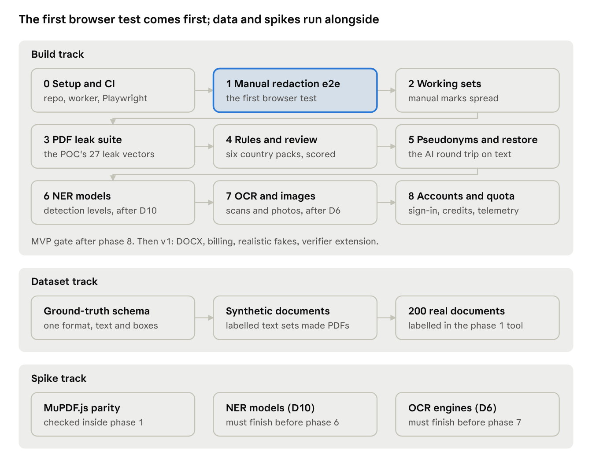

# Redactorator Implementation Plan

Nov 18, 2026 · @Sahil Chaddha

## Summary

This plan turns the [PRD](https://claude.ai/artifact/5BCW7q4dr5jygrAu2ToSiK) and [HLD](https://claude.ai/artifact/BtxzLu9BUqFq3zkPNYxag7) into an order of work. It is ordered for the fastest feedback: the first thing built is a browser app in which a person marks pdf by hand and gets back a PDF with that text truly gone, tested end to end in a real browser. Detection comes later, one layer at a time, and each layer is scored against a dataset with ground truth.

Three tracks run side by side:

- **Build track.** Nine phases to the MVP. Each phase ends with a browser test that runs in CI.
- **Dataset track.** One ground-truth format; synthetic documents made from existing labelled text datasets; 200 real-world documents labelled with the phase 1 tool.
- **Spike track.** Measurements that settle D10 (NER models) and D6 (OCR engine) before the phases that need them.

No durations are given: team size is not set yet. Each phase lists what done means instead.

**Principles**

1. **A browser test first, then features.** Every phase starts by writing the end-to-end test it must pass.
2. **Integration tests over unit tests.** Tests drive the real app in a real browser and check the output file with tools outside the app. Unit tests are added only where a bug shows they would help, or for pure logic such as checksums.
3. **The output is judged by an outsider.** Every exported file is checked by an extractor the app does not use, so a bug in our engine cannot hide its own leak.
4. **Measure before choosing.** Models and the OCR engine are chosen on the dataset, not on reputation.
5. **Thin slices behind the HLD's contracts.** Each phase adds one adapter, detector or stage behind its contract, so later swaps stay cheap.

## Phase overview

The build track runs in order. The dataset and spike tracks start in week one, beside phase 0. The synthetic documents feed both spikes, and the phase 1 tool is also the labelling tool for the real documents.

| Phase | Delivers | Done when (browser test in CI) | Waits for |
| --- | --- | --- | --- |
| 0 Setup and CI | Repo, TypeScript app shell, engine worker, MuPDF.js loaded, Playwright in CI | A test opens a fixture PDF in the app and sees page 1 rendered | Nothing |
| 1 Manual redaction | Mark text or draw a box, apply, download a cleaned PDF; label export | A marked word is gone from the downloaded file, checked outside the app | Phase 0 |
| 2 Working sets | Encrypted store, entities, manual marks spread across a set, stale re-render, set export | A mark made in document A is redacted in document B | Phase 1 |
| 3 PDF leak suite | The POC's 27 leak vectors ported; the certificate | Every leak fixture passes for manually marked values | Phase 2 |
| 4 Rules and review | Regex and validator packs for six countries, term lists, review bands, approval-gated spread | Rule types reach their recall target on the synthetic set | Phase 3; synthetic set |
| 5 Pseudonyms and restore | Text adapter, placeholders, vault, restore | Paste, pseudonymise, restore an AI-style reply exactly | Phase 4 |
| 6 NER models | Models per detection level, device check, level banner | Name and address recall per level is scored and shown | Phase 5; D10 |
| 7 OCR and images | Scanned PDFs, PNG and JPEG, pixel checks | Scanned leak fixtures pass; no ink left under any box | Phase 6; D6 |
| 8 Accounts and quota | Auth0 sign-in, Accounts API, credits, offline batch, telemetry | Only allowed requests leave the browser; quota enforced | Phase 7 |

## Phases 0 and 1: the walking skeleton

The skeleton is the whole product path with no detection: open, mark, apply, check, download. It goes first because it holds the riskiest part, true removal in the browser, and because every later phase plugs into it.

**Phase 0: setup and CI**

- One repository: `app/` (UI), `engine/` (the Web Worker), `tests/e2e/` (Playwright), `tests/oracle/` (the outside checker), `fixtures/`.
- TypeScript, Vite for the build, MuPDF.js loaded in the worker, Playwright running Chromium in CI on every push. Preview builds go to a static host.
- **Done when** a Playwright test opens a fixture PDF in the app and sees page 1 rendered.

**Phase 1: manual redaction end to end**

What the user can do:

1. Open a PDF by picking or dropping it. The worker renders pages with MuPDF.js; nothing is stored or sent.
2. Select words on a text layer built from MuPDF.js character boxes, or draw a box over any area, images included.
3. See the marks in a list and remove any of them.
4. Apply. The worker adds redaction annotations, applies them with text removal and image-pixel blanking, draws black boxes, clears metadata and rewrites the file in full.
5. The worker re-reads the new file and checks that no text is left under any box, then offers the download.
6. In labelling mode, the same screen exports the marks as ground truth in the dataset schema. This is the tool used to label the 200 real documents.

Out of scope: detectors, working sets, storage (files stay in memory), accounts.

**The outside checker.** Tests never trust the app's own check. A separate checker, built fresh in `tests/oracle/` as part of phase 1, reads each downloaded file with extractors the app does not use (such as PyMuPDF and pdfminer.six). It searches for every marked value in the text layers, raw streams, metadata and annotations. It is written from the requirements, not from the POC: the POC is not the oracle, and agents never read it.

Phase 1 browser tests:

| Test | Checks | POC leak vector |
| --- | --- | --- |
| Mark one word, apply, download | The word is in no text layer or raw stream; the area renders black | 1 |
| Box over part of an embedded image | The image's pixels under the box are blank in the file itself | 10 |
| Rotated and cropped pages | The box lands where the text was; the text is gone | 9 |
| Any export | No Info or XMP metadata; one revision | 11, 12, 23 |
| Labelling mode | The exported JSON is valid and its boxes match the marks | none |

**MuPDF.js parity, checked here.** The HLD lists two unknowns that would undermine the whole design: whether MuPDF.js exposes the image-pixel option, and whether it removes text as the POC's pinned PyMuPDF does. Phase 1's tests answer both on the POC's own fixtures. If the image-pixel option is missing, the fallback is to blank pixels by re-encoding the image, which becomes the first follow-up.

**Done when** all five tests pass in CI, and a person outside the team cleans a real PDF with the preview build.

## Dataset track

The dataset is what every detection phase and both spikes are scored against. It has two parts: synthetic documents made from labelled text datasets that already exist, and 200 real-world documents we label ourselves. Counts below are proposals to adjust once the first scoring runs show where errors fall.

**Step 1: one ground-truth schema.** A JSON file per document:

- source, licence, country, format (born-digital PDF, scanned PDF, image, text), split;
- entities, each with a type from our list, its value, and a link id when two spellings are the same person or thing;
- occurrences, each with page, character offsets in the extracted text, and boxes (PDF points, or pixels for images);
- hidden occurrences (metadata, annotation, form field, hidden layer) with their location, for the leak suite.

A validator checks every file. The phase 1 labelling mode writes the same schema.

**Step 2: synthetic documents from labelled text**

| Source | What it has | Licence | Use |
| --- | --- | --- | --- |
| [Nemotron-PII](https://huggingface.co/datasets/nvidia/Nemotron-PII) (NVIDIA) | Synthetic records with character-offset spans across many document types and 55+ PII types; locale US or international | CC BY 4.0 | Main source of synthetic documents |
| [Gretel synthetic PII finance](https://huggingface.co/datasets/gretelai/synthetic_pii_finance_multilingual) | 55.9k synthetic financial documents with spans, 29 PII types, 7 languages | Apache-2.0 | English rows: contracts, statements, forms |
| [TAB](https://github.com/NorskRegnesentral/text-anonymization-benchmark) (ECHR) | 1,268 real court judgments with identifier spans and co-reference | MIT | Long real prose; tests for linking spellings |
| Our generator | Faker locales for the UK, Canada, Australia, New Zealand and Ireland, with valid identifiers from python-stdnum | Ours | The five launch countries that Nemotron's locales do not name |

Avoided: the ai4privacy datasets (earlier releases limit commercial use; the newest is unclear), Kleister and RealKIE labels (unclear or non-commercial), i2b2/n2c2 (a data-use agreement), CoNLL-2003 (Reuters licence).

How a text record becomes a PDF:

1. Pick a template: letter, form with fields, invoice or table, two-column report, printed email. Vary fonts and sizes.
2. Render with PyMuPDF and record every glyph's box as it is drawn, so each span's boxes are exact.
3. Make variants: born-digital; scanned (rasterised at 200 to 300 dpi, noise, slight skew, JPEG), with boxes carried through the same transforms; and hidden carriers (the value copied into metadata, an annotation, a form field or a hidden layer).
4. Re-extract each file and check that every span's text sits in its boxes; drop any file that fails.

The generator is a Python tool beside the POC. Tools need not share the product's language.

**Step 3: 200 real-world documents**

Public documents that already carry real names and addresses:

| Kind | Sources to draw from |
| --- | --- |
| Contracts, agreements, filings (US) | SEC EDGAR exhibits; US court opinions from CourtListener |
| Filings and reports (UK) | Companies House, Charity Commission reports, Find Case Law judgments |
| Judgments (CA, AU, NZ, IE) | National court and legal-information sites, each licence checked first |
| Emails and plain text | The Enron email corpus |
| Scanned letters and memos | UCSF Industry Documents Library |

Proposed mix: 100 born-digital PDFs, 50 scanned PDFs, 20 images and 30 emails or text, spread across the six launch countries. DOCX files join in v1.

Labelling:

1. Pre-label with off-the-shelf PII detectors run as a separate script, not the POC, so people correct labels rather than start from blank.
2. Correct each document in the phase 1 tool's labelling mode.
3. A second person re-labels 20% blind; agreement is reported, and disagreements update the guideline.
4. The guideline adapts TAB's published annotation guidelines to our entity types.

These documents hold real personal data, even if public. They live in private storage, not in the AGPL repository. A manifest records each one's URL and licence, and they are used for testing only.

**Splits.** A development split for tuning, and a held-out test split nobody tunes on. A small smoke subset runs on every pull request; the full set runs nightly.

**Done when:** the schema and validator exist (needed by phase 1), 500 synthetic PDFs exist (needed by the spikes), and the 200 real documents are labelled (needed by phase 6).

## Spike track

The spikes settle HLD decisions D10 (NER models for each detection level) and D6 (OCR engine). The MuPDF.js parity check lives inside phase 1. Both spikes start once the 500 synthetic PDFs exist, and run beside phases 1 to 5.

**One harness for both.** A benchmark page in the app repository uses the same worker and TypeScript code as the product. Playwright drives it through a dataset split and writes a metrics file per candidate; a script turns the files into one comparison table. It runs on three reference devices:

1. a laptop with a strong GPU and WebGPU;
2. an office laptop with integrated graphics;
3. an older or low-memory machine without WebGPU.

The POC's Python numbers on the same documents are the baseline.

**NER spike (D10)**

- **Candidates:** the OpenAI Privacy Filter, GLiNER2-PII, other GLiNER PII models, and BERT- or DeBERTa-based PII taggers with ONNX exports. A licence check comes first; a model whose licence blocks commercial use is dropped before any measuring.
- **Measures:** recall and precision for names and addresses, overall and per name-origin group; download size; peak memory; cold start; time per page with WebGPU and with WebAssembly.
- **Decision rule:** set a budget per detection level before measuring (download size and time per page). For each level, pick the model with the best recall within that level's budget, and set its thresholds per type.
- **Done when** the Full and Standard slots are filled and D10 is recorded in the HLD. Must finish before phase 6.

**OCR spike (D6)**

- **Candidates:** Tesseract.js, PaddleOCR PP-OCRv5 (its browser SDK or an ONNX build), and docTR.
- **Measures:** character error rate on the scanned split; box tightness, as the share of ink pixels outside each word box (the HLD's OCR spike method); whether word boxes come out or must be derived from lines; download size; time per page; tolerance to skew.
- **Decision rule:** Tesseract.js stays unless a candidate beats it by a margin agreed before measuring, on both error rate and box tightness.
- **Done when** D6 is recorded in the HLD. Must finish before phase 7.

## Phases 2 to 8, and after the MVP

Each phase keeps every earlier test green and adds its own.

**Phase 2: working sets.** Encrypted store in origin-private storage with a Web Crypto key, entities and the registry, manual marks spread to every exact match in the set's documents, stale outputs rebuilt from the encrypted originals, set export and import, purge. A manual mark counts as approved, so it spreads at once; the approval gate for detections comes with phase 4. *Tests:* mark a value in document A, and document B comes out redacted; add document C later, and it comes out redacted too; export a set, clear storage, import it, and get the same results. *Done when* those pass in Chromium and WebKit.

**Phase 3: PDF leak suite.** Port the POC's 27 leak vectors and their fixtures. Manual marks must now remove values from hidden text, off-page text, hidden layers, annotations, form fields, bookmarks, links, attachments, structure trees and metadata. Each export gets a certificate. *Tests:* one browser test per leak fixture, judged by the outside checker. *Done when* all 27 pass.

**Phase 4: rules and review.** Regex and validator packs for the US, UK, Canada, Australia, New Zealand and Ireland; term lists; custom patterns; repeats spread within a document. The review screen shows findings in their bands (auto, needs review) and lets the user approve or reject each. An approved finding spreads across the working set; a pending one stays in its own document. *Tests:* each pack is scored on the synthetic set in CI; a browser test approves and rejects findings, and checks that an approved finding spreads to document B while an unapproved one does not. *Done when* each rule type reaches the recall target set at the start of the phase, with no leak-suite regressions.

**Phase 5: pseudonyms and restore.** Text adapter, placeholder surrogates, the vault and the restorer, with unknown placeholders flagged. *Tests:* paste text, pseudonymise, feed back an AI-style reply with changed case, brackets and an invented `PERSON_9`, and restore exactly. *Done when* the round trip passes on the synthetic text split with no wrong restores.

**Phase 6: NER models.** Models in the slots D10 chose, the device check, the level banner, the level recorded per document and on the certificate. *Tests:* recall per level on the real-document test split, reported nightly; a browser test forces each level and checks the banner. *Done when* every level's numbers are published and the banner shows on all three reference devices.

**Phase 7: OCR and images.** The OCR engine D6 chose; scanned PDFs, PNG and JPEG; the coordinate mapping from the HLD; pixel blanking with padding. *Tests:* scanned leak fixtures pass; a pixel check finds no ink left under any box. *Done when* the scanned and image splits meet their recall target with no leaks.

**Phase 8: accounts, quota and telemetry.** Auth0 sign-in with no passwords, the Accounts API, credits and the offline batch, the one-document trial, the published telemetry schema. *Tests:* a network test records every request during a full session and fails on any request outside the allowlist or any telemetry field outside the schema; a quota test runs out of credits and checks that existing data still opens. *Done when* those pass. This completes the MVP.

**MVP gate.** Zero leaks across the leak suite and the dataset; recall per level published; pilot users from the lead persona finish an AI round trip unaided.

**After the MVP (v1):** the DOCX leak-vector list and fixtures, then the DOCX adapter; Stripe billing and the paid plan; realistic fakes with the restore flags; the verifier browser extension; the India pack and a secrets pack.

## Testing strategy

Integration tests come first because they find the bugs that matter here, leaks and broken flows, and because they survive refactoring. Unit tests are added later where they pay.

| Layer | What it runs | Judged by | When |
| --- | --- | --- | --- |
| Browser flows | Playwright drives the real app through user steps on fixtures | Visible results and downloaded files | Every pull request |
| Leak suite | One fixture per POC leak vector, then image and DOCX vectors | The outside checker in `tests/oracle/` | Every pull request |
| Dataset scoring | The app's engine over the dataset splits | Recall and precision per type, per level, per name-origin group | Smoke subset per pull request; full set nightly |
| Network allowlist | A full session with every request recorded | The allowlist and the telemetry schema | Every pull request from phase 8 |
| Devices | The dataset run on the three reference devices | Speed and memory per level | Weekly from phase 6 |
| Unit tests | Validators, checksums, matcher normalisation, key wrapping | Plain assertions | Added as needed |

Rules that keep this fast:

- **Pull-request runs stay short.** Chromium only, the smoke subset of the dataset, the leak suite. WebKit and Firefox, the full dataset and the devices run nightly or weekly.
- **A leak is never a flaky test.** Any leak failure blocks the merge and gets a fixture before it is fixed.
- **Numbers go up, not sideways.** Dataset scores are stored per commit; a drop in recall on any type fails the nightly run.
- **The engine runs headless too.** The same worker code runs in Playwright without the UI, so dataset scoring needs no clicking.

## Checkpoints, risks and open questions

**Feedback checkpoints**

| Checkpoint | When | What we learn |
| --- | --- | --- |
| First browser test green | End of phase 1 | True removal works in a browser; MuPDF.js parity is answered |
| First outside user | End of phase 1 | Whether manual redaction alone is useful, from a person outside the team |
| First dataset scores | Phase 4 | Where rules miss, by type and country |
| Spike readouts | Before phases 6 and 7 | Which models and OCR engine, and what each device level can do |
| AI round trip demo | End of phase 5 | The core promise, with the lead persona |
| MVP gate | End of phase 8 | Zero leaks; pilot users finish unaided |

**Risks**

| Risk | Effect | Mitigation |
| --- | --- | --- |
| MuPDF.js lacks the image-pixel option | Scans under OCR text stay visible | Found in phase 1, not later; fallback is re-encoding the image |
| Labelling 200 documents takes longer than planned | Phase 6 has no real test split | Start labelling as soon as phase 1 ships; pre-label with off-the-shelf detectors; label in batches of 50 |
| Real-document licences differ by country | Some sources are unusable | Check each source before collecting; the manifest records licences |
| Synthetic data covers only US locales | Rules look better than they are elsewhere | Our generator fills the five other countries; real documents are spread across all six |
| Models are too heavy for many devices | Most users get Basic detection | The spike's budgets per level; the banner tells them; manual review stays strong |
| Browser differences (WebKit storage, WebGPU) | A flow works in one browser only | Nightly runs in WebKit and Firefox from phase 2 |

**Open questions**

- [ ] Team size and target dates, so phases can get durations.
- [ ] Hosting for the static app, the Accounts API and the telemetry store. Not decided in the HLD; needed by phase 8, and a preview host by phase 0.
- [ ] Whether and when the app's repository becomes public for the AGPL. The POC stays local, outside any repository.
- [ ] Recall targets per entity type, to set at the start of phase 4.
- [ ] The three reference devices: which machines, and who owns them.
- [ ] Who labels the real documents, and who does the 20% second pass.
