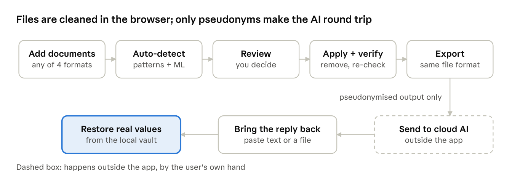
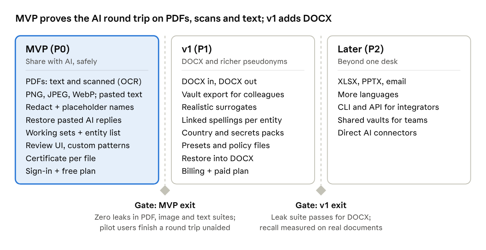

# Redactorator PRD

Nov 15, 2026 · @Sahil Chaddha

Redactorator is a web app, served from our site and working entirely in the browser, that removes or pseudonymises personal data in PDFs, Word files, images and plain text before they leave the user's browser, and puts the real values back into whatever comes home. Nothing a user loads is ever sent to our servers. This PRD is a first draft for partner review; the companion [HLD](HLD.md) covers how it is built, and the [Implementation Plan](Implementation-Plan.md) the order of work.

## Problem and opportunity

People want to use cloud AI on documents they are not allowed to upload. Contracts, medical letters, tax files and HR records all carry personal data, so today the choice is to skip the AI, break policy, or scrub by hand.

The tools on offer each fail one test:

- **Cover-up redaction** draws a black box over text that is still in the file and can be copied out.
- **Cloud redaction services** need the sensitive file uploaded to work.
- **One-way anonymisers** strip the data but cannot restore it in the AI's answer, so the answer is hard to use.
- **Single-file tools** forget their decisions, so the same name is hidden in one document and visible in the next.

The opportunity is one tool that does all four properly: removal that can be proven, pseudonyms that can be reversed locally, consistency across a set of related documents, and no upload at any step.

## Users and use cases

The first user is a professional who wants cloud AI help on confidential documents. The second is someone who must release documents with personal data permanently removed.

| User | Job to be done | What matters most |
| --- | --- | --- |
| AI-assisted professional (lawyer, accountant, consultant, HR) | Pseudonymise a case file, ask Claude or ChatGPT about it, restore real names in the answer | Reversal that works on the AI's reply; the same pseudonym across every file in the matter |
| Disclosure or compliance officer (DSAR, FOIA, litigation production) | Permanently redact a batch of documents and prove it | Irreversibility, a certificate per file, a fast review queue |
| Researcher or data team | Share documents or transcripts with stable pseudonyms | Consistency across the set, custom patterns for domain identifiers |
| Integrator (later) | Run the engine from a script or another product | Stable components and a CLI or API |

Open question for us: which of the first two leads the launch. It changes the order of the MVP, not its content.

## Goals and non-goals

The product succeeds if a user can trust three promises: nothing leaves the browser, redaction cannot be undone, and pseudonyms can be undone only by them.

**Goals**

1. **In the browser only.** No document, extracted text or detected value is sent to our servers. Once loaded, the app works with the network unplugged.
2. **Redaction is destruction.** Redacted content is removed from the output file, including metadata, comments, revisions and hidden layers. Every output is re-checked before release.
3. **Pseudonymisation is reversible, locally.** Each real value maps to a stable stand-in. The map lives only in the user's browser and in backups they export, and it can restore any text that contains the stand-ins.
4. **One decision, every document.** A value handled in one document of a working set is handled the same way in all of them.
5. **Same format out.** PDF in, PDF out. DOCX in, DOCX out. Image in, image out.
6. **The user has the last word.** Auto-detection proposes; the user can accept, reject, add and override, or run fully automatic with a trusted policy.
7. **Composable.** Formats, detectors and front ends are separate parts, so the product can pivot without a rewrite.

**Non-goals for v1**

- A guarantee that every piece of personal data is found. Detection assists; review decides.
- Multi-user collaboration, or cloud sync of documents.
- A built-in AI chat client. We prepare what goes to the AI and restore what comes back.
- Spreadsheets, slides, email, audio and video.
- Mobile, and native desktop apps.

## Core concepts

Eight terms carry the whole product. Both documents use them the same way.

| Term | Meaning |
| --- | --- |
| Working set | A named group of related documents that share one entity list, one vault and one policy. A legal matter, a client, a study. The app calls it a **project**. |
| Entity | One real-world thing with a type: a person, an address, an account number. It owns every spelling it appears under ("Jane Roe", "J. Roe", "Ms Roe"). |
| Finding | One place an entity appears in one document, with the detector that found it and a confidence score. |
| Action | What happens to an entity: **Redact** (remove for good), **Pseudonymise** (swap for a stand-in, reversible) or **Keep**. |
| Surrogate | The stand-in value. Either a typed placeholder such as `PERSON_1` or a realistic fake such as "Maria Keller". |
| Vault | The local map from surrogate to original for one working set, stored with the set on the user's device (not encrypted in v1). Delete it and the pseudonyms become permanent. |
| Policy | The rules that pick a default action: entity types, thresholds, custom patterns, always-hide and never-hide lists. Set globally, overridden per working set. |
| Certificate | A machine-readable record per output file showing which checks proved the removed values are gone. It never contains the values. |

Redact and Pseudonymise can be mixed in one document. A typical policy redacts ID numbers and pseudonymises names.

## User journey

Every decision made in Review is saved to the working set, so the next document added starts with it already applied. Files that are only redacted stop at Export; the lower row applies to pseudonymised output.

## Functional requirements

Requirements are grouped by area and tagged P0 (MVP), P1 (v1) or P2 (later). IDs are stable so we can argue about them one at a time.

### Documents and formats

| ID | Requirement | Priority |
| --- | --- | --- |
| DOC-1 | Import text-based PDFs | P0 |
| DOC-2 | Import free-form text: paste, `.txt`, `.md` | P0 |
| DOC-3 | Output is the same format as the input; the original file is never modified | P0 |
| DOC-4 | Anything that cannot be fully processed (a file that needs a password to open, unknown format, a page OCR cannot read) is refused or flagged, never passed through silently. A PDF that is only locked against editing or copying is cleaned, and its cleaned file has no lock | P0 |
| DOC-5 | Import several files at once by drag and drop or folder pick | P0 |
| DOC-6 | Import DOCX, covering body, tables, headers, footers, footnotes, text boxes, comments and tracked changes | P1 |
| DOC-7 | Import scanned PDFs, PDFs that mix text with scanned images, and image files (PNG, JPEG, WebP; TIFF if the PDF engine can decode it) through OCR that runs in the browser | P0 |
| DOC-8 | Import XLSX, PPTX and email files | P2 |
| DOC-9 | Import more image formats: HEIC, GIF, BMP, and TIFF if it is not in the MVP | P1 |

### Detection

| ID | Requirement | Priority |
| --- | --- | --- |
| DET-1 | Built-in detection for people, addresses, emails, phones, dates of birth, government IDs, financial accounts, payment cards, IP addresses, credentials and URLs | P0 |
| DET-2 | Structured identifiers are confirmed by checksum or format validation, not pattern alone | P0 |
| DET-3 | Names and addresses are found by ML models that run in the browser; no text is sent to a hosted model | P0 |
| DET-4 | Each finding shows its type, its confidence and which detector found it | P0 |
| DET-5 | Findings fall into three bands by confidence: auto, needs review, dropped. Thresholds are set per type | P0 |
| DET-6 | Hidden content is scanned too: metadata, comments, form fields, bookmarks, attachments, hidden and off-page text | P0 for PDF, P1 for DOCX |
| DET-7 | Custom detectors: a regex with optional context words and a type; and plain term lists | P0 |
| DET-8 | Country packs for the US, UK, Canada, Australia, New Zealand and Ireland, switched on per working set | P0 |
| DET-9 | A secrets pack for API keys, tokens and private keys | P1 |
| DET-10 | Languages other than English | P2 |
| DET-11 | Region-specific identifier profiles tied to a jurisdiction's rules, enabled by region. India (DPDP): Aadhaar with Verhoeff checksum, PAN, voter ID. Each profile sets its entity types, validation and default action | P1 |
| DET-12 | The app picks a detection level (Full, Standard, Basic) from the device's capability and always shows it, with what the lower level misses. The user can choose a higher level, and each document records the level it was cleaned at | P0 |

### Review and manual control

| ID | Requirement | Priority |
| --- | --- | --- |
| REV-1 | A review screen shows the document with findings highlighted beside a list that filters by type, band, status and document | P0 |
| REV-2 | Per finding or per entity: accept, reject, change type, change action | P0 |
| REV-3 | Manual marking: select text to redact or pseudonymise it; draw a box to redact an area such as a signature, photo or logo | P0 |
| REV-4 | "Apply to all occurrences" across the document and the working set, on by default | P0 |
| REV-5 | Rejecting a finding can add the value to the never-hide list, for this working set or globally | P0 |
| REV-6 | Preview the output before export | P0 |
| REV-7 | Undo and redo within a document's edits; approving a document cannot be undone. Every decision is saved as it is made | P0 |
| REV-8 | Auto mode: run a trusted policy with no review and get a report of what was changed | P2 |
| REV-9 | Export is blocked while needs-review findings are unresolved, unless the policy says to treat them as accepted | P0 |
| REV-10 | Search by text or regex and mark every match | P0 |
| REV-11 | Keyboard-first review: next, previous, accept, reject | P0 |

### Redaction

| ID | Requirement | Priority |
| --- | --- | --- |
| RED-1 | Redacted content is deleted from the file, not covered. Copy, search and text extraction return nothing | P0 |
| RED-2 | Every hidden carrier is cleaned: metadata, comments, revision history, attachments, thumbnails, form values, hidden layers, alternative text | P0 |
| RED-3 | Each output is re-opened and checked before release. A failed check blocks the export | P0 |
| RED-4 | Each output comes with a certificate listing the checks that passed | P1 |
| RED-5 | Redacted values are never written to the vault, logs, reports or the certificate | P0 |
| RED-6 | Appearance: box of configured colour (black/white to save ink in printing/other colour) or a `[TYPE]` label&#32; | P0 |
| RED-7 | In images, redacted pixels are overwritten and the file is re-encoded with its embedded metadata stripped | P0 |
| RED-8 | Fixed-size marks, so the box does not reveal the length of what was removed | P2 |

### Pseudonymisation and restore

| ID | Requirement | Priority |
| --- | --- | --- |
| PSE-1 | One entity gets one surrogate, used in every document of the working set | P0 |
| PSE-2 | Placeholder surrogates by type and number: `PERSON_1`, `ORG_2`, `ACCOUNT_3` | P0 |
| PSE-3 | Copy/Download pseudonymised text/file to the clipboard, ready to paste into an AI tool | P0 |
| PSE-4 | Restore: paste any text that contains surrogates and get it back with the real values | P0 |
| PSE-5 | Restore survives what AI models do to tokens: changed case, possessives, added punctuation, markdown formatting, line wraps | P0 |
| PSE-6 | Restore reports surrogates it did not recognise and never guesses | P1 |
| PSE-7 | The vault stays on the user's device, with its working set. Deleting it is offered as a deliberate, irreversible action | P0 |
| PSE-8 | Different spellings of one entity link to one surrogate; the user can merge and split entities | P1 |
| PSE-9 | Realistic surrogates generator (fake names, addresses, numbers of the right shape) as an option per type | P1 |
| PSE-10 | Restore into files: `.txt` and `.md` returned by an AI tool | P0 |
| PSE-11 | Export and import a vault so a colleague can restore | P1 |
| PSE-12 | An optional one-line prompt hint that asks the model to keep placeholders unchanged | P1 |
| PSE-13 | Date shifting and other format-preserving surrogates | P2 |
| PSE-14 | Restore into DOCX files returned by an AI tool | P1 |

### Working sets

| ID | Requirement | Priority |
| --- | --- | --- |
| SET-1 | Create, rename, duplicate, archive and delete working sets | P0 |
| SET-2 | Each document is Not started, In review or Approved. Approving a document applies its decisions (text marked by hand, a box over an image, and from phase 4 the detections approved in it) to every document in the set, including documents added later, after a heads-up naming the documents it changes. Until then they stay in their own document. A spread sends an approved document back to In review, where the user can review only what the spread changed | P0 |
| SET-3 | An entity view lists each entity with its type, action, surrogate and where it occurs | P0 |
| SET-4 | Working sets are isolated: no entity, surrogate or decision crosses from one to another | P0 |
| SET-5 | Purge: delete a set with its stored documents, vault and entity list in one action | P0 |
| SET-6 | When a new decision changes a document that was already exported, it shows "Changed since download" and can be downloaded again. Cleaned files are ordinary browser downloads; the set keeps no copy | P0 |
| SET-7 | Export and import a set's policy without its data | P1 |
| SET-8 | Back up a whole working set, and move it to another browser or device, by copying its folder; import copies a picked set folder in | P0 |

### Records

| ID | Requirement | Priority |
| --- | --- | --- |
| AUD-1 | A report per run: what was found, by which detector, what was done, and whether a person or the policy decided. No raw values | P0 |
| AUD-2 | An activity log per working set | P1 |
| AUD-3 | A step-level audit trail: each detection, decision, override and export recorded in order, with the actor (person or policy) and a timestamp, and no raw values | P1 |

### Accounts and plans

| ID | Requirement | Priority |
| --- | --- | --- |
| ACC-1 | Sign up and sign in with an emailed one-time code, Google or Microsoft; no passwords. Enterprise single sign-on comes with team plans | P0 |
| ACC-2 | A free plan that asks for no payment details | P0 |
| ACC-3 | Account, plan and billing calls carry no document data: no file names, text or findings. The only usage they carry is one credit per new document, with a random id | P0 |
| ACC-4 | Once loaded, the app keeps working offline on the user's current plan, using a small batch of credits for new documents | P0 |
| ACC-5 | A plans page shows how many documents each plan includes, which one the user is on and the remaining balance | P0 |
| ACC-6 | Delete the account and all account data on request | P0 |
| ACC-7 | Upgrade, change card, download invoices and cancel through a hosted billing page | P1 |
| ACC-8 | A lapsed or cancelled plan never locks data: open, export, back up, purge and restore existing pseudonyms still work, also at a balance of zero | P1 |
| ACC-9 | Team plans with seats | P2 |
| ACC-10 | A plan is a monthly number of document redactions plus a separate monthly allowance of pasted-text characters; every feature is on every plan. A document counts once, at its first cleaned output; re-exports of it are free, and restoring an AI reply never counts. Free plan: 10 documents and 20,000 characters a month | P0 |
| ACC-11 | Usage telemetry with a published schema of counts and events and no document content; on by default, and users can switch it off or on in settings | P0 |
| ACC-12 | A visitor can clean one document before signing up | P0 |

## Configuration

Settings resolve in one order: built-in default, then global, then working set, then the user's decision on a single entity. The most specific one wins.

| Setting | What the user controls | Global | Per working set | Priority |
| --- | --- | --- | --- | --- |
| Entity types | Which types are detected, and the default action for each: redact, pseudonymise, review or ignore | Yes | Override | P0 |
| Confidence thresholds | The auto and review cut-offs per type | Yes | Override | P0 |
| Custom patterns | Named regex rules with a type, optional context words and an action. For case numbers, employee IDs, project codes | Yes | Add | P0 |
| Always-hide list | Terms that are always acted on: client names, codenames, a specific address | Yes | Add | P0 |
| Never-hide list | Terms that are never flagged: the user's own firm, public figures, a shared mailbox | Yes | Add | P0 |
| Review strictness | Whether needs-review findings block export or count as accepted | Yes | Override | P0 |
| Redaction appearance | A configurable coloured box or type label | Yes | Override | P0 |
| Hidden content | Remove all comments and annotations, or only those with findings; keep or drop accessibility tags | Yes | Override | P0 |
| Detection level | Full, Standard or Basic (DET-12). The app picks one from the device; the user can choose a higher one | Yes | Override | P0 |
| Storage location | A folder on this computer, or the browser's own storage until one is picked | Yes | No | P0 |
| Surrogate style | Placeholder or realistic, per type | Yes | Override | P1 |
| Region and language | Country packs, phone regions, OCR languages | Yes | Override | P1 |
| Presets | Ready-made policies such as "Share with AI", "Legal disclosure", "HIPAA Safe Harbor" | Yes | Pick one | P1 |
| Output | File naming and export folder | Yes | Override | P1 |
| Retention | Auto-purge a working set after a set number of days | Yes | Override | P1 |
| Policy file | Export and import all of the above as one file to share with a colleague | Yes | Yes | P1 |

Beyond the regex set and exclusion list in the brief, the rows most likely to matter in daily use are the always-hide list, per-type default actions, and presets. Custom patterns need a built-in tester: paste sample text, see what matches.

## Non-functional requirements

Privacy and irreversibility are hard gates: a release that fails either does not ship. The other targets are proposals to confirm.

| Area | Requirement |
| --- | --- |
| Privacy | No document bytes, extracted text, findings or vault entries leave the browser. Once loaded, the app works offline. The only network use is loading the app, rule packs, models and libraries (models and libraries may come from their public hosts, pinned and hash-checked), plus account and billing calls that carry no document data, one of which spends a credit per new document, and usage telemetry that carries counts and events, never document content. |
| Telemetry | On by default; users can switch it off or on in settings. It carries only operational data under a published schema, never document content. |
| Irreversibility | A redacted value cannot be recovered from the output by text extraction, copy and paste, metadata, revision history or raw file inspection. Verified per file. |
| Honest limits | The certificate proves detected values are gone. It does not prove nothing was missed, and the UI says so. |
| Data at rest | Not encrypted in v1. Working-set data, vault included, lives in a folder the user picked, as private as their other files, or in the browser's storage, private to our site. Logs and reports hold no raw values. |
| Safety | Originals are never modified. Decisions autosave. A crash loses no work. |
| Performance | First pattern-based findings within seconds of import. Full ML pass at 2 seconds per page or better on a recent laptop; the in-browser figure is still to be measured. The UI stays responsive while documents process. |
| Footprint | Models must be small enough to download and run in a browser. Which models fill each detection level is an open HLD decision (D10). The Basic level must work without any model. |
| Platforms | Current desktop Chrome in v1. Nothing to install. Safari and Firefox come later, through a storage backend of their own, since they cannot save into a folder the user picks. |
| Accessibility | UI meets WCAG 2.2 AA and is fully keyboard-operable. PDF accessibility tags can be kept on request. |
| Licensing | Every bundled component permits the way we distribute. The PDF engine's AGPL licence is met by publishing the browser app's source; the server side stays closed. |

## Release phasing

The MVP is deliberately the shortest path to one complete loop: clean, send, restore. It builds provable PDF redaction in the browser, adds OCR so scanned pages and images are covered, and adds plain text, the format AI replies arrive in. Sign-in and the free plan ship with the MVP; billing and the paid plan follow in v1. No dates are set yet.

## Success metrics

One metric is a gate and the rest are targets. All targets are proposals; none has a baseline yet. Targets are reported, not gates.

| Metric | Proposed target | How it is measured |
| --- | --- | --- |
| Recoverable redacted values in exported files | Zero (gate) | The leak test suite, per format, passing before any build reaches users outside the team |
| Detection recall on structured identifiers | 99% or better | A labelled benchmark set we build per format |
| Detection recall on names and addresses, before review | To set after a real-document benchmark | Same benchmark |
| False positives a reviewer must reject | Under 5% of findings | Same benchmark |
| Surrogates correctly restored in AI replies | 99% or better for placeholders | Round-trip tests against real model outputs |
| Time from first visit to first cleaned document | Under 5 minutes | Pilot sessions |
| Review time per page | To set after pilots | Pilot sessions |

Usage metrics come from telemetry: counts of documents, pages and working sets, feature use, timings and errors, per account.

## Risks and open questions

The largest product risk is over-trust: a user reads "redacted" as "nothing was missed". The rest are known and have a mitigation.

| Risk | Why it matters | Mitigation |
| --- | --- | --- |
| Missed personal data | ML recall on real documents is usually well below results on synthetic data | Review band on by default, always-hide lists, honest wording on what the certificate proves |
| Re-identification from context | A pseudonymised text can still identify someone by role, dates or events | Warn in the product; offer redaction of quasi-identifiers such as dates and job titles |
| AI models alter surrogates | A changed token cannot be restored | Tokens designed to survive; tolerant matching; a report of anything unrecognised |
| Pseudonyms in PDFs and images | A stand-in rarely fits the space and font of the original | Placeholders fitted into the redaction box; set the expectation that layout is approximate |
| First-load weight | Models and WebAssembly modules make the first visit a large download, and weak devices run them slowly | The Basic detection level works without models; staged, cached downloads; browser-sized models |
| The working set is itself sensitive | It remembers values in order to stay consistent across documents, and v1 stores it unencrypted | Kept in a folder the user chose or in storage private to our site; purge; optional retention limit |
| PDF engine licence | MuPDF is AGPL or commercial | Decide before the app is public (HLD D2) |
| Trust in a hosted app | The browser runs whatever code our site serves, so "nothing leaves" rests on our release process | No upload route, a claim users can test offline, public source, reproducible builds with signed release hashes shown in the app, and a verifier extension in v1 (HLD D9) |
| Browser storage can be lost | Clearing site data, or a browser's own clean-up (Safari's after seven days without a visit), deletes the vault, and its pseudonyms can then never be restored | A folder on the user's disk; persistent storage requested again and again until one is picked; backup prompt after pseudonymising; working-set export and import (SET-8) |

**Open questions for partner review**

- [ ] Product name. "Redactorator" stays the working title; decide before launch, after trademark and domain checks.

**Decided**

- **Lead user:** the AI-assisted professional (lawyer, accountant, consultant, HR). The disclosure officer follows.
- **Default surrogate style:** placeholders (`PERSON_1`). Realistic fakes, from v1, are an option per working set.
- **Redacted values:** the working set stores them so later documents match and spellings can be linked.
- **Originals:** a working set keeps its own copy of each original, included in set export and backup.
- **Teams:** v1 is single-user. Colleagues share a working set by copying its folder (SET-8); shared vaults and team plans stay P2.
- **Launch scope:** English, with identifier packs for the US, UK, Canada, Australia, New Zealand and Ireland. India is not at launch; it follows in v1 (DET-11).
- **Free plan:** 10 documents and 20,000 characters of pasted text a month, each resetting monthly; restoring never counts. One document before sign-up.
- **Sign-in:** Auth0, with no passwords. Enterprise single sign-on comes with team plans.
- **Licence:** the browser app is open source under the AGPL; accounts, billing and telemetry stay closed. To be confirmed with counsel.
- **Trust in served code:** public source, reproducible builds and signed release hashes at launch; a verifier browser extension in v1.
- **Bias testing:** a synthetic test set with names of many origins found in the launch countries and each country's address formats. Recall per group is measured and published with each release; it does not gate a release.
- **Models:** chosen by device capability (DET-12). A weaker device gets a lower detection level, and the app always says so.
- **Model and library hosting:** models and libraries may load from their public hosts (for example the Hugging Face Hub or a CDN), each pinned to an exact revision and hash-checked. The promise is that no document is uploaded without the user's consent; downloads carry no document content.
- **Telemetry:** on by default; users can switch it off or on in settings (ACC-11).
- **Priorities changed on 18 Nov 2026:** realistic surrogates (PSE-9) and restore into DOCX (PSE-14) are v1. MVP images are PNG, JPEG and WebP; TIFF joins if the PDF engine decodes it; HEIC, GIF and BMP are v1 (DOC-9).
- **Working sets (21 Nov 2026):** the app calls a working set a project, and every document lives in one. Data is stored as files behind one storage interface: a folder on the user's disk, or the browser's storage until one is picked; backends for other browsers or a cloud may follow. v1 supports Chrome only. No encryption at rest and no vault passphrase in v1, because a forgotten passphrase would lose every project with no way back. Decisions spread only when a document is approved (SET-2).
- **The earlier POC:** nothing from it is used, to avoid bias: not its code, tests, fixtures or measured figures. The product is specified and tested on its own terms.
