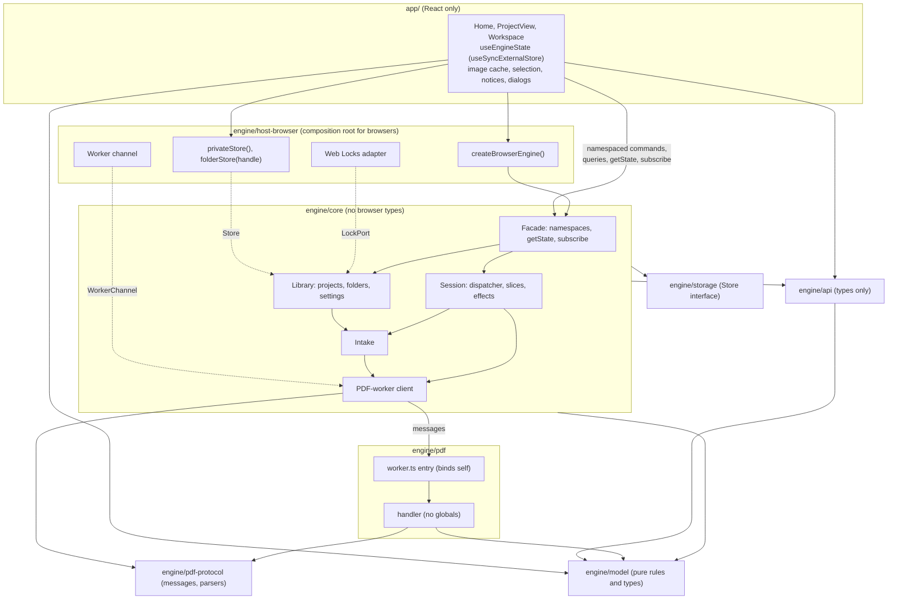
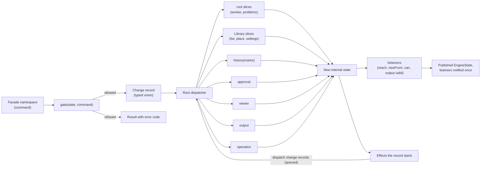
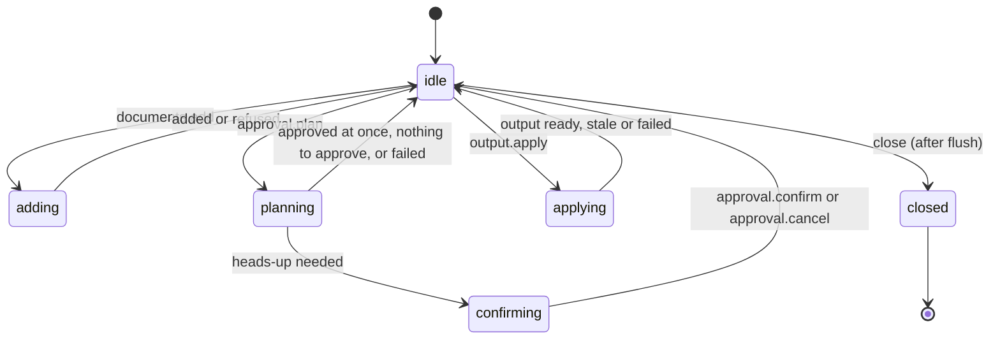
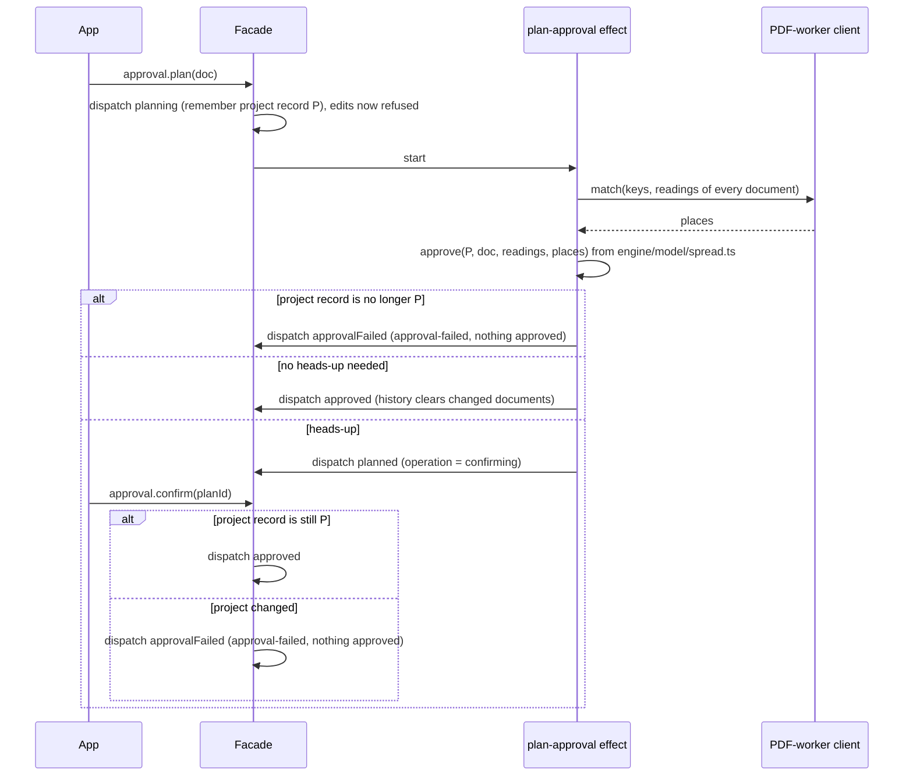
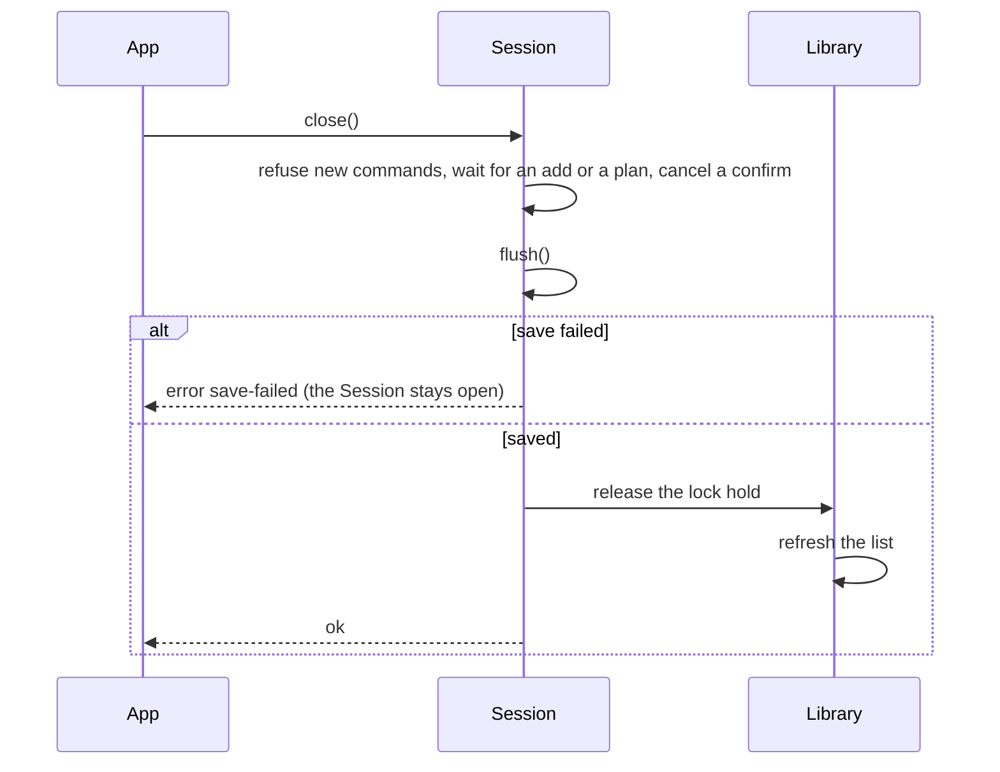
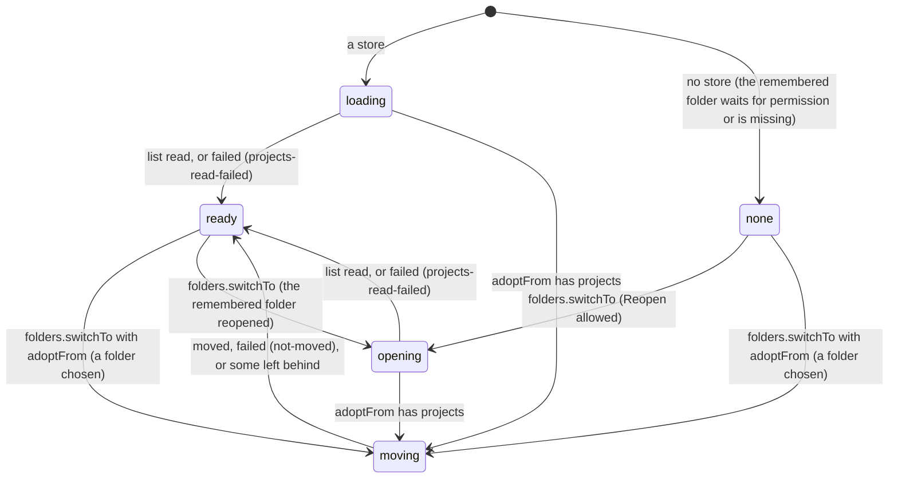

# Composable engine refactor

*   **Author:** Sahil Chaddha
*   **Status:** Proposed
*   **Date:** 2026-11-24

--------------------------------------------------------------------------------

## Overview

Redactorator removes personal data from PDFs inside the browser. Its engine code
today is one Web Worker file, `engine/worker.ts` (about 760 lines), that opens
PDFs, renders pages, extracts text, fingerprints images, finds repeated values
across documents, redacts, and checks the cleaned file. The rules of a project
(marks, undo and redo, saving, approval and spreading, adding documents, the
one-writer lock, the project list and settings) live in React hooks under
`app/`.

This design splits that code into components that each own one
responsibility, under a headless engine. The engine is one facade object.
The code that uses it, the React app in a browser or a script in Node or Bun,
calls its commands and reads its state in the same thread. Behind the facade,
the engine owns each project's state, its rules and each document's undo and
redo history. MuPDF runs in a worker the host starts for the engine. The host
also passes in the store projects live in, and the lock mechanism.

The same seams take other document formats later (DOCX, XLSX, PPTX, plain
text): a format adds a reader and a writer, and routing in intake and in the
Session's effects; marks, spreading, approval, history and the stored files
stay as they are (section 12).

The refactor changes no behaviour except the deliberate changes listed under
Non-Goals. It comes before phase 3 (the PDF leak suite) and phase 4
(detection), which will plug into the seams it creates.

The full reasoning, three review rounds and 51 owner decisions are in
[the brief](./composable-engine-brief.md). Decision numbers below refer to it.
Decision 47 makes this document the source of truth for names; where the
brief uses an older name, this document wins.

**Citations.** Every `file:line` citation of today's code refers to commit
`f64230d` ("Phase 2 slice 4: keep projects in a folder on this computer"),
`main` when this design was written. Read a citation with
`git show f64230d:<path>`, since lines move as the refactor moves code.

## Terms

| Term | Meaning here |
| --- | --- |
| Engine, facade | The one object the app or a script uses. "Engine" means this, never the PDF worker |
| Engine root | What the host builds once: ports, the PDF-worker client, worker status, problems, the Library and at most one Session |
| Library | The engine part that lives as long as the app: the project list, settings, creating, importing, renaming, duplicating, archiving, deleting, and the first move into a folder |
| Session | The engine part for one open, locked project |
| Host, port, adapter | A port is an interface the core declares; an adapter fills it for one platform; the host is the platform code that builds the engine with its adapters |
| PDF worker | The Web Worker running MuPDF. UI text and old tests call it "the PDF engine" |
| PDF-worker client | Engine-side code that numbers requests to the PDF worker and matches replies. "Client" means only this; the app's object is "the facade" |
| State | The immutable value `engine.getState()` returns |
| Lock hold | The one-writer lock on a project, held by a Session. A second tab cannot open a locked project |
| Open-document handle | What `viewer.open` returns for the document open in the PDF worker; render and page-text requests carry it. The brief calls it the "view lease" |
| Store | The `Store` interface (`read`, `write`, `folders`, `files`, `remove`) over one root folder: Chrome's private storage or a folder the user picked |
| The four stored files | In each project's folder, `.redactorator/project.json` (the project record) and, per document, `.redactorator/text/<id>.json` and `.redactorator/images/<id>.json` (its reading); at the store's root, `.redactorator/settings.json` (settings) |
| Mark | Something the user marked to hide in one document: a text target (per-page character ranges, with their boxes and text) or a box with no text behind it. Each mark has a type, such as a person's name |
| Value, key | A mark's text, normalised, or for a box over an image, the image's fingerprint. The key identifies the value across documents (`markKey`, `itemKey`) |
| Review state | Each document is `not-started`, `in-review` or `approved`. Any change to an approved document's marks, including an undo, puts it back in review |
| Approval | The user's statement that a document's marks are complete. Approving makes the document's values hidden values of the project |
| Hidden value | A value the project hides in every document, with its type, recorded in the project record when a document is approved |
| Spreading | What approval does to the other documents: every place a hidden value appears becomes a mark there, a value no longer hidden is unmarked, and a changed type is applied. Adding a document spreads the hidden values into it too |
| Heads-up | The dialog shown before an approval that changes other documents or this one beyond its review state; it says how many places change where |
| Keep-here, kept-visible list | "Don't hide here" keeps one hidden value visible in one document; the document's kept-visible list (`shown`) records those values, and spreading skips them there |
| Reach | For each value key, how many marked places and documents it has across the project, shown in the marks panel (`reachOf`, `spread.ts:16-27`) |
| `newFrom` | The file names of the documents whose approval brought the open document's new marks, which the review banner names (`spread.ts:29-33`) |
| Running header | A block repeated at the same place on neighbouring pages, such as "Page 1 of 3"; a selection across pages leaves it out |
| Edit kind | `edit` or `label`. An `edit` puts the document back in review and enters undo history; a `label` change (a link id) does neither |
| Reading | What the PDF worker reads from one document for the project to keep: each page's text (`PageText`) and its placed images with fingerprints (`PlacedImage`). Stored as `text/<id>.json` and `images/<id>.json` |
| Inspection | Reading a newly added file: page count, reading and fingerprint, before it joins a project |
| Labelling, link id, ground truth | Labelling mode (`?label` in the address) lets a maintainer tag marks with link ids and export them as ground truth for the dataset, in the schema of `dataset/ground-truth.schema.json`. `DocumentFacts` are the dataset fields the maintainer enters on export (source, licence, country, format, split) |
| Problem | A failure that must outlive the command that caused it, such as a failed save or a stopped worker, shown in today's single problem slot |
| Refusal | A file an add or create did not take, with the reason; listed in the "files not added" notice |
| The verbatim set | The write-path functions that move with no edit inside their bodies: everything that goes to `engine/pdf/write/` (item 52) |
| Leak fixture | A PDF in `fixtures/` with a known way of leaking data, judged by the oracle. AGENTS.md requires one for any change to how the write path behaves; phase 3's leak suite is the full set |
| Oracle | The Python checker in `tests/oracle/`, which reads a cleaned PDF with pdfminer and a raw-object scan and reports any text or image data left under a box. It shares no code with the app; tests call it through `judge` (`tests/e2e/oracle.ts`) |
| fallow | The repo's static analysis tool. `pnpm exec fallow audit` reports unused code, duplicates, cycles and boundary breaks; zones are its import rules; the "fallow gate" is the agent hook `.claude/hooks/fallow-gate.sh`, which blocks a commit when the audit fails |
| Slice (state) | A pure function that owns one part of the Session or Library state |
| Step (work) | One PR in the Detailed Implementation Plan, numbered −1 to 8, with steps 5 and 6 in parts (5a, 5b, 6a to 6d), each its own PR. Phase 2's PRs were also called slices; this document says "step" |
| Item | A numbered heading of the Detailed Implementation Plan (items 1 to 57) |
| Phases | The Implementation Plan's phases: 3 is the PDF leak suite, 4 rules and review (detection; its review bands are score ranges that set a finding's default action), 5 pseudonyms and restore (a text adapter), 6 NER models |
| HLD | The High-Level Design (`docs/HLD.md`) |

## The Problem

**Nothing runs without the UI.** Project rules live inside React hooks:
`useProject.ts` holds the project, undo history and the save queue;
`useApproval.ts` drives approval; `useProjectStore.ts` holds the project
list, the lock, settings and the first move into a folder; `useEngine.ts`
starts the worker and speaks its message protocol. A command-line tool, an
automated benchmark, or any host other than this React app would have to
rebuild them.

**Rules are spread across call sites.** Some project rules live at the places
that call them rather than in one owner. For example, throwing away a cleaned
file after a change is done by `engine.discardOutput()` at five places in
`ProjectView.tsx`; adds and approvals exclude each other through flags in the
same component; edits are passed as functions built in `useMarks.ts`. A
change to one rule means finding every call site, and a missed one is a bug.

**One worker does everything, in one file.** Reading, rendering, matching,
writing and checking share one 760-line file and one message switch. Phase 4
detection and phase 6 models would be added to the same file, and every page
render already waits behind other work.

**Boundaries are not enforced.** One TypeScript config gives every file the
browser's types, and nothing stops `app/` from importing engine internals or
the engine from using browser globals, so nothing would stop a later change
from undoing the separation.

**A data-loss race exists.** While projects move from Chrome's storage into a
newly chosen folder, Home still lets the user open a project. Opening one then
can leave it behind and later save it into the wrong place: the move skips
it, the store is swapped under the open project, and later saves write a lone
`project.json` into the picked folder (`App.tsx:65-74`,
`projects.ts:247-248, 272`, `useProjectStore.ts:127-128`). This was read from
the code, not reproduced.

## Goals

*   **No project rule in `app/`.** `useProject.ts`, `useApproval.ts`,
    `useEngine.ts`, `useAddDocuments.ts`, `documentReadings.ts` and
    `importFiles.ts` are deleted; `useProjectStore.ts` (renamed
    `useProjectsFolder.ts`), `useMarks.ts` and `useDocumentInEngine.ts` keep
    only React concerns (state binding,
    UI-only rules such as the pending mark). These rules move under
    `engine/core` or `engine/model`:
    *   the project record, its saving (immediate, ordered, coalesced,
        retried) and the `pagehide` flush;
    *   marks: add, retype, remove, keep-here, link ids, mark ids, one type
        per value, a new custom type reaching settings;
    *   undo and redo per document, and what clears them;
    *   approval, spreading and the heads-up decision;
    *   adding documents: intake order, refusals, spreading into new
        documents;
    *   outputs: when one is valid, and what drops it;
    *   what may run together (section 7);
    *   the project list, the lock, settings and their write queue, the first
        move into a folder, import, rename, duplicate, archive and delete;
    *   the problem slot and its clearing rules.
*   **A headless engine.** `engine/model`, `engine/storage`, `engine/api`,
    `engine/pdf-protocol`, `engine/core` and `engine/pdf` (all but its
    one-file Web Worker entry) typecheck with no browser library (decision
    16); browser code lives only in `engine/host-browser`, the worker entry
    and `app/`.
*   **One facade, split by role.** The app reaches the engine only through
    the facade's namespaces (for example `session.marks`, `session.output`,
    `library.projects`): commands that resolve to a result, queries on the
    open-document handle, `getState()` and `subscribe()` (decisions 19, 24).
    Inside, each Session and Library rule has one owner: a slice or an
    effect.
*   **The worker split by responsibility.** `engine/worker.ts` becomes modules
    for reading, images, inspecting, text, rendering, applying and writing,
    with the write path moved verbatim (decisions 10, 30).
*   **Enforced boundaries.** Each engine folder has its own typecheck config,
    all run by `pnpm typecheck`, and fallow zones enforce the import rules of
    the component map (decision 27). `pnpm test` runs the typecheck configs
    and, from step 0, `pnpm exec fallow architecture --boundaries` and
    `pnpm exec fallow audit`.
*   **Behaviour kept, and checked by tests.** Every browser test passes, and
    the oracle passes every cleaned PDF the tests judge; any rewritten test
    checks the same thing, recorded in a ledger with a negative control
    (decision 29); new tests cover the behaviours nothing watches today
    (decision 20); the golden test shows all four stored files keep their
    bytes once ids and dates are replaced by placeholders.
*   **The race fixed first**, in its own PR, with a browser test (decision 31).
*   **Room for other formats.** A second format adds a reader and a writer,
    and routing in intake and in the Session's effects; marks, spreading,
    approval, history and the stored files stay as they are (section 12).

## Non-Goals

*   **Behaviour changes, except these deliberate ones:**

    | Change | Decision | Seen by users? |
    | --- | --- | --- |
    | Project rows and their menus on Home are not clickable while projects move into a folder or the remembered folder reopens; opening from the address waits for the move | 31, 43, 51 | Yes |
    | Only the newest project-list refresh lands | 37 | Yes: an older list can no longer replace a newer one |
    | No store change while a project is open | 37 | No |
    | A Library command on this engine's own open project is refused with its own code | 11 | No (headless callers only) |
    | `marks.add` refuses invalid targets with typed codes | 33 | No |
    | `bad-message` is split into five codes, each keeping today's sentence | 28 | No |
    | While approval works out what spreads, the page and the marks panel take no edits. Today they do, and approval works it out again (`useApproval.ts:42-46`) | 48 | Yes: marking waits for the approval search |
    | Adding documents is refused while a document is being applied, or while the heads-up is open. Today an add can start during an apply (`ProjectView.tsx:281, 295`) | 49 | Yes: Add is disabled during an apply |

*   **Changes to stored files.** No format version bump, no migration; the
    existing v1 and v2 migrations stay (decision 6).
*   **Detection, recognizers, models or OCR.** Only the seams they will use
    are named.
*   **Readers and writers for other formats** (DOCX, XLSX, PPTX, `.txt`,
    `.md`). Section 12 says where they attach; nothing format-neutral is built
    beyond giving the new worker channel a format-neutral name.
*   **A CLI, a Node host or a server.** The core is made able to run in Node;
    building a Node host waits for a real consumer (decision 16).
*   **Any transport besides in-process calls.** The engine never moves into a
    worker (decisions 2, 38).
*   **A render queue** with priority and cancelling (issue #13).
*   **Fixing known bugs found on the way:** the image-check misreport
    (issue #14) and the undo-after-approval type inconsistency (decision 22).
*   **A diagnostics stream, automatic worker restart, or editing the live
    documents in `docs/`** (the PRD, HLD and Implementation Plan). Changes to
    them are proposed to the owner as one list at the end (decision 23).
    `docs/designs/` holds design documents written in this repo, such as this
    one, and is edited by PRs; step 0 says so in AGENTS.md.

## Open Questions

*   **Fallow's reach**: settled in step 0. Fallow sees the worker edge
    through `new URL(..., import.meta.url)`, the edge counts for zone rules,
    and a zone can limit `engine/pdf/write/` to a single importer; every
    rule uses a fallow zone (Technical Plan section 3).
*   **Formats without fixed pages** (to settle before phase 5's text adapter,
    the first one planned): virtual pages with made-up boxes, or an anchor
    with no geometry. The two do not cost the same (section 12).
*   **Undo after accepting detection findings** (to settle in phase 4):
    section 11.

## Critical User Journeys (CUJs)

### CUJ 1: Marking and cleaning a document works as before

*   **Given**: a project with two PDFs that share a name, opened in Chrome.
*   **When**: the user marks the name in the first PDF, undoes and redoes it,
    approves the document, opens the second PDF and downloads its cleaned
    file.
*   **Then**: every step looks and behaves as today, apart from the
    deliberate changes in Non-Goals: the mark spreads on approval, the second
    document shows it as new, the cleaned file has the name removed and
    passes the oracle, and `project.json` holds the same bytes as today's
    build would write, once ids and dates are replaced (the golden test).

### CUJ 2: The first move into a folder cannot lose a project

*   **Given**: projects in Chrome's storage, and a user who chooses a folder.
*   **When**: the move is running and the user clicks a project row, or the
    page loads with `#project=<id>` in the address.
*   **Then**: neither the row nor its menu acts while "Moving your projects
    into …" shows; the address waits until the move ends and then opens the
    project from the folder, once; no project is left behind or saved into
    the wrong store.

### CUJ 3: A maintainer adds a project rule in one place

*   **Given**: the refactored code, and a new rule to add (for example, phase
    4's review bands deciding a finding's default action).
*   **When**: the maintainer implements it.
*   **Then**: the change lives in `engine/core` or `engine/model`, is reached
    through a facade command or the state, and needs no change to a React hook
    beyond reading a new field of the state.

### CUJ 4: A boundary break fails fast

*   **Given**: a developer who imports `engine/core` from `app/`, or uses
    `window` or `File` inside `engine/core`.
*   **When**: they run `pnpm typecheck` or `pnpm test` (which runs
    `pnpm exec fallow architecture --boundaries` and
    `pnpm exec fallow audit` from step 0 on), or an agent commits (the fallow
    gate runs the same audit).
*   **Then**: the check fails and names the file and the rule it broke.

### CUJ 5: The engine core is ready for a headless host

*   **Given**: the engine folders after the refactor.
*   **When**: `pnpm typecheck` runs the core's config, which has no browser
    library.
*   **Then**: it passes, showing the core names only the web globals Node,
    Bun and browsers share (`crypto.randomUUID`, `crypto.subtle.digest`,
    `TextDecoder`). Running the core in Node stays untested until a Node host
    exists; a later host needs its own adapters.

## Technical Plan (Architecture)

### 1. The shape at a glance



The app talks to the facade, to `createBrowserEngine`, and to the store
builders (`privateStore`, `folderStore`) when it picks a folder; it reads
model and api types. The core never names a browser API: it receives a `Store`, a `LockPort` and a
`WorkerChannel` from the host, through interfaces the core declares. Only `engine/pdf`
imports MuPDF, and only its one-file entry knows it runs in a Web Worker.

### 2. Hosts

A host is the platform code that builds the three port objects and calls the
core's `createEngine`. Only the browser host is built now (decision 16).

| Port | Browser (`engine/host-browser`) |
| --- | --- |
| `Store` | `privateStore()` over Chrome's private storage; `folderStore(handle)` over a picked folder |
| `LockPort` | Web Locks, name `redactorator-project:<id>`, `ifAvailable` |
| `WorkerChannel` | `new Worker(new URL("../pdf/worker.ts", import.meta.url))` wrapped as the five channel functions |
| Building | `createBrowserEngine({ store, adoptFrom, folderName })` |

A later host, such as Node or Bun, supplies its own three adapters and its
own building function, designed with its first real consumer.

MuPDF.js runs in browsers and Node according to its own documentation; this
repo's patched build (`vendor/mupdf`) has not been tried in Node.

### 3. Folders, configs and import rules

| Folder | Holds | May import | Typecheck config | Fallow zone | Zone from step | Rule on in step |
| --- | --- | --- | --- | --- | --- | --- |
| `engine/model` | Pure rules and types: units, geometry, text model, marks, matching, spreading, images and their fingerprint, mark types, ground truth, project and settings types, the target functions, the stored-format parse kit, the reader and writer error codes | `dataset/*.json` | `engine/model/tsconfig.json`, extending the base | `model` | 2 | 2 |
| `engine/storage` | The `Store` interface | nothing | `engine/storage/tsconfig.json`, extending the base | `storage` | 3 | 3 |
| `engine/pdf-protocol` | PDF-worker messages and their parsers, `FileNumber`, `InspectionNumber`, `MatchNumber`, the wire's error-code list (typed by model's reader and writer codes) | model | `engine/pdf-protocol/tsconfig.json`, extending the base | `pdf-protocol` | 2 | 4 |
| `engine/api` | Types only: the facade namespaces, state, results, `ErrorCode`, `Refusal`, handle and pixel types | model; the `Store` type from storage | `engine/api/tsconfig.json`, extending the base | `api` | 5a | 5a |
| `engine/core` | The facade, Library, Session (dispatcher, slices, effects, selectors, gate), intake, stored formats and stored files (`core/stored/`), readings, the PDF-worker client, the `LockPort` and `WorkerChannel` interfaces | model, storage, api, pdf-protocol | `engine/core/tsconfig.json`, extending the base | `core` | 2 | 5a |
| `engine/pdf` | The handler and its modules; `write/` holds the verbatim set | model, pdf-protocol, `mupdf` | `engine/pdf/tsconfig.json`, extending the base, excluding `worker.ts` | `pdf`, with `pdf/write` limited to `pdf/apply.ts` | 2 (today's `engine/worker.ts` and `engine/glyphs.ts`) | 7 |
| `engine/pdf/worker.ts` | The Web Worker entry: binds `self` to the handler | the handler | `engine/pdf/tsconfig.worker.json`: the base plus `lib: ["ES2024", "WebWorker"]` | `pdf` | 2 (as `engine/worker.ts`) | 7 |
| `engine/host-browser` | Store backends, Web Locks adapter, worker channel, `createBrowserEngine` | everything in `engine/` except `pdf` (the worker is reached by URL) | the root `tsconfig.json` (DOM) | `host-browser` | 4 | 8 |
| `app` | React components and hooks, browser-only UI concerns | model, api, the `Store` type from storage, `host-browser` | the root `tsconfig.json` (DOM, `vite/client`) | `app` | 2 | 8 |

**Zones before rules.** Fallow checks an import only when the imported file
is in a zone, so a rule refuses nothing while the folders it names are
unzoned (step 2 showed this: with only `model` zoned, a model file importing
`app/` passed). So every folder has its zone from the step that creates it,
or from step 2 for folders that exist then, with no rule; its rule comes in
the step the table names. A zone with no rule restricts nothing. Until step
7, the `pdf` zone lists today's `engine/worker.ts` and `engine/glyphs.ts`
(and its test); step 7 changes its pattern to `engine/pdf/**`. The `tests`
zone (`tests/**`) also exists from step 2 and gets its rule in step 7.

**Typecheck configs.** In TypeScript a child config's `files`, `include`
and `exclude` each replace the parent's when set, so the layout is:
*   `engine/tsconfig.base.json` extends the root's strict flags, sets
    `lib: ["ES2024"]` and `types: []`, lists `engine/globals.ts` in
    `files`, and excludes `*.test.ts`.
*   Each engine folder's config extends the base and sets only `include` to
    its own folder, so it keeps the base's `files` and `exclude`.
*   `engine/tsconfig.test.json` extends the base, adds `types: ["vitest"]`,
    includes the `*.test.ts` files of every engine folder whose config is on,
    and sets `exclude: []`.
*   `engine/pdf/tsconfig.worker.json` adds the `WebWorker` library and sets
    `files` to the entry alone. That library already declares `crypto` and
    `TextDecoder`, so it does not take `engine/globals.ts`.
*   The root config excludes each engine folder once that folder's config is
    on, and always excludes `engine/globals.ts`, so the declarations never
    meet the DOM library.

`pnpm typecheck` runs `tsc -p` once per config; item 21 gives the literal
files and the script line, and each later step appends its config.

**`engine/globals.ts`** declares only `crypto.randomUUID(): string`,
`crypto.subtle.digest("SHA-256", data: Uint8Array): Promise<ArrayBuffer>` and
`TextDecoder` with `decode`, inside `declare global { ... }` with
`export {}`. Node 20 and later, Bun and browsers provide all three. It is a
`.ts` file, not a `.d.ts`, because the root's `skipLibCheck` skips every
declaration file: a mistake in a `.d.ts` would never be reported. No module
imports it, so `.fallowrc.json` lists it in `supportEntry`.

**Fallow's reach, settled in step 0.** A throwaway spike on fallow 3.43.2
(`fallow trace --path`, `fallow architecture --boundaries` and
`fallow audit`, on a copy of the repo with the target folders stubbed)
found:

*   **Fallow sees the worker edge.** `fallow trace --path app/useEngine.ts
    engine/worker.ts` reports one `dynamic` hop at `app/useEngine.ts:178`,
    the `new Worker(new URL("../engine/worker.ts", import.meta.url))` call.
*   **The edge counts for zones.** With `engine/pdf/**` in a zone that
    `host-browser` may not import, the `new URL(...)` line is reported as a
    boundary violation, exactly like a static import.
*   **A zone can have a single importer.** A file belongs to the first zone,
    in the order listed, whose pattern matches it; a zone listed after a
    broader one matches no file, and fallow warns that it matched none.
    Imports inside one zone are always allowed. So `pdf-apply`
    (`engine/pdf/apply.ts`) and `pdf-write` (`engine/pdf/write/**`), listed
    before `pdf` (`engine/pdf/**`), with `pdf-write` in no rule's `allow`
    but `pdf-apply`'s, flag every other import into `write/`: through
    `write/index.ts` or straight to a file inside it.
*   **Only zoned files with a rule are checked.** A file in no zone, or in a
    zone with no rule, may import anything. A rule is as strong as the set
    of importers that are zoned.
*   **Only imports of zoned files can break a rule** (found in step 2). An
    import of a file in no zone passes whatever the importer's rule says, so
    a rule is also only as strong as the set of targets that are zoned.
    Hence zones come before rules (above).
*   **JSON files are in no zone.** A zone pattern such as `dataset/*.json`
    matches no file, so a JSON import never breaks a rule. The `model`
    zone's rule is `allow: []`, and its imports of `dataset/*.json` pass.
*   **`fallow audit` checks only changed files.** It fails on a violation in
    a file changed since its base (the merge-base with `origin/main`), and
    counts a violation already there in a touched file as inherited, which
    does not fail. A step that only switches a zone's rule on in
    `.fallowrc.json` therefore leaves the audit green even when unchanged
    files break the rule. `pnpm exec fallow architecture --boundaries` checks every file and
    exits 1 on any violation.
*   **TypeScript project references** (the optional question). On
    TypeScript 7.0.2, with `composite` configs and `references`, `tsc -b`
    fails when a project imports a file of a project it does not reference
    (TS6307), so references could enforce the direction between folders.
    They cannot limit a folder to one importing file, and they need
    declaration output and build-info files. Not chosen: zones express
    every rule.

Each rule's mechanism:

| Rule | Mechanism | On in step |
| --- | --- | --- |
| `host-browser` may not import `engine/pdf`, yet starts the worker through `new URL(..., import.meta.url)` | Fallow zone. `engine/pdf/worker.ts` is in the `pdf` zone, which `host-browser`'s rule does not allow. The one `new Worker(new URL("../pdf/worker.ts", import.meta.url))` line in `engine/host-browser/workerChannel.ts` has `// fallow-ignore-next-line boundary-violation` above it. Any other import of a file under `engine/pdf`, a static import of `worker.ts` included, is still a violation; if the comment stops sitting over the edge, fallow reports it as a stale suppression. A separate zone for `worker.ts` that `host-browser` may import was tried and not chosen: it also lets a static import of `worker.ts` through, which would load the handler and MuPDF on the page | 7 (`pdf`), 8 (`host-browser`) |
| Only `engine/pdf/apply.ts` may import `engine/pdf/write/` | Fallow zones `pdf-apply` and `pdf-write`, listed before `pdf`; only `pdf-apply`'s rule allows `pdf-write`. Since unzoned files are not checked, step 7 also adds the rule of the `tests` zone (`tests/**`, a zone from step 2), which allows every zone except `pdf-write`, and step 8's `app` and `host-browser` rules leave `pdf-write` out | 7 |
| Each folder's direction rule in the table above | Fallow zone per folder, with the `allow` list of the "May import" column | per the table |

**Every source file in a zone, from step 8.** Because a file in no zone is
not checked, step 8 (item 55) turns on
`"boundaries": { "coverage": { "requireAllFiles": true, "allowUnmatched": ["*.config.ts", "engine/globals.ts"] } }`
in `.fallowrc.json`: fallow then reports every source file that matches no
zone, so a new folder cannot import around a rule. The root
`playwright.config.ts`, `vite.config.ts` and `vitest.config.ts` stay
unzoned; the spike showed fallow reports them otherwise. So does
`engine/globals.ts`, which only the typecheck configs load: with
`requireAllFiles` on and only `*.config.ts` allowed, fallow reports it (step
2 checked).

`engine/boundaries.test.ts` (item 56) is not needed: no rule falls back to
it.

### 4. The facade (`engine/api`)

The facade is split into namespaces by role, so each component depends only
on the namespace it uses. Names and signatures below are binding; comments
are explanation.

```ts
type Result<T> = { ok: true; value: T } | { ok: false; error: EngineError };
interface EngineError {
  code: ErrorCode;                              // the union of the codes in the error table (Detailed Implementation Plan)
  data?: Readonly<Record<string, string | number>>;  // values the sentence names: a project or folder name, a file name
  message?: string;                             // only for a sentence the PDF worker composed; passed through unchanged
}
interface Refusal { file: string; error: EngineError }  // a file an add or create did not take

interface Engine {
  getState(): EngineState;                     // the same object until something changes
  subscribe(listener: () => void): () => void;  // returns unsubscribe
  library: Library;
  session(): Session | undefined;              // the open Session, if any
}

interface Library {
  projects: {
    refresh(): Promise<Result<void>>;
    create(files: readonly IncomingFile[]): Promise<Result<{ session?: Session; refused: readonly Refusal[] }>>;
    open(projectId: string): Promise<Result<Session>>;
    rename(projectId: string, name: string): Promise<Result<void>>;
    duplicate(projectId: string): Promise<Result<void>>;
    archive(projectId: string, archived: boolean): Promise<Result<void>>;
    remove(projectId: string): Promise<Result<void>>;
  };
  folders: {
    // The folder the user picked to keep projects in, before moving into it:
    // "one-project" when it is itself one project's folder, which is refused.
    check(store: Store): Promise<Result<"usable" | "one-project">>;
    // Makes `store` the place projects live. With adoptFrom, moves its projects
    // and settings in first; returns the names left behind (open in another tab).
    switchTo(store: Store, options: { name: string; adoptFrom?: Store }): Promise<Result<{ leftBehind: readonly string[] }>>;
    // Copies one project's folder into the current place. The current place does not change.
    importFrom(store: Store): Promise<Result<void>>;
  };
  settings: {
    update(change: SettingsChange): Result<void>;
  };
}

interface Session {
  readonly projectId: string;
  marks: {                                     // synchronous: state changes before returning
    add(input: { handle: DocumentHandle; type: MarkType; target: TargetInput }): Result<{ markId: number }>;
    retype(document: DocumentId, markId: number, type: MarkType): Result<void>;
    remove(document: DocumentId, markId: number): Result<void>;
    keepHere(document: DocumentId, markId: number): Result<void>;
  };
  history: { undo(document: DocumentId): Result<void>; redo(document: DocumentId): Result<void> };
  approval: {
    // landed: approved at once (no heads-up needed); otherwise the plan waits for confirm or cancel
    plan(document: DocumentId): Promise<Result<{ landed: true } | { landed: false; plan: ApprovalPlan }>>;
    confirm(planId: number): Promise<Result<void>>;
    cancel(planId: number): Result<void>;
  };
  documents: {
    add(files: readonly IncomingFile[]): Promise<Result<{ added: readonly DocumentId[]; refused: readonly Refusal[] }>>;
    markDownloaded(document: DocumentId): Result<void>;
  };
  viewer: {                                    // results never enter the state
    open(document: DocumentId): Promise<Result<DocumentHandle>>;
    render(handle: DocumentHandle, source: "original" | "output", page: PageIndex, scale: number): Promise<Result<Pixels>>;
    pageText(handle: DocumentHandle, page: PageIndex): Promise<Result<PageText>>;
    images(document: DocumentId): Promise<Result<readonly PlacedImage[]>>;
  };
  output: {
    apply(): Promise<Result<void>>;            // the open document, with the current appearance
    bytes(): Result<Uint8Array>;               // the valid output's bytes, for Download
    discard(): Result<void>;                   // back to editing
  };
  labelling: {
    link(document: DocumentId, markId: number, linkId: string): Result<void>;  // not undoable
    exportGroundTruth(document: DocumentId, facts: DocumentFacts): Result<GroundTruth>;
  };
  flush(): Promise<boolean>;                   // true once every change is written; no await before store.write
  close(): Promise<Result<void>>;              // settles, saves, releases, refreshes the list
}

type TargetInput =
  | { kind: "text"; pieces: readonly TextPieceRange[] }   // from selectionPieces in engine/model
  | { kind: "box"; page: PageIndex; box: Box };
interface TextPieceRange { page: PageIndex; start: number; end: number }

interface IncomingFile {                       // the app wraps a browser File; a script wraps a path
  name: string; path: string; type: string;
  read(): Promise<Uint8Array>;                 // called only for PDFs, one at a time, in order
}

interface DocumentHandle { readonly document: DocumentId; readonly pages: readonly PageModel[] }
interface Pixels { width: number; height: number; rgba: Uint8ClampedArray }
interface ApprovalPlan {
  planId: number;
  document: DocumentId;
  changes: readonly Change[];                  // per other document: places hidden, shown, retyped (engine/model/spread.ts)
  here: Change;                                // more places of its own values in the approved document
}
type SettingsChange = Partial<Pick<Settings, "appearance">>;  // the only setting the user edits directly today
// From engine/model: MarkType, PageIndex, Box, PageModel, PageText, PlacedImage,
// DocumentId, Settings, Change, DocumentFacts and GroundTruth (the value groundTruth() returns).
```

**Open-document handle.** The PDF worker holds one open document at a time.
`viewer.open(document)` opens it and returns a handle: the document's id and
its page sizes. The client tracks which document is open; no file number
crosses the facade. `render`, `pageText` and `marks.add` carry the handle and are
refused with `stale-handle` once it is not the Session's current handle
object (compared by identity), as `isAboutOlderFile` does today
(`contract.ts:380-381`).

**`marks.add`** takes the per-page pieces the app already trimmed with
`selectionPieces` (decision 41). It does not trim again: it calls only
`textTarget`, which works out each piece's boxes and the joined text from the
page texts the `viewer` slice holds for the handle (section 9). It is refused with
`page-text-missing` when a page in the target has no text yet; the app offers
marks only on pages whose text it shows, so this does not happen in the UI,
and a headless caller fetches each page's text with `viewer.pageText` first. It is also refused with
`empty-target` or `empty-box`. A mark whose type is `custom:<name>` with a
name not yet in the settings adds the name to `settings.customTypes` after
the project change, through the Library's settings, as today
(`useMarks.ts:36-45`); `marks.retype` does the same.

**`IncomingFile.read()`** keeps today's order exactly (`importFiles.ts:29-46`):
hidden files dropped, files sorted by path, a non-PDF refused as "This is not
a PDF." before any read, a failed read refused, and only then inspection.
Passing a function works because the facade is in-process (decision 38).

**Refusals** come back in the results of `projects.create` and
`documents.add`, each with its code; a sentence the worker composed (an
encrypted or unreadable PDF) rides in `error.message`. `projects.create`
returns no Session when nothing was added, and still returns the refusals.
The "files not added" notice, its dismissal, and carrying it from Home into
the new project are the app's state (`NotAdded.tsx`, `App.tsx:72, 133, 151`).
When the gate refuses a whole `documents.add` (for example
`add-while-approving`), the app adds one notice entry per file to the notice
already shown; a completed add replaces the notice with its own refusals, as
today (`useAddDocuments.ts:28, 50`).

**Unknown ids.** A command that names a document or mark the project does
not hold is refused with `unknown-document` or `unknown-mark`.

**Errors.** The app maps each code, with its data, to today's exact sentence
(`app/errors.ts`); an error with a `message` is shown as that message. The
error table in the Detailed Implementation Plan lists every code with its
data and the source line of today's sentence.

**`marks.keepHere`** works out the value's key inside the command; the UI
never needs the key, only the action.

**`settings.update(change)`** takes a partial of the editable settings
(today only the appearance). Adding a custom type happens inside `marks.add`
and `marks.retype`, as today.

### 5. Inside the engine: one dispatcher, slices, effects, selectors

The engine follows the slice pattern of Redux Toolkit and Zustand, written by
hand with a small dispatcher and no new dependency (decision 50).



The rules:

1. **One dispatcher, at the root.** A pass runs one record through the root
   slices, the Library's slices and, while a Session is open, the Session's
   slices, and commits the new internal state. It then starts, synchronously
   and in order, the effects that record starts, and notifies listeners once.
   A record dispatched during a pass (by an effect that settles at once) or
   by a listener is queued and runs after the current pass, in order;
   listeners are never called inside a pass. So a listener never sees a
   state whose save has not begun, and no update is lost. The published
   `EngineState` is a projection of the internal state plus the selectors:
   the output's bytes, the undo snapshots and the edit counters stay
   internal. A unit test dispatches from an effect and from a listener
   (item 33).
2. **Every state-changing command produces one typed change record**, built
   by the facade from the command and the current state, carrying everything
   any slice needs, for example `{ type: "markAdded", document, mark }` or
   `{ type: "approved", project, changedDocuments }`. The Session's records
   form one union in `engine/core/session/changes.ts`, the Library's in
   `engine/core/library/changes.ts`. A slice handles the records it names;
   every other record returns its part unchanged. Queries (`viewer.*`,
   `output.bytes`, `labelling.exportGroundTruth`) produce no record.
3. **Slices are pure and synchronous.** Each takes its own previous part of
   the state and a change record, and returns its new part. By convention a
   slice imports only `engine/model` and its scope's `changes.ts`, and only
   `slices/index.ts` composes slices; inside `engine/core` this is checked by
   review, not by a fallow zone. Because each slice writes only its own part,
   the order slices run in cannot change the result.
4. **`history` wraps `marks` without importing it.** `slices/history.ts`
   exports `history(inner, undoable)`, a function that takes any slice and a
   test for which records are undoable, and returns a slice whose part holds
   the inner slice's part plus each document's undo and redo snapshots. On an
   undoable record it keeps the document's marks and kept-visible list from
   before the record, then passes the record on. On `undo` or `redo` it
   passes the inner slice a `restored` record carrying the snapshot, so the
   `marks` slice applies the restore with its own rules (the document goes
   back to review). This is how `redux-undo` works.
   `engine/core/session/slices/index.ts` composes them as
   `history(marks, isUndoable)`.
5. **One gate.** `gate(state, command)` in `engine/core/session/gate.ts`
   implements section 7's table, and `engine/core/library/gate.ts` section
   8's gates. Every command calls it first; a refused command returns its
   code and dispatches nothing. The same functions fill the `can` flags of
   both scopes, so the app enables its controls from the state and never
   repeats the tables.
6. **Derived values are selectors**, computed from the state and memoized on
   it, never stored copies: `reach`, `newFrom` for the open document, the
   `can` flags, and whether the output is still valid (its tag's edit counter
   and appearance still match the document and the settings). The facade
   puts them into the published state once per change (decision 34).
7. **Async work lives in effects.** An effect reads state through selectors,
   calls ports or the PDF-worker client, and dispatches change records. The
   Session's effects (`engine/core/session/effects/`): save (after every
   change to the project record), open, apply, readings, plan approval, add
   documents. The Library's (`engine/core/library/effects/`): refresh, open,
   create, manage (rename, duplicate, archive, remove), move, import,
   settings writes.
8. **Commands change state before their first `await`.** A command
   dispatches its record synchronously; the effects it starts begin in that
   same pass (rule 1). So the `pagehide` flush starts its write in the same
   task when no write is in flight, as today (`useProject.ts:56-62, 84-90`).

**Who owns what.**

| Slice | Owns | Reacts to |
| --- | --- | --- |
| `worker` (root) | `worker` | the client's status records |
| `problems` (root) | `problems` | records that raise or clear a problem (section 6) |
| `list` (Library) | `projects` and the list sequence | `listed`, `refreshStarted` |
| `place` (Library) | `place` and `phase` | `storeChanged`, `moveStarted`, `moveEnded`, `opened` |
| `settings` (Library) | `settings`, the write queue's state and `creating` | `settingsChanged`, `createStarted`, `createEnded` |
| `marks` | The project record (documents, marks, kept-visible lists, hidden values) and per-document edit counters | `markAdded`, `markRetyped`, `markRemoved`, `keptHere`, `linked`, `restored`, `approved`, `documentsAdded`, `downloaded` |
| `history` (wraps `marks`) | Per-document undo and redo snapshots, at most 100 | every undoable record (keeps the snapshot before it, clears redo), `undo`, `redo`, `approved` (clears the documents it changed), `documentsAdded` (starts empty histories for the new documents) |
| `approval` | The plan waiting for confirmation | `planned`, `approved`, `approvalCancelled` |
| `viewer` | The open-document handle, and the open document's page texts (internal) | `opened`, `pageTextLoaded` |
| `output` | The cleaned file's bytes (internal) and its tag: document, edit counter, appearance | `applied`, `outputDiscarded`, `opened` |
| `operation` | `idle`, `adding`, `planning`, `confirming` or `applying`, and the save state | the start and end record of each operation, `saved`, `saveFailed` |

`worker.status` is `applying` while the Session's `operation` is `applying`;
gates read `operation`.

### 6. The state (`engine/api`)

```ts
interface EngineState {
  revision: number;
  worker: { status: "starting" | "ready" | "applying" | "stopped"; error?: EngineError };
  problems: readonly Problem[];       // today's single problem slot, as a list; see below
  library: LibraryState;
  session?: SessionState;             // set while a Session is open
}

interface Problem { error: EngineError; raisedAt: number }   // raisedAt: the revision it was raised at

interface LibraryState {
  place: { kind: "none" } | { kind: "browser" } | { kind: "folder"; name: string };
  // moving: projects move into a newly chosen folder.
  // opening: the remembered folder opens again after the user allowed it (Reopen).
  // none: no store yet (the remembered folder waits for permission or is missing).
  phase: "none" | "loading" | "ready" | "moving" | "opening";
  projects?: readonly ProjectSummary[];  // undefined until the first list lands
  settings: Settings;
  creating: boolean;
  can: { create: boolean; open: boolean; manage: boolean; import: boolean };  // from the Library gate
}

type ProjectSummary =
  | { folder: string; id: string; name: string; archived: boolean; marks: number; approved: number; documents: number }
  | { folder: string; unreadable: "damaged" | "newer" };

interface SessionState {
  project: Project;                    // the record, as stored
  folder: string;
  save: "saved" | "saving" | "failed";
  operation: "idle" | "adding" | "planning" | "confirming" | "applying";
  approval?: ApprovalPlan;             // while confirming
  open?: DocumentHandle;
  output?: { document: DocumentId; pages: readonly PageModel[] };  // only while valid; the bytes stay internal
  // selectors, computed once per change
  can: { mark: boolean; undo: boolean; redo: boolean; apply: boolean; approve: boolean; add: boolean; switchDocument: boolean };  // for the open document
  reach: ReadonlyMap<string, { places: number; documents: number }>;  // keyed by value key: marked places
  newFrom: readonly string[];          // file names of the documents whose approval brought the open document's new marks
}
```

**Problems** keep today's rules (`App.tsx:138, 149`, `ProjectView.tsx:306`,
`useProjectStore.ts:131-132, 199, 278`, `useApproval.ts:39`):

| Problems | Raised by | Cleared by |
| --- | --- | --- |
| Store problems: `projects-read-failed`, `settings-damaged`, `settings-newer`, `left-behind`, `not-moved` | a store load or refresh | the next store load (which replaces them), a successful open, a successful import |
| `change-failed`, `open-elsewhere`, `project-gone`, `settings-save-failed` | the command | a successful open, the next store load |
| `approval-failed` | approval | the next `approval.plan` |
| `save-failed` | not in the list | shown while `session.save` is `failed` |
| Worker errors | not in the list | `worker.error`, shown before any problem |

The app shows one slot, as today: the worker's error if any; otherwise the
newer of its own problem (from picking a folder or asking permission,
`one-project`, `import-*`, stamped with the revision when set) and the newest
engine problems. Store problems raised together are joined with a space, as
today.

The app keeps what is not the engine's: whether the remembered folder waits
for permission or is missing (`reopen`, `missing`), the pending mark, the
selection, tabs, zoom, panels, the image cache, the "files not added" notice,
dialogs, and the mapping from error codes to sentences.

**Counters**, none stored: the state revision (rises on any change; read by
subscribers); a per-document edit counter, read by output validity, which
rises on any record that changes a document's marks or kept-visible list (a
mark edit, keep-here, undo, redo, and an approval or add that spreads into
it), and not on a link change or `markDownloaded`; the list sequence (read by
the Library to keep only the newest refresh). An output is tagged with the
appearance it was written with, so a settings change unrelated to output
never drops it. Before it lands, an approval compares the project record the
plan was made from with the current one, by identity (decision 45).

### 7. What may run together (the Session)

One operation runs at a time. Rows are what is asked; columns are what is
already running. "Allowed" runs now; "refused" returns the code shown at once
and changes nothing. No command is queued; `close` waits for a running add or
plan.

| Asked \ Running | idle | adding | planning | confirming | applying |
| --- | --- | --- | --- | --- | --- |
| `marks.*`, `labelling.link` | allowed | allowed | refused (`busy-approving`) | refused (`busy-approving`) | allowed; the arriving output is stale and dropped (`redact.spec.ts:267-286`) |
| `history.undo`, `history.redo` | allowed | refused (`busy-adding`) | refused (`busy-approving`) | refused (`busy-approving`) | refused (`busy-applying`) |
| `documents.add` | allowed | refused (`busy-adding`) | refused (`add-while-approving`, today's "wasn't added while a document was being approved") | refused (`add-while-approving`) | refused (`busy-applying`) |
| `approval.plan` | allowed | refused (`busy-adding`) | refused (`busy-approving`) | refused (`busy-approving`) | refused (`busy-applying`) |
| `approval.confirm`, `approval.cancel` | refused (`no-plan`) | refused (`no-plan`) | refused (`no-plan`) | allowed | refused (`no-plan`) |
| `viewer.open` (switch document) | allowed | refused (`busy-adding`) | refused (`busy-approving`) | allowed | refused (`busy-applying`) |
| `output.apply` | allowed | refused (`busy-adding`) | refused (`busy-approving`) | refused (`busy-approving`) | refused (`busy-applying`) |
| `settings.update` (Library) | allowed | allowed | allowed | allowed | allowed; an appearance change drops the output |
| `documents.markDownloaded` | allowed | allowed | refused (`busy-approving`) | refused (`busy-approving`) | allowed |
| `flush` | allowed | allowed | allowed | allowed | allowed |
| Queries (`viewer.*`, `output.bytes`, `labelling.exportGroundTruth`) | allowed | allowed | allowed | allowed | allowed; a stale handle is refused (`stale-handle`) |
| `close` | allowed | waits for the add | waits for the plan | cancels the plan | allowed; the output is dropped |

These rows keep today's gates, `busy` (`ProjectView.tsx:161`), `quiet` and
`canSwitch` (`ProjectView.tsx:280-283`), `addingUnless`
(`ProjectView.tsx:252-253`) and leaving after adds and approvals settle
(`ProjectView.tsx:276`), with the two deliberate changes listed in
Non-Goals: no edits while planning or confirming, and no add while applying
or confirming. `marks.add`, `history.undo`, `history.redo`, `output.apply`
and `approval.plan` are also refused while the worker is starting or stopped
(`worker-not-ready`), as `busy` does today (`ProjectView.tsx:161`), and
`documents.add` while it is stopped (`ProjectView.tsx:295`). Undo while the
app has a pending (untyped) mark is refused by the app.

#### Session operation states



`close` from any other state first waits for a running add or plan, cancels
a heads-up, or drops an output being applied, so the Session reaches `idle`
and then closes. Today this is leaving with **Projects** during an add
(`projects.spec.ts:510`) or an approval search, or pressing the browser's
Back button with the heads-up open (`App.tsx:97-105`).

#### Approval



Under decisions 48 and 49 the gate refuses every command that changes the
project record while planning and confirming, so the record cannot change
and nothing is planned again. The identity check stays as a guard: if it
ever finds a change, a gate bug let one through, and the approval fails
closed, because a mark lost that way could leave personal data in an
output.

#### Closing



A closed Session refuses every command with `session-closed`. The dispatcher
drops records from the effects of a Session that is no longer the open one,
so work a closed Session started can never land in the next project.

### 8. The Library



A Session is open while `EngineState.session` is set; the Library's phase
does not change for it.

Gates (decisions 31, 37, 43, 51), in `engine/core/library/gate.ts`:
*   While the phase is `moving` or `opening`, every Library command except
    `projects.refresh` is refused with `busy-moving`.
*   `projects.create` and `projects.open` are refused with `busy-creating`
    while `creating`, and with `session-open` while a Session is open;
    `folders.switchTo` is refused with `session-open` while a Session is open.
*   `projects.create` and `folders.importFrom` are refused with
    `worker-not-ready` unless the worker is ready and not applying, as Home's
    add controls are today (`App.tsx:147`).
*   `rename`, `duplicate`, `archive` and `remove` each take the lock and read
    the project again, and are refused with `open-elsewhere` when another tab
    holds it or `open-here` when this engine's Session does.
*   Each list refresh carries a sequence number; a result older than the
    newest started refresh is dropped.

The same gate fills `LibraryState.can`, which Home reads for its rows,
menus, Add and Import.

**Starting in the browser.** The app decides the first store, as today
(`useProjectStore.ts:81-99`): a remembered folder with permission gives
`folderStore(handle)` with `adoptFrom: privateStore()`; a remembered folder
without permission, or gone, gives no store (`place: none`) and the app shows
its reopen or missing card; otherwise `privateStore()`. Only then does it
call `createBrowserEngine({ store, adoptFrom, folderName })`, once; starting
with `adoptFrom` runs the same move effect, under the same gate, as
`folders.switchTo`. Opening
from the address waits for the phase to be `ready`, then calls
`projects.open(id)` (decision 43).

### 9. The PDF seam

```ts
interface WorkerChannel {   // supplied by the host; one per worker
  post(message: unknown, transfer?: ArrayBuffer[]): void;
  onMessage(listener: (data: unknown) => void): void;
  onMessageError(listener: () => void): void;
  onError(listener: () => void): void;
  terminate(): void;
}
```

The channel is format-neutral: it carries messages it does not read. The
PDF-worker client in `engine/core/pdf-client/` speaks MuPDF's protocol over
it and keeps its PDF names, since it is one format's client. It has one
method per worker request, plus status:

```ts
interface PdfClient {
  onStatus(listener: (status: WorkerStatus) => void): () => void;  // called at once with the current status
  inspect(bytes: Uint8Array): Promise<{ reading: Reading; pages: number } | ClientError>;  // reads a newly added PDF
  match(keys: readonly string[], documents: readonly { id: string; texts: readonly PageText[] }[]): Promise<Found[] | ClientError>;  // every place the values appear
  open(bytes: Uint8Array): Promise<DocumentModel | ClientError>;   // becomes the open document
  render(source: Source, page: PageIndex, scale: number): Promise<Pixels | ClientError>;  // the open document, or its output
  text(page: PageIndex): Promise<PageText | ClientError>;          // the open document's page
  apply(edits: readonly Edit[], appearance: Appearance): Promise<{ bytes: Uint8Array; model: DocumentModel } | ClientError>;  // writes, checks and keeps the output open
}
type WorkerStatus = { state: "starting" | "ready" | "applying" | "stopped"; error?: ClientError };
type ClientError = { code: PdfErrorCode | ClientErrorCode; message?: string };  // message: a worker-composed sentence
type ClientErrorCode = "worker-stopped" | "worker-not-running" | "unexpected-reply" | "unreadable-reply" | "unknown-request" | "stale-handle";
```

*   **What it keeps.** It is lifted from `useEngine.ts:104-270`: the queue
    held until `ready`, numbered `inspect` and `match` requests matched to
    their replies (`Waiting`, in `engine/core/pdf-client/waiting.ts`), and
    the worker's file number for the open document. The file number stays
    inside the client: `render`, `text` and `apply` act on the document
    opened last. The client copies bytes before posting them with
    `transfer`, so a caller's array is never detached.
*   **Matching replies.** The worker answers in the order it receives
    requests, because its handler is synchronous (`worker.ts:732-762`); the
    handler must stay synchronous. A reply about the open document settles
    its oldest waiting request of that kind. An `error` that names the open
    document's file settles its oldest waiting request. A reply or error
    about a document opened earlier settles that request with
    `stale-handle`, as `isAboutOlderFile` filters today. An `error` with no
    file (`unknown-request`) settles nothing and goes to the status.
*   **Stopping.** When the worker stops, every waiting request settles with
    the stop's code (`worker-stopped`, `unexpected-reply` or
    `unreadable-reply`), and a request made after the stop settles with
    `worker-not-running`, as `Waiting` does today (`useEngine.ts:115,
    128-135`).
*   **Codes.** `ClientErrorCode` lives in `engine/core/pdf-client/errors.ts`.
    The wire's list (`PdfErrorCode`, today's `engineErrorCodes`) is
    unchanged, so the worker cannot send a client code.

Intake and the Session's effects use the client; the Library reaches it only
through intake. Replies that arrive for a closed Session are dropped by the
dispatcher (section 7).

**Render bookkeeping.** The Session's `viewer` slice keeps the open
document's page texts as they arrive, so `marks.add` reads them at once; the
open effect fetches each page's text once and the next page's text early
(`useEngine.ts:272-276, 296-299`). Once the output is out of date, the
Session stops asking for its renders and drops late ones, as `outputWanted`
does today (`useEngine.ts:168-169, 226`). The app's image cache keeps at most six
finely drawn pages, keeps a finer render over a coarser one that lands later,
and forgets a page whose render was still on the way (`useEngine.ts:43-54,
137-142, 165-167, 216-219, 278-292, 314`). Renders still wait behind other worker jobs, as
today (issue #13).

**Wire changes.** One: `rendered` carries `{width, height, rgba}` instead of
an `ImageData` (`worker.ts:286`, `contract.ts:166, 334`); `app/usePageImages.ts`
wraps it in an `ImageData` to draw. `bad-message` stays one code on the wire;
the client reports it as `worker-stopped`, `worker-not-running`,
`unexpected-reply`, `unreadable-reply` or `unknown-request` by where it
arose, each keeping today's sentence.

**The worker after the split** (`engine/pdf/`) is listed function by
function in item 52's move table, which is the only list. The worker stays
one bundled entry.

### 10. The lock port and stores

```ts
interface LockPort { acquire(projectId: string): Promise<LockHold | undefined> }  // undefined: held elsewhere
interface LockHold { release(): void }

interface Store {
  read(path: string): Promise<Uint8Array | undefined>;   // a fresh array the caller owns
  write(path: string, data: Uint8Array | string): Promise<void>;
  folders(path: string): Promise<string[]>;
  files(path: string): Promise<string[]>;
  remove(path: string): Promise<void>;
}
```

A `LockHold` is released when its holder dies, as Web Locks do. `Store`
paths are relative to the store's root and `/`-separated; an adapter refuses
a path with a `..` segment or a leading `/`, since a document's file name
comes from a stored, possibly imported `project.json`.

### 11. Room for phase 4 detection (speculative, not built)

Nothing in this subsection is built by the refactor. It sketches where
detection would attach, so the `marks` slice does not grow into the next
large module. The first four bullets are the shape; the rest are
illustrative, for phase 4 to decide. It follows the owner's intent for phase
4:
detection proposes, the user decides, and only an accepted finding becomes a
mark.

*   **Findings are proposals, not marks.** A detection run produces findings
    (span or box, type, score, detector, band). They show in a findings side
    panel and on the page, apart from marks, and change nothing in the
    project until the user acts on them.
*   **A `findings` slice** owns them, outside the project record approval
    compares and outside `history`. So a run streaming findings in while an
    approval is planned does not change the record the identity check
    compares, and an undo never restores or loses a finding. (Illustrative:
    findings stored in their own file per document, not in `project.json`.)
*   **A detection port and effect.** Recognizers run behind a port, in a
    worker the host starts, like the PDF worker, over a `WorkerChannel`. A
    `detect` effect reads the open document's page text, calls the port, and
    dispatches `detected` records. Each run has a run id.
*   **Accepting is a mark edit.** Accepting a finding dispatches
    `findingAccepted`; the `marks` slice reacts by adding the mark, so
    approval, spreading, history and output validity keep working unchanged.
    Rejecting dispatches `findingRejected`, which only the `findings` slice
    handles.
*   **Illustrative:** thresholds, bands and per-type actions as a new part of
    the Library's settings; namespaces such as `session.findings` and
    `session.detection`.
*   **Open, for phase 4: what undo does after accepting.** Two shapes fit the
    slices, and the owner chooses when phase 4 is designed:
    *   one accept is one undo step, and undoing it removes the mark and
        returns the finding to pending; "accept all" is one step;
    *   undo removes every mark accepted from one run, and the run can be
        started again.

### 12. Room for other formats

Only PDF is built. This section says where DOCX, XLSX, PPTX, `.txt` and
`.md` attach, and what a second format changes.

*   **A format adds a reader and a writer.** The reader turns a
    file into the text model (each page's characters with their boxes, and
    placed images with fingerprints: a `Reading`). The writer takes the
    original file and the marks as edits, writes the cleaned file, and checks
    it. For PDF both live in the PDF worker. Another format runs its reader
    and writer in its own worker (folder `engine/<format>`, with its own
    typecheck config and fallow zone), reached through a `WorkerChannel` and
    its own client, or in-process if it is light.
*   **The writer rule.** A writer locates text edits by offsets into its own
    reader's text, never by boxes, as `apply` does today by reading the page
    text again (`worker.ts:431-440`).
*   **A document's format comes from its file name** (`ProjectDocument.file`),
    so the stored project needs no new field (decision 6). A name with no
    extension is a PDF, since intake accepts a PDF by its media type alone
    today (`importFiles.ts:11`).
*   **What a second format changes, besides its reader and writer:**
    *   intake's PDF check and the `not-pdf` refusal;
    *   the open, apply, add and plan effects, which call the PDF client
        directly and would choose a client by format;
    *   the single `worker` status in the state;
    *   matching, which runs in the PDF worker (decision 17), so a project
        with no PDF would still load MuPDF to approve;
    *   readings read again through the PDF client's `inspect` when stored
        ones are missing.
*   **What stays the same:** marks, spreading, approval, history, the save
    queue, the Library and every stored file. Spreading
    and matching already work on the text model and fingerprints, not on
    PDF objects. Tables are text in the text model today, as MuPDF reads them
    in reading order; images are fingerprinted and covered by boxes. A DOCX
    or XLSX reader produces the same model.
*   **Three places assume fixed pages:** `viewer.render`, `TargetInput`
    (per-page ranges and boxes) and `DocumentHandle.pages`. A format with
    fixed pages (PPTX slides) fits them as they are. A flowing format (DOCX,
    `.txt`, `.md`, an XLSX sheet) needs one of two things, decided before
    phase 5's text adapter:
    *   **Virtual pages** with made-up boxes from a layout keep every stored
        format, since boxes are stored in each text piece (`TextPiece.boxes`)
        and used by `Edit`; they need a layout to draw.
    *   **A text anchor with no geometry** changes the stored mark shape and
        spreading's place model, since today a piece with no boxes is dropped
        (`selection.ts:155-156`, `spread.ts:108-109`).
*   **Today's names:** the port is `WorkerChannel` because it is neutral; the
    client folder and the protocol types keep PDF names because they are the
    PDF format's own.

### 13. Proof

The test plan (brief, Analysis section 8), in short:

*   **Fakes stay at the worker wire**, for failure and timing cases only, with
    helpers named by behaviour (`holdApprovalSearch`, `delayPageText`).
*   **Rewrite before refactor.** A rewritten test lands in an earlier step
    than the code it covers and passes on today's code.
*   **Negative controls.** Each timing or ordering test is shown red once with
    the behaviour it guards removed; the PR records the red run.
*   **Self-checking fakes.** A route that matched nothing, or a hold that held
    nothing, fails the test.
*   **A ledger** in each PR, one row per rewritten test: old and new name,
    what it proves, the fault injected, the assertion before and after,
    evidence it can fail (the template is under item 4).
*   **New tests** for behaviours nothing watches today, and **the golden
    test**: a scripted session writes the same bytes to all four stored files
    as today's build, once ids and dates are replaced by placeholders.

Slices and selectors are pure functions, so where a bug shows a unit test
helps (AGENTS.md), one can call a slice with a record and compare states
without a browser. `pnpm test` runs all of it; each step in the Detailed
Implementation Plan says when it is done.

## Alternatives Considered

Each alternative was rejected by the owner decision in its last column; the
brief holds the reasoning.

| Alternative | Rejected because | Trade-off accepted | Decision |
| --- | --- | --- | --- |
| A. The engine in a worker, with the UI keeping a copy of the state | Every mark, undo and redo becomes a round trip, the UI must reconcile its copy, and a `pagehide` flush would land in a later task, possibly never | Engine code runs on the main thread, so a slow command can delay a frame; heavy work stays in the PDF worker | 2, 38 |
| B. The engine in a worker, with the UI predicting each result | The rules would run twice, in the UI and in the engine, and wrong predictions must be undone on screen | Same as A | 2 |
| C. Undo and redo kept in the UI | Undo carries project rules (an undo puts a document in review, labelling is not undoable, approvals clear history); inverse commands would split rules between UI and engine; every headless host would rebuild undo | The engine is larger; findings must live outside `history` (section 11) | 3 |
| D. The engine holding folder handles and permissions | Picking a folder and granting permission need a user in the browser; a headless host has neither | The app keeps the folder memory and permission prompts | 4 |
| E. Store descriptions and a host store-opener port | One more port and a platform-specific description type, for a store that changes only when the user picks a folder | Library commands take live `Store` objects, which cannot be logged or replayed | 36 |
| F. A platform port for ids and hashes | More code than declaring three web globals every target runtime provides | The core depends on `crypto` and `TextDecoder` being present | 32 |
| G. Transports besides in-process calls, and a clone check | Machinery for an engine that never leaves its caller's thread | A future out-of-process caller needs a transport then | 19, 38 |
| H. A separate `MessageChannel` for renders | A second channel to the same worker, with its own ordering | Renders wait behind other worker jobs (issue #13) | 24 |
| I. Separate Library and Session states | Two reads can disagree, for example a new box colour beside an outdated cleaned file | Every change produces a new root state, so a Library change also re-renders Session readers whose selectors did not change their output | 19 |
| J. The UI sending a mark's finished target, text included | The text and the positions can disagree; spreading uses the text, redaction the positions | `marks.add` needs the page text in the engine, so it is refused on a page whose text is not fetched yet | 33, 41 |
| K. One flat Session interface, or one class behind namespaces | One class would hold every rule and grow with each phase | More files: a slice and an effect per rule | 50 |
| L. Building onto today's worker and hooks | Detection and models would deepen the coupling in the same files | Phase 3 starts later | 8 |
| M. Deferring the `worker.ts` split to phases 3 and 5 | The worker would stay one file through the leak suite and detection | The write path moves now, with the oracle-judged tests as proof and no new leak fixture | 10, 40 |
| N. Freezing every test and the worker protocol | Freezes the worker's file name and messages and blocks the split | Some tests are rewritten, guarded by the ledger and negative controls | 9, 29 |
| O. A Session-only engine, with project-library work left in the app | The one-writer lock rule would stay split between the engine and the app | The engine owns the project list, the first move and import too | 11 |
| P. A stricter Library gate, one operation at a time | Refuses operations that are safe today, a visible change | The Library keeps today's gates plus three additions, so its table is longer | 37 |
| Q. A before-and-after byte comparison of cleaned PDFs | Needs MuPDF to write identical bytes on every save, which is unverified | A change inside the moved write path that the oracle does not catch would go unnoticed; decision 40 accepts this | 40 |

--------------------------------------------------------------------------------

## Risks and Mitigations

The brief's table (brief, "Risks and Mitigations") still holds: rewritten
tests guarded by the ledger, the verbatim move, stored bytes guarded by the
golden test, `marks.add`'s text, browser code creeping into the core, the
unload flush, and the race. This design adds:

| Risk | Mitigation |
| --- | --- |
| Work a closed Session started lands later, in the next project | A closed Session refuses every command; the dispatcher drops records from a Session that is no longer open (section 7) |
| A worker reply settles the wrong request | The handler stays synchronous, so replies come in request order; the client matches each reply by kind and file, and a stopped worker settles every waiting request (section 9) |
| A stale cleaned file is downloaded after an approval spreads into its document | The edit counter rises on every record that changes a document's marks, including spreads (section 6); a test covers it (item 45) |
| The facade's paged types do not fit a flowing format | Named in section 12, with the two options and what each changes; decided before phase 5's text adapter |
| App code misuses a `Store` it built, writing around the save queue or the lock | The app hands stores only to `createBrowserEngine` and `library.folders.*` and keeps no other use; the `app` zone allows only `host-browser`'s store builders and the `Store` type |
| A slow command delays a frame, now that the engine runs on the main thread | Commands do work in proportion to the marks they touch; document-sized work (matching, rendering, reading text) stays in the PDF worker |
| A gate bug lets a mark change during approval, so the approved plan misses it and personal data stays in an output | Before an approval lands, it compares the project record with the one it was planned from, by identity, and fails with `approval-failed` if they differ (section 7) |
| Interim wiring between steps breaks the app | A module is deleted only in the step that moves its last caller; the owner of each part is named per step (Detailed Implementation Plan) |

--------------------------------------------------------------------------------

## Non-Functional Requirements

*   **Privacy.** No new outbound request. Document text and marks stay in the
    page's memory and the user's store, as today; the facade is
    in-process only and the bundle adds no network transport. A browser test
    checks that no WebSocket or EventSource is opened, on the page or in the
    worker, during the golden test's scripted session (decisions 14, 38).
*   **Redaction safety.** The write path moves verbatim; its sentences and
    messages are frozen; every test that downloads a cleaned PDF and calls
    `judge` keeps calling it, and the oracle judges it as before (decisions
    10, 30, 40).
*   **Performance.** A command's own work grows with the marks it touches,
    and it publishes one state. `reach` and `newFrom` then recompute over the
    project's marks once per change to the project record; the `can` flags
    and output validity recompute on operation or settings changes; each save
    writes the whole `project.json`, as today. Work that grows with the
    characters of a document (matching, rendering, reading text) stays in the
    PDF worker, as today. React components re-render when the state object
    changes, as with any external store. Reading stored page texts for an approval stays on the main thread, as
    today (`documentReadings.ts`). Renders wait behind other worker jobs, as
    today (issue #13).
*   **Rollout and rollback.** One PR per step and per part, each green on its
    own. No
    stored format changes in any step, so redeploying the previous build is
    the rollback. Lock names, storage keys and stored paths stay as listed in
    step 0, so an old tab and a new tab exclude each other during a deploy.

--------------------------------------------------------------------------------

## Additional Resources

*   [The brief](./composable-engine-brief.md): the brainstorm brief, three
    review rounds and decisions 1 to 51.
*   [AGENTS.md](../../AGENTS.md), [REVIEW.md](../../REVIEW.md) and
    [typescript-rules](../../.claude/skills/typescript-rules/SKILL.md).
*   [PRD](../PRD.md), [HLD](../HLD.md),
    [Implementation Plan](../Implementation-Plan.md).
*   Issues [#13](https://github.com/Sahil333/redactorator/issues/13) (render
    queue) and [#14](https://github.com/Sahil333/redactorator/issues/14)
    (image-check message).

## Future Improvements

*   **A Node host** (`engine/host-node`) and a CLI, once a headless consumer
    exists; it supplies its own `Store`, `LockPort` and `WorkerChannel`
    (Technical Plan section 2).
*   **Phase 4 detection** as sketched in Technical Plan section 11.
*   **A second document format** as sketched in Technical Plan section 12.
*   **A render queue** that serves visible pages first and cancels renders of
    pages scrolled away (issue #13).
*   **Reading stored page texts off the main thread** for approvals in large
    projects.

--------------------------------------------------------------------------------

## Detailed Implementation Plan

### How every step works

*   **One PR per step and per part**, numbered −1 to 8, with steps 5 and 6 in
    parts (5a, 5b, 6a to 6d). Each keeps `pnpm test` green: the typecheck,
    Vitest, the oracle and dataset tools, Playwright, and from step 0
    `pnpm exec fallow architecture --boundaries` and
    `pnpm exec fallow audit` (item 6). The brief's slices 7, 8 and 9 are steps 5b, 7
    and 8 here.
*   **Done when.** Each step ends with a "Done when" line naming the tests
    and checks that prove it. The PR description lists the configs, zones
    and zone rules it switched on, the temporary edges it allows (and the
    step that removes each), and its ledger rows.
*   **Moves land in one commit.** A move writes the new file, updates every
    importer and deletes the old file in the same commit, so the fallow gate
    never sees a duplicate or an unused export. "Copy, verify, then remove"
    happens in the working tree before that commit. A file's colocated
    `*.test.ts` moves with it, changing only its imports.
*   **No module is deleted before its last caller moves.** Until then it
    stays as it is or becomes a thin adapter over the engine; it is deleted in
    the step that moves its last caller. The tables below name the owner of
    each part in each step.
*   **Builders keep today's key order.** Every place that builds a stored
    object keeps the key order its builder uses today (item 18). The golden
    test catches a slip.
*   **Each step's items point to the Technical Plan** for behaviour and name
    files and lines; they do not restate it.
*   Paths are relative to the repository root. "Move" means the file's content
    moves with only import changes; "Split" means its parts go to the named
    files; "Delete" means its responsibility now lives elsewhere. Line
    citations refer to commit `f64230d`.

### Owner of each part, by step

| Part | Steps −1 to 3 | Step 4 | Step 5a | Step 5b | Step 6a | Step 6b | Step 6c | Step 6d |
| --- | --- | --- | --- | --- | --- | --- | --- | --- |
| PDF worker and its client | `useEngine.ts` | `useEngine.ts`, over the core client and the host channel | the engine root; hooks reach the client through `interim` | same | same | same | same | the engine only |
| Store, project list, lock, settings, first move | `useProjectStore.ts` | same | the Library | same | same | same | same | same |
| Create, rename, duplicate, archive, delete, import | `App.tsx`, `useProjectStore.ts` | same | same, with stored files from `interim` | the Library | same | same | same | same |
| Intake (`importFiles.ts`) | app | app | app | `engine/core/intake.ts`; `useAddDocuments` reaches it through `interim` | same | same | same | the Session |
| Project record, saving, `pagehide` flush | `useProject.ts` | same | same, with the record and store from `interim` | same | the Session; `useProject.ts` is an adapter | same | same | the Session; adapter deleted |
| Marks commands and outputs | `useMarks.ts`, `ProjectView.tsx` | same | same | same | through the adapter's `replace` | the Session | same | same |
| Open document, render, page text, images | `useEngine.ts`, `useDocumentInEngine.ts`, `useImages.ts` | same | same | same | same | the Session's viewer | same | same |
| Readings (`documentReadings.ts`) | app | app | app | app | app | `engine/core/session/effects/readings.ts`; callers through `interim` | same | same |
| Approval | `useApproval.ts` | same | same | same | same | same | the Session | same |
| Adding documents | `useAddDocuments.ts` | same | same | same | same | same | same | the Session |

Step 5 is split so the store has one owner from 5a: the store, the list, the
lock, settings and the first move change owner together (5a), and project
management and intake follow (5b).

**`interim`.** From step 5a to step 6c, `createBrowserEngine` returns
`{ engine, interim }`. `interim` (`engine/host-browser/interim.ts`) hands the
app's not-yet-moved hooks what they took from today's modules:

| Member | Added | Removed |
| --- | --- | --- |
| `client`, the PDF-worker client | 5a | 6d |
| `opened(session)`, giving `{ store, folder, project }` for the open Session | 5a | 6d |
| the stored-file functions of `engine/core/stored/projects.ts` | 5a | 6d |
| `addCustomType(name)`, adding a custom type to the Library's settings | 5a | 6b |
| `intake` | 5b | 6d |
| `replace(document, marks, shown, kind)`, dispatching a temporary `replaced` record | 6a | 6b |
| `approve(pending)`, dispatching `approved` | 6a | 6c |
| `addDocuments(added)`, dispatching `documentsAdded` | 6a | 6d |
| `readings`, giving `documentReadings` and `findPlaces` | 6b | 6d |

Step 6d deletes the file, and `createBrowserEngine` returns the engine alone.

**The app's own flags until each operation moves.** Approval runs in the app
until 6c and adding documents until 6d. Until then the app ANDs its own
`adding`, `working` and `asking` into `can.mark`, `can.undo`, `can.redo`,
`can.approve`, `can.add` and `can.switchDocument`, and leaving awaits
`adder.settled()` and `approval.settled()` before `session.close()`, as
today (`ProjectView.tsx:161, 276`). Step 6c drops the approval half and 6d
the add half.

### Error table

The app maps each code to today's sentence in `app/errors.ts` (created in
step 4, extended by each later step). Sentences are not copied here: the
source line holds each one, and the tests assert them.

**App sentences, now codes.** "Problem" means the state's problem list;
"refusal" means a `Refusal` in a command result; "result" means the
command's error.

| Code | Data | Today's sentence (`f64230d`) | Carried by | Step |
| --- | --- | --- | --- | --- |
| `projects-read-failed` | none | `app/useProjectStore.ts:17` | problem | 5a |
| `change-failed` | none | `app/useProjectStore.ts:18` | problem | 5b |
| `open-elsewhere` | `name`, `doing` ("change it", "open it") | `app/useProjectStore.ts:24` | result and problem | 5a |
| `project-gone` | `name` | `app/useProjectStore.ts:27` | result and problem | 5a |
| `settings-damaged`, `settings-newer` | none | `app/useProjectStore.ts:30, 31` | problem | 5a |
| `left-behind` | `name` (one problem per project) | `app/useProjectStore.ts:51` | problem | 5a |
| `not-moved` | `name` (folder) | `app/useProjectStore.ts:60` | problem | 5a |
| `one-project` | `name` (folder) | `app/useProjectStore.ts:53` | `folders.check` result, shown as an app problem | 5a |
| `folder-not-chosen` | none | `app/useProjectStore.ts:55` | app problem (picking a folder stays in the app) | 5a |
| `folder-not-allowed` | `name` (folder) | `app/useProjectStore.ts:58` | app problem (permission stays in the app) | 5a |
| `import-projects`, `import-missing`, `import-damaged`, `import-newer`, `import-failed` | none | `app/useProjectStore.ts:64-68` | result, shown as an app problem | 5b |
| `settings-save-failed` | none | `app/useProjectStore.ts:229` | problem | 5a |
| `add-while-approving` | none | `app/ProjectView.tsx:95` | `documents.add` result; the app adds one notice entry per file | 6d |
| `save-failed` | none | `app/ProjectView.tsx:97` | problem, and `close`'s result | 6a |
| `approval-failed` | none | `app/useApproval.ts:9` | problem | 6c |
| `add-save-failed` | none | `app/useAddDocuments.ts:10` | refusal, for every file | 6d |
| `add-search-failed` | none | `app/useAddDocuments.ts:11` | refusal, for every file | 6d |
| `original-missing` | `file` | `app/useDocumentInEngine.ts:28` | `viewer.open` result | 6b |
| `not-pdf` | none | `app/importFiles.ts:33` | refusal | 5b |
| `unreadable-file` | none | `app/importFiles.ts:40` | refusal | 5b |
| `worker-not-running` | none | `app/useEngine.ts:135` | result or refusal | 4 |
| `unexpected-reply` | none | `app/useEngine.ts:194` | `worker.error` | 4 |
| `unreadable-reply` | none | `app/useEngine.ts:235` | `worker.error` | 4 |
| `worker-stopped` | none | `app/useEngine.ts:237` | `worker.error` | 4 |

The stored-file problems on Home's rows (`app/Home.tsx:49-50`), the missing
folder card (`app/Home.tsx:113-114`), the download failure
(`app/CheckedBanner.tsx:50`), the "files not added" heading
(`app/NotAdded.tsx:20`), "Not saved" (`app/TopBar.tsx:52`) and the status
lines (`app/useEngine.ts:29-34`, moved to `app/engineStatus.ts` in 6b) stay app text: they are labels for state
values (`unreadable`, `place`, `save`, `worker.status`), not errors.

**Worker sentences, passed through.** The worker composes these, some with
page numbers; they travel in `EngineError.message` under the wire code, and
the app shows the message as it is.

| Wire code | Today's sentences (`engine/worker.ts`) | Reaches the user as |
| --- | --- | --- |
| `encrypted` | 90 | refusal (from inspection) or `viewer.open` result |
| `open-failed` | 95, 101 | refusal or `viewer.open` result |
| `text-failed` | 226 (inspection), 404 (page text, with page number) | refusal, or `viewer.pageText` result |
| `render-failed` | 266, 289 (with page number) | `viewer.render` result |
| `apply-failed` | 705, and 723 joined with the suffix at 727 | `output.apply` result |
| `check-failed` | 435, 523, 681, 683, 685, 691, 694, 697, 717 (several with page numbers), each joined with the suffix at 727 | `output.apply` result |
| `bad-message` | 738 (unknown request) | `worker.error` under `unknown-request`, keeping the sentence |

**New codes with no sentence today.** The app never shows these: it
disables the control from the state's `can` flags or never sends the
command, so `app/errors.ts` maps them to no sentence. They reach headless
callers: `busy-adding`, `busy-approving`, `busy-applying`,
`busy-moving`, `busy-creating`, `worker-not-ready`, `no-plan`,
`session-open`, `session-closed`, `open-here`, `stale-handle`,
`page-text-missing`, `empty-target`, `empty-box`, `unknown-document`,
`unknown-mark`.

### Step −1: the race fix (decisions 31, 43, 51)

#### 1. `app/App.tsx` (Modify)

*   **Type / Scope**: React component.
*   **Proposed Changes**: built in PR #15. `onLoaded` runs through a
    closure from the render where the folder was chosen
    (`useProjectStore.ts:136, 162`; `App.tsx:54`), in which `settling`
    (`App.tsx:58-59`: projects are moving into a folder, or the remembered
    folder is reopening) is still false. So the address is no longer opened
    from there. A new hook, `useAddressedProject`, holds the address's
    project id in state; `openFromAddress` and `followAddress`
    (`App.tsx:77-104`) only set it. One effect opens it when the projects are
    listed and `settling` is false, looking the id up in the list loaded
    after the move (folder names can change during the move,
    `projects.ts:209-217`), and clears it; no other path opens it, so the
    project opens once. `openProject` (`App.tsx:65-74`) also does nothing
    while settling.

#### 2. `app/Home.tsx` (Modify)

*   **Type / Scope**: React component.
*   **Proposed Changes**: while the "Moving your projects into …" or
    "Opening …" status shows (`Home.tsx:91-96`), each project row's name
    button (`Home.tsx:256-258`) and its row-menu button (`Home.tsx:191`)
    render with `disabled` (decision 51). A Duplicate during the move would
    otherwise write a copy into the old store after the move listed it
    (`projects.ts:284`).

#### 3. `tests/e2e/folder.spec.ts` (Modify)

*   **Type / Scope**: Playwright test.
*   **Proposed Changes**: a new test, built in PR #15. It uses
    `standInForFolderPicker(page, "Picked")` (`tests/e2e/app.ts:324`), makes
    a project with "Jane Roe" marked, keeps its address, and goes Home. Then
    a `createWritable` wrapper installed with `page.evaluate` holds every
    write until the test releases it; setting the address later does not
    reload the page, so the wrapper stays. It chooses the folder
    (`chooseFolder`'s click, without its final wait), and while "Moving your
    projects into" shows:
    checks the row button and its menu button are disabled; sets
    `location.hash` to `#project=<id>`; releases the writes. It then checks
    the project opens with no alert shown, that
    `Picked/<name>/.redactorator/project.json` exists, and that Chrome's
    storage holds no project. Shown red once without items 1 and 2.

**Done when:** the new test and every existing test pass.

### Step 0: names, spike, ledger and rules (no app code)

#### 4. `docs/designs/composable-engine.md` (Modify)

*   **Type / Scope**: design document.
*   **Proposed Changes**: add the fallow spike's answers (the worker URL edge,
    zones on that edge, a zone limiting `pdf/write` to one importer) and
    choose each rule's mechanism from Technical Plan section 3; add the
    stable-names list: the lock name `redactorator-project:<id>`; IndexedDB
    database and key names (`projectsFolder.ts:16-18`); the tabs key
    `redactorator:tabs:<id>` (`useTabs.ts:12`); stored paths
    (`projects.ts:22-26`) and format names (`project.ts:95-98`);
    folder-naming rules (`projects.ts:53-68, 163, 179-183`), the fallback
    names "Document.pdf" and "Project" (`projects.ts:107, 143`) and
    `nameFromFile` (`projects.ts:70`); picker ids
    `redactorator-projects` and `redactorator-import`; `#project=` and
    `?label`; the built worker's `worker-` prefix; add the ledger template
    (old and new test name, what it proves, fault injected, assertion before
    and after, evidence it can fail). The spike also asks, optionally,
    whether composite project references on TypeScript 7.0.2 could enforce
    the direction rules.
*   **Spike answers**: Technical Plan section 3, "Fallow's reach, settled in
    step 0".

**Stable names.** An old tab and a new tab run side by side during a
deploy, and stored files outlive both, so no step changes any of these.
Code that moves keeps the value; a test that names one keeps naming it.
Citations are to `f64230d`; each line is the same on the `main` that step 0
started from.

| Name | Value | Source | Why it stays |
| --- | --- | --- | --- |
| Project lock | Web Locks name `redactorator-project:<id>`, requested with `ifAvailable` | `app/projects.ts:328` | An old and a new tab must exclude each other from one project |
| IndexedDB database | `redactorator`, version 1 | `app/projectsFolder.ts:16, 29` | Holds the remembered folder; a new version number would block an old tab's open |
| IndexedDB object store and key | store `handles`, key `projects-folder` | `app/projectsFolder.ts:17-18` | The remembered folder is read back under them |
| Tabs key | `sessionStorage` key `redactorator:tabs:<id>` | `app/useTabs.ts:12, 17, 38` | A reload into the new build keeps the open tabs |
| Records folder | `.redactorator` | `app/projects.ts:22` | Every stored path is under it |
| Stored paths | `<folder>/.redactorator/project.json`, `<folder>/.redactorator/text/<id>.json`, `<folder>/.redactorator/images/<id>.json`, and at the root `.redactorator/settings.json` | `app/projects.ts:23-26` | The four stored files |
| Format names | `redactorator-project`, `redactorator-text`, `redactorator-images`, `redactorator-settings` | `app/project.ts:95-98` | A stored file with another name reads as damaged |
| Format versions | project 3, text 1, images 1, settings 1 | `app/project.ts:102-105` | No format bump (decision 6); an old tab reads a higher version as newer |
| Folder-name rules | `sameName` (`localeCompare` with `sensitivity: "accent"`, so case is ignored), `unique` (`name (2)`, `name (3)` and on, before the extension), `UNSAFE` characters become `-`, `safeName` (dots and white space trimmed from both ends, at most 120 characters) | `app/projects.ts:53-68` | Old and new tabs must pick the same folder and file names |
| Project-name rules | `<name> (copy)` for a duplicate; `copyName` gives `<name> (2)` and on to a project copied into a store that already holds its id | `app/projects.ts:163, 179-183` | As above |
| Fallback names | `Document.pdf` for a document, `Project` for a project | `app/projects.ts:107, 143` | As above |
| `nameFromFile` | the file name without a final `.pdf`, any case | `app/projects.ts:70` | A new project's name |
| Picker ids | `redactorator-projects` (choose a folder), `redactorator-import` (import) | `app/useProjectStore.ts:246, 272` | Chrome remembers the last folder per id |
| Project address | `#project=<id>`, the id URI-encoded | `app/App.tsx:14, 24` | Bookmarks and Back and Forward |
| Labelling mode | `?label` in the query | `app/App.tsx:10` | Maintainers open it by address |
| Built worker name | `assets/worker-<hash>.js`, from the entry's file name `worker.ts` | `app/useEngine.ts:178`, `vite.config.ts:50` | The tests' routes and fakes find the PDF worker by it (`tests/e2e/app.ts:28, 35`); item 54 keeps the file name |

**The ledger.** Each PR that rewrites a test adds one row per rewritten
test to its description (section 13, decision 29). A new test that
replaces nothing has no row.

| Column | What goes in it |
| --- | --- |
| Old test | File, line and title of the test before the PR (`file:line › title`) |
| New test | File, line and title after the PR |
| What it proves | The behaviour a user or the oracle sees, in one sentence; the same for old and new |
| Fault injected | The change to the app or the fake that removes the guarded behaviour for the red run, for example "`isAboutOlderFile` returns false" |
| Assertion before | The old test's assertion that catches the fault, quoted |
| Assertion after | The new test's assertion that catches it, quoted |
| Evidence it can fail | The red run: the commit or diff used, the command, and the failing line of its output |

```markdown
| Old test | New test | What it proves | Fault injected | Assertion before | Assertion after | Evidence it can fail |
| --- | --- | --- | --- | --- | --- | --- |
| `<file>:<line> › <title>` | `<file>:<line> › <title>` | <behaviour> | <fault> | `<assertion>` | `<assertion>` | <commit or diff>, `<command>`: `<failing line>` |
```

#### 5. `AGENTS.md`, `.claude/skills/typescript-rules/SKILL.md` (Modify, already edited)

*   **Type / Scope**: project rules.
*   **Proposed Changes**: commit three rule changes, each quoted in the PR so
    reviewers can quote them in their summary, as REVIEW.md asks: rule 1 of typescript-rules and AGENTS.md's "Write only
    the code the task needs" (components that each own one responsibility
    are intended design); the leak-fixture rule for verbatim moves; and the
    sentence that `docs/designs/` holds design documents written in this
    repo and edited by PRs, unlike the live documents in `docs/`.
*   **As built**: all three landed in PR #16 with the design, each quoted
    in its description, so step 0 commits nothing for this item.

#### 6. `package.json` (Modify)

*   **Type / Scope**: scripts.
*   **Proposed Changes**: as built, `test` becomes
    `pnpm typecheck && pnpm exec fallow architecture --boundaries && vitest run && pnpm test:tools && pnpm test:coverage && pnpm exec fallow audit`.
    *   **Playwright runs once, on the instrumented build** (`pnpm test:coverage`,
        `COVERAGE=1 playwright test`), and writes
        `coverage/coverage-final.json`. `.fallowrc.json` keeps
        `health.coverage`, so the audit's complexity scores use that run's
        counts. The file is not committed (`.gitignore`), so the audit
        comes after Playwright. Without it the audit stops with an error
        once any file has changed; fallow's static estimate in its place
        flags 95 functions on today's code, against 1 (a test helper the
        audit does not gate) with coverage. The owner chose this over
        removing `health.coverage` or running Playwright twice.
    *   **`fallow architecture --boundaries` checks every file**, since the
        audit checks only files changed since its base (Technical Plan
        section 3). Each step that turns a zone's rule on is then checked
        against every file in the tree, not only the files it changed.
    *   The audit and the boundary check are green on today's code, with no
        finding to fix or record.

**Done when:** the spike's answers, the names list and the ledger template
are in this document; `pnpm test`, now with fallow, is green.

### Step 1: tests first (decisions 14, 20, 29)

Every test in this step passes on today's code before any code moves.

#### 7. `tests/e2e/fakes.ts` (Create); `tests/e2e/app.ts`, `tests/e2e/coverage.ts` (Modify)

*   **Type / Scope**: Playwright helpers and the shared fixture.
*   **Proposed Changes**: `fakes.ts` holds the behaviour-named helpers. Each
    worker-side part is written as a TypeScript function typed with the
    message types of `engine/contract.ts` (from step 2, `engine/pdf-protocol/
    messages.ts`; a type-only edge from `tests/` that stays) and turned into
    the prelude with `String(fn)`, so the prelude is typechecked. Helpers and
    the call sites they replace:

    | Helper | Signature | Replaces |
    | --- | --- | --- |
    | `failWorkerStart` | `(page: Page): Promise<void>` | `fakeEngine` at `engine-replies.spec.ts:6` |
    | `replyWith` | `(page: Page, message: unknown): Promise<void>` (after `ready`) | `fakeEngine` at `engine-replies.spec.ts:15` |
    | `staleOpenReply` | `(page: Page): Promise<void>` | `fakeEngine` at `engine-replies.spec.ts:28-39` |
    | `stopWorkerAfter` | `(page: Page): Promise<void>`: wraps the real worker, which reads the first file inspected; the next inspection throws instead of being answered | `fakeEngine` at `projects.spec.ts:532-542` |
    | `delayPageText` | `(page: Page, pageIndex: number, ms: number): Promise<void>` | `wrapEngine` at `pages.spec.ts:71-76` |
    | `tamperApply` | `(page: Page): Promise<void>` | `wrapEngine` at `redact.spec.ts:251-256` |
    | `delayApplied` | `(page: Page, ms: number): Promise<void>` | `wrapEngine` at `redact.spec.ts:268-273` |
    | `holdApprovalSearch` | `(page: Page): Promise<() => Promise<void>>` | `holdReplies(page, "matched")` at `spreading.spec.ts:453, 471` |
    | `holdInspection` | `(page: Page): Promise<() => Promise<void>>` | `holdReplies(page, "inspected")` at `spreading.spec.ts:494` |
    | `holdWrites` | `(page: Page, file?: string): Promise<() => Promise<void>>` (installed with `addInitScript`, and on the page already loaded); the release lets held writes go newest first, as a disk might finish them, so a write that must land last only does if it waited | the slow `createWritable` at `projects.spec.ts:514-521` |
    | `failWrites`, `restoreWrites`, `writeAttempts` | as today | moved from `projects.spec.ts:368-387` |
    | `countWrites` | `(page: Page, file: string): Promise<() => Promise<number>>` | new: counts `createWritable` calls on handles named `file` |
    | `connectionsMade` | `(page: Page): Promise<() => string[]>` | new, for item 13: lists the `WebSocket` and `EventSource` connections made in the page and the PDF worker |

    Worker-side parts use `Wire<T>`, the message types with plain numbers
    for branded ones, so a fake can write literals without casts. The
    helpers several specs share (`explorer`, `inExplorer`, `marks`,
    `approve`, `show`, the letter and logo fixtures) move into `app.ts`.

    Self-checking: each helper registers itself with a `fakes` auto fixture
    added to `tests/e2e/coverage.ts`'s `test` (`coverage.ts:14-24`). Each
    fake reports when it acts: in the PDF worker through a
    `BroadcastChannel` to the page, and from the page through a function
    the test exposes, so the report survives reloads. The worker cannot be
    read after the test, because the app terminates it when it fails
    (`useEngine.ts:183`), which `failWorkerStart`, `replyWith` and
    `stopWorkerAfter` cause. The fixture fails the test when:
    *   a helper's route served no worker script;
    *   `failWorkerStart`, `replyWith`, `staleOpenReply`, `stopWorkerAfter`,
        `delayPageText`, `tamperApply` or `delayApplied` never acted;
    *   a hold (`holdApprovalSearch`, `holdInspection`, `holdWrites`) was
        released without having held anything;
    *   `failWrites` or `countWrites` saw no matching write.

    `fakeEngine`, `wrapEngine` and `holdReplies` are deleted once nothing
    calls them.

#### 8. `tests/e2e/engine-replies.spec.ts`, `tests/e2e/pages.spec.ts`, `tests/e2e/redact.spec.ts`, `tests/e2e/spreading.spec.ts`, `tests/e2e/projects.spec.ts` (Modify)

*   **Type / Scope**: Playwright tests.
*   **Proposed Changes**: use the helpers at the call sites in item 7's
    table. Each rewrite is a ledger row and is shown red once with its
    guarded behaviour removed.

#### 9. `tests/e2e/history.spec.ts` (Create)

*   **Type / Scope**: Playwright test.
*   **Proposed Changes**: a new change clears redo; undo and redo keep a
    downloaded document in review and mark it "Changed since download" (an
    approved document cannot be undone today: approval ends its own undo
    history, `useProject.ts:132-136`); undoing "Don't hide here" brings the value back, and
    marking it again drops it from the kept-visible list; approval clears
    history only for the documents it changed; undo is disabled while an
    apply (`delayApplied`), an approval search (`holdApprovalSearch`) or an
    add (`holdInspection`) runs.

#### 10. `tests/e2e/saving.spec.ts` (Create)

*   **Type / Scope**: Playwright test.
*   **Proposed Changes**, each with what it observes:
    *   Coalescing: with `holdWrites(page, "project.json")`, make one mark (its
        write starts and is held), then nine more; release. `countWrites` is
        at most 2, and the stored `project.json` holds all ten marks.
    *   Retry: with `failWrites(page, 1)`, one mark shows "Not saved"; the
        next mark saves, and the stored file holds both.
    *   `pagehide`: held, not in this step. A change made right before the
        page is left is lost today: in 3 of 3 runs a mark, then
        `about:blank` at once, then back left the stored file without it.
        So the three tests (a mark, then leaving at once; the same during a
        `delayApplied` apply and during a `holdApprovalSearch` search) fail
        on today's code. The gap is tracked as a bug, and the tests land
        with its fix.
    *   After the worker stops (`stopWorkerAfter`, triggered by adding a
        document): a mark removed afterwards is gone from the stored file.
        No mark can be made once the worker stops (`Workspace.tsx:85`).
    *   Settings order: with `holdWrites(page, "settings.json")`, change the
        box colour twice, then release: `settings.json` holds the second
        colour.

#### 11. `tests/e2e/projects.spec.ts` (Modify)

*   **Type / Scope**: Playwright test.
*   **Proposed Changes**: rename, duplicate, archive and delete are refused
    with today's sentence while another page holds the project's lock.

#### 12. `tests/e2e/golden.spec.ts`, `tests/e2e/goldenSession.ts`, `fixtures/golden/` (Create)

*   **Type / Scope**: Playwright test, shared script, fixture folder.
*   **Proposed Changes**:
    *   `goldenSession.ts` exports the scripted session: create a project
        from `fixtures/one-word.pdf` twice (two documents sharing the name),
        `fixtures/cross-page.pdf` (running header) and `fixtures/logo-a.pdf`
        and `fixtures/logo-b.pdf` (a repeated image); add a text mark, a box
        mark over the logo, a mark across two pages of `cross-page.pdf`;
        retype one; link one (labelling, `?label`); undo, redo; approve
        `logo-a.pdf` (spreading onto `logo-b.pdf`'s copies) and `one-word.pdf`;
        mark with a new custom type; change the box colour; mark one
        download; reload; add one more mark. The retyped and linked mark is
        the "Jane Roe" text mark in the first `one-word.pdf`; the download
        is `logo-b.pdf`'s.
    *   `golden.spec.ts` runs it, reads `project.json`, `settings.json`,
        `text/<id>.json` and `images/<id>.json` from Chrome's storage with
        `page.evaluate` (as `projects.spec.ts:259-263` does), replaces each
        distinct UUID and ISO date with a numbered placeholder by first
        appearance (so the same id is always the same placeholder), names
        each `text/<id>.json` and `images/<id>.json` by its id's placeholder
        without the angle brackets (`text/id-2.json`, since some file
        systems refuse them), and compares the bytes with
        `fixtures/golden/expected/`. With `GOLDEN_UPDATE=1` it writes those
        files instead. They were recorded once, on commit `fc0649f`
        (`f64230d` with the step −1 race fix and this design), with this
        step's test code; with `app/` and `engine/` from `f64230d` the test
        passes against the same files.
    *   Old projects: `fixtures/golden/project/` holds the whole storage
        today's build left during that recording: the project folder and
        the root `.redactorator/settings.json`, so all four files exist. The
        test copies it into Chrome's storage and reloads, so the app reads
        it as it loads; it opens the project, adds one text mark, and
        compares the four files with `fixtures/golden/expected-old/`,
        recorded the same way.

#### 13. `tests/e2e/network.spec.ts` (Modify)

*   **Type / Scope**: Playwright test.
*   **Proposed Changes**: wrap the `WebSocket` and `EventSource`
    constructors on the page (`addInitScript`) and in the worker (a prelude
    from `fakes.ts`, `connectionsMade`), run the golden session, and assert neither was
    constructed. Find the PDF worker by its `worker-` URL prefix instead of
    taking the first worker (`network.spec.ts:47`).

**Done when:** every new and rewritten test passes on today's code (the
held `pagehide` tests apart); each timing or ordering test was shown red
once with its behaviour removed; the ledger lists every rewrite.

### Step 2: moves into `engine/model`, `engine/pdf-protocol` and `engine/core/formats` (decision 27)

Every item in this step moves code with no change to logic: import changes,
plus the renames and new exports item 14 names. Renamed symbols are renamed
at every use site in the same commit, with no import aliases.

#### 14. `engine/contract.ts` (Split, then Delete)

*   **Type / Scope**: TypeScript module.
*   **Proposed Changes**: every symbol, by target. The leaf `guards.ts` has no
    imports, so `geometry.ts` and `parse.ts` do not import each other in a
    cycle. Import order: `brand`, `guards`, `geometry`, `document` (types),
    `parse`, then `pdf-protocol/messages`, then `pdf-protocol/parse`.

    | Target | Symbols (`contract.ts` lines) |
    | --- | --- |
    | `engine/model/brand.ts` | `brand`, `Brand` (4-5), `Brand` now exported |
    | `engine/model/guards.ts` | `isRecord` (174-175), `isPositiveNumber` (177-178), `isOffset` (180-181), `parseAll` (218-227), `isText` (233) |
    | `engine/model/geometry.ts` | `PageIndex` (8), `Points` (14), `isPageIndex` (25-26), `isPoints` (28), `pointBox` (30-32), `Box` (34-40), `Matrix` (71-72), `isMatrix` (292-293, now exported), `parseBox` (196-201) |
    | `engine/model/document.ts` | `Appearance` (42-46), `PageModel` (48-52), `DocumentModel` (54-56), `PageChar` (58-65), `PageText` (67-69), `PlacedImage` (74-89), `Reading` (91-95), `Edit` (97-100), `Source` (102-103) |
    | `engine/model/parse.ts` | `isColour` (194), `parseEdit` (203-211), `parseAppearance` (213-216), `parsePageModel` (267-272), `parseDocumentModel` (274-278), `parsePageChar` (280-285), `parsePageText` (287-290), `isFingerprint` (295), `parsePlacedImage` (297-303), `parseReading` (305-310); the private ones become exported where `pdf-protocol/parse.ts` uses them |
    | `engine/pdf-protocol/messages.ts` | `FileNumber` (17), `InspectionNumber` (20), `MatchNumber` (23), `isFileNumber` (183-184), `isInspectionNumber` (186-187), `isMatchNumber` (189-190), `EngineRequest` as `PdfRequest` (105-132), `engineErrorCodes` (134-142, now exported), `EngineError` as `PdfError` (144-147), `DocumentFound` (149-153), `EngineMessage` as `PdfReply` (155-172) |
    | `engine/pdf-protocol/parse.ts` | `isSource` (192), `parseInspectRequest` (229-231), `parseMatchRequest` (235-241), `parseEngineRequest` as `parsePdfRequest` (243-265), `parseFound` (312-318), `parseEngineError` (320-324), `parseFileMessage` (326-350, keeping the `instanceof ImageData` check at 334), `parseInspectionMessage` (352-362), `parseEngineMessage` as `parsePdfReply` (364-378), `isAboutOlderFile` (380-381) |

#### 15. `engine/pageText.ts`, `engine/match.ts`, `engine/match.test.ts` (Move to `engine/model/`)

*   **Type / Scope**: TypeScript modules and unit test.
*   **Proposed Changes**: imports only.

#### 16. `app/spread.ts`, `app/spread.test.ts`, `app/images.ts`, `app/images.test.ts`, `app/markTypes.ts`, `app/groundTruth.ts` (Move to `engine/model/`)

*   **Type / Scope**: TypeScript modules and unit tests.
*   **Proposed Changes**: imports only. `ImageAnchor` and `imageKey` move with
    `images.ts`, and `markTypeLabel` with `markTypes.ts`, so `marks.ts`'s
    model half (item 17) imports only model.

#### 17. `app/marks.ts` (Split)

*   **Type / Scope**: TypeScript module.
*   **Proposed Changes**: `engine/model/marks.ts` gets `TextPiece` (13-19),
    `MarkTarget` (21-28), `TextTarget` (30), `Mark` (32-40), `nextId` (42),
    `markKey` (44-49), `itemKey` (51-55), `markPages` (63-64), `boxesOn`
    (66-70), `firstPage` (72-73), `markName` (82-84) and `toEdits` (86-92).
    `app/marks.ts` keeps `Tool` (7), `MIN_BOX_POINTS` (9-11), `Pending`
    (57-61) and `pagesLabel` (75-80). The type-only cycle with
    `selection.ts` (`marks.ts:5`) goes, since `Pending` stays in the app.

#### 18. `app/project.ts` (Split)

*   **Type / Scope**: TypeScript module.
*   **Proposed Changes**: `engine/model/project.ts` gets lines 25-93
    (`DocumentId`, `newDocumentId`, `ReviewState`, `DownloadState`,
    `ProjectDocument`, `HiddenValue`, `Project`, `Settings`,
    `defaultSettings`), with `isDocumentId` (30), `reviewStates` (38) and
    `downloadStates` (42) now exported; its `brand` reuses
    `engine/model/brand.ts`. `engine/core/formats/project.ts` gets lines
    95-279: the stored formats, parsers, serialisers and the v1 and v2
    migrations. `app/project.test.ts` moves to
    `engine/core/formats/project.test.ts`.

    **Key orders.** A stored `project.json` today mixes the orders of
    several builders, so each builder that moves keeps its own order:

    | Builder | Order | Today |
    | --- | --- | --- |
    | a text mark the user adds | `{id, type, linkId, target, isNew}` | `useMarks.ts:45` |
    | a box target the user draws | `{kind, page, box}` | `usePointerMarking.ts:55`, `useKeyboardMarking.ts:41` |
    | a spread text or box mark | `{id, type, linkId, isNew, target}` | `spread.ts:111, 123` |
    | a hidden value | `{key, text, type, from, image?}` | `spread.ts:189` |
    | a new document | as built | `projects.ts:113` |
    | a new project | as built | `projects.ts:154` |
    | records read back from disk | project `{id, name, created, archived, documents, hidden}` (208); document `{id, file, sha256, pages, marks, review, download, shown}` (176); mark `{id, type, target, linkId, isNew}` (158); text target `{kind, text, pieces}` and box target `{kind, page, box, image?}` (147, 150); piece `{page, start, end, boxes}` (116); settings `{appearance, customTypes}` (275) | `project.ts` parsers |

#### 19. `app/selection.ts` (Split)

*   **Type / Scope**: TypeScript module.
*   **Proposed Changes**: `engine/model/selection.ts` gets the pure helpers,
    unchanged: `Position` and `Selection` (7-16), `compare` and `sorted`
    (21-24), `Texts` (18-19), `pageText` (26-29), `shown` (31), `Run`
    (34-38), `lines` (40-51), `blocks` (53-65), `RUNNING_PLACE` (67-69),
    `runningKey` (70), `runningBlocks` (72-88), `pieceRange` (90-109) and
    `pastRunning` (111-130). It exports those the app still uses:
    `Position`, `Selection`, `sorted`, `Texts`, `pageText`, `shown`, `Run`,
    `lines` and `pieceRange`. Here `shown(char)` means "the character has a
    box", not the kept-visible list. `app/selection.ts` keeps
    `missingPages`, `selectionTarget` (body unchanged, now importing the
    helpers) and the keyboard functions. The split of `selectionTarget`
    itself waits for step 6b (item 42).

#### 20. Importers of the moved modules (Modify)

*   **Type / Scope**: every file that imports a module this step moves.
*   **Proposed Changes**: import paths, plus the item 14 renames at their
    use sites (`PdfRequest`, `PdfError`, `PdfReply`, `parsePdfRequest`,
    `parsePdfReply`; `engine/worker.ts:37, 41, 81, 733` and `app/useEngine.ts`),
    in: `engine/worker.ts`,
    `engine/glyphs.ts`, `engine/glyphs.test.ts`; `app/useEngine.ts`,
    `app/projects.ts`, `app/documentReadings.ts`, `app/useProject.ts`,
    `app/useProjectStore.ts`, `app/useAddDocuments.ts`, `app/useApproval.ts`,
    `app/useDocumentInEngine.ts`, `app/useImages.ts`, `app/useMarks.ts`,
    `app/useTabs.ts`, `app/importFiles.ts`, `app/pageGeometry.ts`,
    `app/keyboardMarking.ts`, `app/usePointerMarking.ts`,
    `app/useKeyboardMarking.ts`, `app/useTextSelection.ts`, `app/useZoom.ts`,
    `app/PageLink.tsx`, `app/TopBar.tsx`, `app/AppearanceSettings.tsx`,
    `app/MarksPanel.tsx`, `app/PageList.tsx`, `app/PageView.tsx`,
    `app/Workspace.tsx`, `app/Thumbnails.tsx`, `app/ProjectView.tsx`,
    `app/Explorer.tsx`, `app/ApproveDialog.tsx`, `app/DocumentTabs.tsx`,
    `app/ReviewBanner.tsx`, `app/TypePicker.tsx`, `app/LabelExport.tsx`;
    `tests/e2e/fakes.ts` (types).

#### 21. `engine/tsconfig.base.json`, `engine/model/tsconfig.json`, `engine/tsconfig.test.json`, `engine/globals.ts` (Create); `tsconfig.json`, `package.json`, `.fallowrc.json` (Modify)

*   **Type / Scope**: build configuration.
*   **Proposed Changes**: the files below (Technical Plan section 3 explains
    them); the root config's `exclude` gains `engine/model` and
    `engine/globals.ts`. The `typecheck` script becomes
    `tsc -p . && tsc -p engine/model && tsc -p engine/tsconfig.test.json`;
    each later step appends its folder's `&& tsc -p engine/<folder>`, adds
    its folder to the root's `exclude` and its tests to the test config's
    `include`. `.fallowrc.json` gets the `model` zone, whose rule is
    `allow: []`: JSON files are in no zone, so its imports of
    `dataset/*.json` pass. It also gets, with no rule, a zone for each other
    folder that exists: `pdf-protocol`, `core`, `pdf` (`engine/worker.ts`,
    `engine/glyphs.ts` and its test), `app` and `tests`, so the `model` rule
    refuses an import of any of them; and `supportEntry` lists
    `engine/globals.ts`, which no module imports (Technical Plan section 3).

    ```jsonc
    // .fallowrc.json, the boundaries part
    "zones": [
      { "name": "model", "patterns": ["engine/model/**"] },
      { "name": "pdf-protocol", "patterns": ["engine/pdf-protocol/**"] },
      { "name": "core", "patterns": ["engine/core/**"] },
      { "name": "pdf", "patterns": ["engine/worker.ts", "engine/glyphs.ts", "engine/glyphs.test.ts"] },
      { "name": "app", "patterns": ["app/**"] },
      { "name": "tests", "patterns": ["tests/**"] }
    ],
    "rules": [{ "from": "model", "allow": [] }]
    ```

    ```jsonc
    // engine/tsconfig.base.json
    { "extends": "../tsconfig.json",
      "compilerOptions": { "lib": ["ES2024"], "types": [] },
      "files": ["globals.ts"], "include": [], "exclude": ["**/*.test.ts"] }
    // engine/model/tsconfig.json (every folder config is the same, with its own include)
    { "extends": "../tsconfig.base.json", "include": ["."] }
    // engine/tsconfig.test.json
    { "extends": "./tsconfig.base.json", "compilerOptions": { "types": ["vitest"] },
      "include": ["model/**/*.test.ts"], "exclude": [] }
    ```
*   **Temporary edges:** `app` imports `engine/core/formats` and
    `engine/pdf-protocol` until step 5a.

**Done when:** `tsc -p engine/model` and `tsc -p engine/tsconfig.test.json`
pass, and fail on a typo in `engine/globals.ts`; the `model` zone and its
rule are on, `pnpm exec fallow architecture --boundaries` passes, and it
reports a model file that imports `app/` (a probe, removed); every test is
green,
including the running-header tests (`pages.spec.ts:18-67, 105-139`) and the
golden test.

### Step 3: platform-neutral storage and the lock port (decisions 15, 32, 36)

#### 22. `app/storage.ts` (Split, then Delete)

*   **Type / Scope**: TypeScript module.
*   **Proposed Changes**: `engine/storage/store.ts` gets the `Store`
    interface (`storage.ts:5-16`) with `read(path): Promise<Uint8Array |
    undefined>` (a fresh array the caller owns) and `write(path, data:
    Uint8Array | string)`. `engine/host-browser/stores.ts` gets
    `directoryStore` (renamed `folderStore`, 43-87) with its helpers
    `isNotFound`, `segments` and `names` (31-41), `privateStore` (90-92) and
    `writeWhole` (19-29), converting `File` to `Uint8Array` on read.

#### 23. `app/projects.ts` (Modify; moves in step 5a)

*   **Type / Scope**: TypeScript module.
*   **Proposed Changes**: reads use `Uint8Array` and `TextDecoder` instead of
    `File.text()`, `.bytes()` and `.size` (`projects.ts:76, 126, 135,
    166-201, 221-231, 306-317`); `NewDocument.bytes` becomes `Uint8Array`
    (44), and its write at 110 takes it;
    `readOriginal` and `findOriginal` return bytes. `lockProject` (326-336)
    moves to `engine/host-browser/locks.ts` as the Web Locks `LockPort`;
    `moveProject` and `moveProjects` (246-258, 282-290) take the `LockPort`
    as an argument.

#### 24. `engine/core/ports.ts` (Create)

*   **Type / Scope**: TypeScript interfaces.
*   **Proposed Changes**: `LockPort` and `LockHold`, as in Technical Plan
    section 10. `WorkerChannel` joins in step 4, with its first user.

#### 25. Users of the store and the lock (Modify)

*   **Type / Scope**: React hooks and components.
*   **Proposed Changes**: `app/useProjectStore.ts` builds stores with
    `folderStore` and `privateStore` and takes the lock through the
    `LockPort` (`take`, 182-206); `app/App.tsx` keeps the `LockHold` in
    `OpenProject` where it keeps `release` today (45-50, 72, 89);
    `app/download.ts` imports `writeWhole` from `host-browser`;
    `app/importFiles.ts` builds `NewDocument.bytes` as
    `new Uint8Array(await file.arrayBuffer())` (36-45);
    `app/documentReadings.ts:21` and `app/useDocumentInEngine.ts:22-25` pass
    the bytes on, and `app/useEngine.ts`'s `open` (61, 269) takes a
    `Uint8Array` and transfers `bytes.slice().buffer`; the
    type-only `Store` imports move to `engine/storage` in
    `app/useProject.ts`, `app/useAddDocuments.ts`, `app/documentReadings.ts`,
    `app/useImages.ts`, `app/useApproval.ts` and `app/ProjectView.tsx`.

#### 26. `engine/storage/tsconfig.json` (Create); `tsconfig.json`, `package.json`, `.fallowrc.json` (Modify)

*   **Type / Scope**: build configuration.
*   **Proposed Changes**: the storage config, and the `storage` zone with
    its rule (imports nothing).
*   **Temporary edges:** `app` imports `engine/core/ports` until step 6d;
    `app` imports `engine/storage` and `engine/host-browser` from here on,
    which step 8 makes the app's allowed edges.

**Done when:** `tsc -p engine/storage` passes; the golden test and the
project and folder tests are green.

### Step 4: the PDF-worker client and protocol (decisions 24, 25, 28)

#### 27. `engine/core/pdf-client/client.ts`, `engine/core/pdf-client/waiting.ts`, `engine/core/pdf-client/errors.ts` (Create from `app/useEngine.ts`)

*   **Type / Scope**: TypeScript modules.
*   **Proposed Changes**: the `PdfClient` of Technical Plan section 9, over a
    `WorkerChannel`. `waiting.ts` gets `Waiting` and `notRunning`
    (`useEngine.ts:104-135`); `client.ts` gets the held queue until `ready`
    (144-147, 156-157, 199-203, 241-244), file numbering (158-159, 254-270),
    the stale-reply filter (197) and the fail-closed stop (180-189, 193-196,
    234-238); `errors.ts` gets `ClientErrorCode`, all five `bad-message`
    codes including `unknown-request`, plus `stale-handle`. Until step 6b,
    `useEngine` keeps the page-text cache and early fetch (164, 173, 221-223,
    272-276, 297-299) and `outputWanted` (168-169, 226) as React state.

#### 28. `engine/core/ports.ts` (Modify); `engine/host-browser/workerChannel.ts` (Create)

*   **Type / Scope**: TypeScript modules.
*   **Proposed Changes**: `WorkerChannel` joins the ports.
    `workerChannel.ts` starts `new Worker(new URL("../worker.ts",
    import.meta.url), { type: "module" })`, the worker's file today
    (`useEngine.ts:178`), and wraps it as a `WorkerChannel`. Step 7 changes
    the URL to `../pdf/worker.ts`.

#### 29. `app/useEngine.ts` (Modify; deleted in step 6b), `app/errors.ts` (Create), `app/pageGeometry.ts`, `app/PageView.tsx`, `app/useZoom.ts` (Modify)

*   **Type / Scope**: React hooks and modules.
*   **Proposed Changes**: `useEngine` builds the channel and the client and
    keeps only React state and the image cache (six fine pages, finer over
    coarser, forgotten pages: 43-54, 137-142, 165-167, 216-219, 278-292,
    314), wrapping each `{width, height, rgba}` in an `ImageData`. Its
    `error` becomes an `EngineError`, shown through `app/errors.ts`, which
    starts with the client codes. `CSS_PIXELS_PER_POINT` (25-26) moves
    to `app/pageGeometry.ts`; `PageView.tsx` and `useZoom.ts` import it
    from there.

#### 30. `engine/worker.ts`, `engine/pdf-protocol/messages.ts`, `engine/pdf-protocol/parse.ts` (Modify)

*   **Type / Scope**: worker and protocol.
*   **Proposed Changes**: the one wire change: `rendered` carries
    `{ width, height, rgba }` instead of an `ImageData` (`worker.ts:286`,
    `contract.ts:166`); the parser checks `rgba instanceof
    Uint8ClampedArray` instead of `instanceof ImageData` (`contract.ts:334`),
    so the protocol names no DOM type.

#### 31. `engine/pdf-protocol/tsconfig.json` (Create); `tsconfig.json`, `package.json`, `.fallowrc.json` (Modify)

*   **Type / Scope**: build configuration.
*   **Proposed Changes**: the protocol config, and the rule of the
    `pdf-protocol` zone (imports model); the zone exists from step 2. The
    `host-browser` zone (`engine/host-browser/**`), new with item 28's
    folder, is added with no rule; its rule comes in step 8.
*   **Temporary edges:** `app/useEngine.ts` imports `engine/core/pdf-client`
    until step 5a.

**Done when:** `tsc -p engine/pdf-protocol` passes; `useEngine.ts` holds
only React state and the image cache; `engine-replies.spec.ts`,
`pages.spec.ts` and `network.spec.ts` are green.

### Step 5a: the engine root, the facade and the store's owner (decisions 2, 11, 13, 19, 26, 36, 37, 38)

The store, the project list, the lock, settings and the first move change
owner together here, so the store never has two owners.

#### 32. `engine/api/facade.ts`, `engine/api/state.ts`, `engine/api/errors.ts` (Create); `engine/model/errors.ts` (Create)

*   **Type / Scope**: TypeScript types only.
*   **Proposed Changes**: only the types step 5a uses: `Result`,
    `EngineError`, `ErrorCode` (the codes this step introduces, from the
    error table), `EngineState`, `LibraryState`, and `SessionState` with
    `project`, `folder` and `save`; the `Engine`, `Library` and `Session`
    interfaces with the commands this step builds. Each later item adds the
    types and commands it first uses (Technical Plan sections 4 and 6).
    `engine/model/errors.ts` declares the reader and writer error codes;
    `engine/pdf-protocol/messages.ts`'s wire list is checked against them
    with `satisfies`.

#### 33. `engine/core/createEngine.ts`, `engine/core/dispatcher.ts`, `engine/core/problems.ts`, `engine/core/dispatcher.test.ts` (Create)

*   **Type / Scope**: TypeScript modules and a unit test.
*   **Proposed Changes**: `createEngine({ worker, lock, store, adoptFrom,
    folderName })` builds the root: the PDF-worker client over `worker`, the
    Library, and no Session. The dispatcher follows Technical Plan section 5
    rule 1; `getState` and `subscribe`. `problems.ts` keeps the problem list
    with the clearing rules of Technical Plan section 6. The unit test
    dispatches from an effect and from a listener and checks that no update
    is lost and listeners are notified once per pass.

#### 34. `app/projects.ts` (Move to `engine/core/stored/projects.ts`); `engine/core/library/` (Create): `facade.ts`, `changes.ts`, `gate.ts`, `slices/list.ts`, `slices/place.ts`, `slices/settings.ts`, `effects/refresh.ts`, `effects/open.ts`, `effects/move.ts`, `effects/settings.ts`

*   **Type / Scope**: TypeScript modules.
*   **Proposed Changes**: `projects.refresh` with a sequence number
    (`useProjectStore.ts:168-176`); `projects.open` (lock, read again, check
    the id; `useProjectStore.ts:182-206`) returning a Session;
    `folders.check` (`useProjectStore.ts:248-252`); `folders.switchTo` and
    the start-up move (copy, verify, remove, settings merge, left-behind
    list; `useProjectStore.ts:81-101`, `projects.ts:240-290`); settings load
    and `settings.update`, with today's write queue and newer-version rule
    (`useProjectStore.ts:113-121, 223-230`); the Library gate of Technical
    Plan section 8 and `LibraryState.can`. `engine/core/stored/projects.ts`
    is imported by both the Library and, later, the Session.

#### 35. `engine/core/session/facade.ts` (Create); `engine/host-browser/createBrowserEngine.ts`, `engine/host-browser/interim.ts` (Create)

*   **Type / Scope**: TypeScript modules.
*   **Proposed Changes**: a Session holding the lock hold, the project
    record as read when it opened, the folder, and `close` (release, then
    refresh the list); the app still saves through `useProject` before
    calling `close`, as today (`App.tsx:86-94`).
    `createBrowserEngine({ store, adoptFrom, folderName })` builds the
    worker channel and the Web Locks adapter and calls `createEngine`, and
    returns `{ engine, interim }` with the step 5a members of the `interim`
    table.

#### 36. App side, and configs (Create and Modify)

*   **Type / Scope**: React hooks and components; build configuration.
*   **Proposed Changes**:
    *   `app/useEngineState.ts` (Create) binds `getState` and `subscribe` with
        `useSyncExternalStore`.
    *   `app/useProjectStore.ts` is renamed `app/useProjectsFolder.ts`
        (Modify) and keeps only app concerns: the remembered folder, the
        permission prompts, the reopen and missing cards, `persist()`
        (`keepStorage`), and picking folders (`pickFolder`).
    *   `app/main.tsx` and `app/App.tsx` (Modify): `App` works out the first
        store as today (`useProjectStore.ts:81-99`) and then calls
        `createBrowserEngine` once; until then Home shows its loading state
        and `useEngine` is not started. Opening, leaving and the address use
        the facade; creating still runs in `App` with the stored-file
        functions from `interim`.
    *   `app/Home.tsx` (Modify) reads the list, the place, the phase,
        settings and `can` from the state and calls `library.projects.open`
        and `library.folders.*`.
    *   `app/ProjectView.tsx`, `app/useProject.ts`, `app/useApproval.ts`,
        `app/documentReadings.ts`, `app/useDocumentInEngine.ts`,
        `app/useImages.ts`, `app/useAddDocuments.ts`, `app/useEngine.ts`
        (Modify): take the record, store, folder, stored-file functions and
        client from `interim` instead of `app/projects.ts` and their own
        client; `useMarks`'s new custom type goes through
        `interim.addCustomType`.
    *   `app/errors.ts` (Modify) gains the step 5a codes of the error table.
    *   `engine/api/tsconfig.json`, `engine/core/tsconfig.json` (Create);
        `tsconfig.json`, `package.json`, `.fallowrc.json` (Modify): the api
        and core configs, the `api` zone, and the rules of `api` and `core`
        (the `core` zone exists from step 2).
*   **Temporary edges:** none from core to app; `app` imports
    `engine/host-browser/interim.ts` until step 6d.

**Done when:** `tsc -p engine/api` and `tsc -p engine/core` pass; the
dispatcher test, the project, folder and race tests and the golden test are
green; Home reads the project list, settings and worker status from the
state.

### Step 5b: intake and project management (decisions 1, 11, 37)

#### 37. `engine/core/intake.ts` (Create from `app/importFiles.ts`); `engine/core/library/effects/create.ts`, `effects/manage.ts`, `effects/import.ts` (Create)

*   **Type / Scope**: TypeScript modules.
*   **Proposed Changes**: intake over `IncomingFile` with today's order and
    sentences (`importFiles.ts:11-48`), SHA-256 through `crypto.subtle`;
    `projects.create` (intake, then create and open; `App.tsx:107-124`);
    `rename`, `duplicate`, `archive`, `remove` (each locks and reads again,
    `useProjectStore.ts:209-221`); `folders.importFrom`
    (`projects.ts:292-303`).

#### 38. App side (Create, Modify, Delete)

*   **Type / Scope**: React and browser glue.
*   **Proposed Changes**: `app/incomingFiles.ts` (Create) wraps browser
    `File`s as `IncomingFile` (path from `webkitRelativePath`);
    `app/importFiles.ts` (Delete); `app/App.tsx` and `app/Home.tsx` (Modify)
    call `library.projects.*`; `app/useAddDocuments.ts` (Modify) takes
    `intake` from `interim`; `app/NotAdded.tsx` (Modify) shows refusals
    through `app/errors.ts`, which gains the step 5b codes.

**Done when:** the project, folder, import and add tests and the golden test
are green.

### Step 6a: the project record, history, saving and closing (decisions 3, 4)

#### 39. `engine/core/session/` (Create): `changes.ts`, `gate.ts`, `selectors.ts`, `slices/index.ts`, `slices/marks.ts`, `slices/history.ts`, `slices/operation.ts`, `effects/save.ts`; `facade.ts` (Modify)

*   **Type / Scope**: TypeScript modules.
*   **Proposed Changes**: the change-record union; the `marks` slice owning
    the project record and per-document edit counters (`withEdits`,
    `useProject.ts:29-38`); `history(marks, isUndoable)` composed in
    `slices/index.ts` (100 snapshots, a new change clears redo, link ids kept
    on undo; `useProject.ts:9, 22-27, 104-128`), with approvals clearing the
    histories of the documents they changed (131-138); `operation` with the
    save state; the `can.undo` and `can.redo` selectors; the save effect
    (immediate, ordered, coalesced, retried by the next change;
    `useProject.ts:51-82`); `flush` with no `await` before `store.write`;
    `close` per Technical Plan section 7. Commands: `history.undo`,
    `history.redo`, `documents.markDownloaded` (`useProject.ts:140-143`),
    `flush`, `close`. The change records `approved`, `documentsAdded` and
    `downloaded` also land now, because the adapter (item 40) dispatches them
    before their commands arrive.

#### 40. `app/useProject.ts` (Modify into an adapter; deleted in step 6d); `engine/host-browser/interim.ts` (Modify)

*   **Type / Scope**: React hook and host module.
*   **Proposed Changes**: `useProject` keeps its return shape for its
    remaining callers and reads `project` and `saveState` from the state.
    `edit(id, change, kind)` runs the caller's function on the current
    marks and kept-visible list and dispatches the result as a temporary
    `replaced { document, marks, shown, kind }` record through
    `interim.replace` (removed in step 6b); `approve` and `addDocuments`
    dispatch `approved` and `documentsAdded` through `interim`; `current`
    reads the state's record; `undo`, `redo`, `downloaded`, `save` call the
    Session.

#### 41. `app/ProjectView.tsx`, `app/TopBar.tsx`, `app/useUndoKeys.ts`, `app/App.tsx` (Modify)

*   **Type / Scope**: React components and hooks.
*   **Proposed Changes**: undo and redo read `can`, ANDed with the app's own
    flags (the "app's own flags" rule above), and call `session.history`;
    the `pagehide` listener (`useProject.ts:84-92`) moves to
    `ProjectView.tsx` and calls `session.flush()`; leaving awaits
    `adder.settled()` and `approval.settled()`, then calls `session.close()`,
    which now saves first. `TopBar.tsx` takes its save state type from
    `SessionState["save"]` in `engine/api` instead of `useProject.ts:7`'s
    `SaveState`.

**Done when:** `history.spec.ts`, `saving.spec.ts` and the golden test are
green.

### Step 6b: marks, outputs, the open document and readings (decisions 33, 34, 41, 44)

#### 42. `engine/model/selection.ts` (Modify); `app/selection.ts`, `app/useTextSelection.ts` (Modify)

*   **Type / Scope**: TypeScript modules.
*   **Proposed Changes**: `selectionTarget` (`selection.ts:142-162`) splits
    into two model functions, with no change to what they compute:
    *   `selectionPieces(texts, first, last): readonly TextPieceRange[] |
        "page-text-missing"` takes lines 145 and 147-154: for each page,
        `pageText` (or `"page-text-missing"`, today's early return at 149),
        `pieceRange` and the trim with `shown`; it drops pieces with nothing
        left (`start >= end`, including a page that is all running blocks),
        which is what lines 155-156 did through empty boxes.
    *   `textTarget(texts, pieces): TextTarget | "empty-target"` takes lines
        146 and 155-161: `rangeBoxes` and `rangeText` per piece, the text
        joined by a space.
    The app's `selectionTarget(selection, texts)` becomes `sorted`, then the
    two functions, and returns `undefined` on either code, as today. The
    app calls `selectionPieces` for both the preview and `marks.add`;
    `marks.add` calls only `textTarget` on the pieces it receives, so the
    stored text is the one the preview showed (decision 41). Ledger row with
    a negative control: the golden test's cross-page mark, and the
    running-header tests `pages.spec.ts:18-67, 105-139`.

#### 43. `engine/core/session/` (Create): `slices/viewer.ts`, `slices/output.ts`, `effects/open.ts`, `effects/apply.ts`, `effects/readings.ts`; `changes.ts`, `gate.ts`, `selectors.ts`, `facade.ts` (Modify)

*   **Type / Scope**: TypeScript modules.
*   **Proposed Changes**:
    *   `viewer.open` reads the original and opens it, returning a handle
        (`useDocumentInEngine.ts:13-28`); `render` and `pageText` check the
        handle; `viewer.images` reads a document's images
        (`documentReadings.ts:37-46`).
    *   `effects/readings.ts` moves `app/documentReadings.ts` (readings of
        every document, re-inspecting and re-saving one whose stored text or
        images are missing, 14-31; `documentReadings`, 48-56; `findPlaces`,
        58-72), which
        `viewer.images` needs first.
    *   The `viewer` slice keeps the page texts as they arrive
        (`pageTextLoaded`); the open effect fetches each page's text once and
        the next page's early, moved from `useEngine.ts`; output renders stop
        once the output is out of date. `marks.add` uses `textTarget` on the
        viewer's page texts and the
        refusals of Technical Plan section 4; a new custom type reaches
        settings (`useMarks.ts:36-45`). `marks.retype`, `marks.remove`,
        `marks.keepHere` (the key worked out inside, `ProjectView.tsx:118-123`),
        `labelling.link` (`useMarks.ts:69`, not undoable) and
        `labelling.exportGroundTruth(document, facts)`
        (`ProjectView.tsx:62-64`). Each builder keeps today's key order
        (item 18). `interim.addCustomType` goes.
    *   The output slice tags the output with the document's edit counter
        and the appearance; the output-valid selector; `output.apply` reads
        marks from the state (today `ProjectView.tsx:186`); `bytes` and
        `discard`; the `reach`, `newFrom` and remaining `can` selectors.
    *   The temporary `replaced` record and `interim.replace` go.

#### 44. App side (Create, Modify, Delete)

*   **Type / Scope**: React hooks and components.
*   **Proposed Changes**:
    *   `app/usePageImages.ts` (Create) holds the image cache over
        `viewer.render`, moved from `useEngine.ts`, and wraps pixels in
        `ImageData`.
    *   `app/useEngine.ts` (Delete), since this step moves its last callers:
        `PageList.tsx` and `PageView.tsx` take `RenderDetail` from
        `usePageImages.ts`, and `engineStatus` (`useEngine.ts:29-34`) moves to
        `app/engineStatus.ts` (Create) as
        `engineStatus(worker: EngineState["worker"])`, used by `App.tsx:148`
        and `ProjectView.tsx:57`.
    *   `app/documentReadings.ts` (Delete): `useApproval.ts` and
        `useAddDocuments.ts` (Modify) take `documentReadings` and
        `findPlaces` from `interim.readings`.
    *   `app/useMarks.ts` (Modify) keeps the pending mark and the highlight,
        calls `session.marks` and `session.labelling`, and drops its
        `ChangeKind` import (`useMarks.ts:3`).
    *   `app/useDocumentInEngine.ts` (Modify) calls `viewer.open` on a tab
        change; `app/useImages.ts` (Modify) calls `viewer.images`.
    *   `app/ProjectView.tsx`, `app/Workspace.tsx`, `app/PageList.tsx`,
        `app/PageView.tsx`, `app/MarksPanel.tsx`, `app/CheckedBanner.tsx`,
        `app/LabelExport.tsx`, `app/App.tsx` (Modify) read marks, `reach`,
        `newFrom`, the output and `can` from the state and call the
        namespaces. The `engine.discardOutput()` calls at
        `ProjectView.tsx:121, 154, 164, 180` go (output validity is a
        selector); the one at `ProjectView.tsx:328` (`onBack`) becomes
        `output.discard()`.

#### 45. `tests/e2e/spreading.spec.ts` (Modify)

*   **Type / Scope**: Playwright test.
*   **Proposed Changes**: a new test: with a document's cleaned output
    showing, approving another document that spreads into it drops the
    output, and the document shows its marks again.

**Done when:** the golden test, marking, redaction (with `judge`) and
labelling tests are green; the new output test is green.

### Step 6c: approval (decision 45)

#### 46. `engine/core/session/` (Create): `slices/approval.ts`, `effects/plan.ts`; `gate.ts`, `facade.ts` (Modify)

*   **Type / Scope**: TypeScript modules.
*   **Proposed Changes**: `approval.plan` (readings, `findPlaces` through the
    client, `approve` from `engine/model/spread.ts`; `useApproval.ts:28-35`),
    returning `{ landed: true }` when nothing needs a heads-up;
    `approval.confirm` (the identity check, then `approved`; if the record
    changed, `approval-failed` and nothing approved; `useApproval.ts:42-50,
    64-70` planned again instead, which decision 48 makes unnecessary);
    `approval.cancel`; the gate refuses every record-changing command,
    `markDownloaded` included, while planning and confirming. Spreading's builders keep today's
    key order (`spread.ts:111, 123`).

#### 47. `app/useApproval.ts` (Delete); `app/ApproveDialog.tsx`, `app/ProjectView.tsx` (Modify)

*   **Type / Scope**: React hook and components.
*   **Proposed Changes**: the dialog reads the plan from the state and calls
    `approval.confirm` or `approval.cancel`; Approve reads `can.approve`;
    `approval-failed` shows as a problem; the app drops the approval half of
    its own flags. The marking tools read `can.mark` and are disabled while
    it is false: `app/Workspace.tsx` (which passes `tool` only while
    marking, `Workspace.tsx:85`), `app/PageList.tsx`, `app/PageView.tsx`,
    `app/usePointerMarking.ts`, `app/useTextSelection.ts`,
    `app/useKeyboardMarking.ts` and `app/MarksPanel.tsx` (remove, retype and
    "Don't hide here") (Modify).

#### 48. `tests/e2e/spreading.spec.ts` (Modify)

*   **Type / Scope**: Playwright test.
*   **Proposed Changes**: the test of a mark made during approval
    (`spreading.spec.ts:453`) changes to the new rule (decision 48): while
    `holdApprovalSearch` holds, the marking tools are disabled and a drag
    makes no pending mark; after release the approval lands. Ledger row, as
    a deliberate behaviour change.

**Done when:** the spreading tests and the golden test are green.

### Step 6d: adding documents (decision 1)

#### 49. `engine/core/session/effects/add.ts` (Create); `gate.ts`, `facade.ts` (Modify)

*   **Type / Scope**: TypeScript modules.
*   **Proposed Changes**: `documents.add` in today's order
    (`useAddDocuments.ts:25-44`):
    1.  intake, whose refusals keep their own reasons
        (`useAddDocuments.ts:27`);
    2.  `findPlaces` for the project's hidden text keys, before anything is
        written; on failure every file is refused with `add-search-failed`;
    3.  `writeOriginals` (`projects.ts:97-121`), which writes each file's
        original, text and images in turn and, on any failure, removes
        every file it wrote; then every file is refused with
        `add-save-failed`;
    4.  dispatch `documentsAdded` with `spreadToAdded`'s result.

    An unexpected failure refuses every file with `add-save-failed`
    (`useAddDocuments.ts:55`). The gate refuses an add while planning or
    confirming (`add-while-approving`) and while applying (`busy-applying`).

#### 50. Deletes and app side

*   **Type / Scope**: React hooks, components, host module.
*   **Proposed Changes**: `app/useAddDocuments.ts` (Delete);
    `app/useProject.ts` (Delete); `engine/host-browser/interim.ts` (Delete),
    and `createBrowserEngine` returns the engine alone;
    `app/ProjectView.tsx`, `app/App.tsx`, `app/NotAdded.tsx` (Modify): Add
    reads `can.add` and calls `documents.add`; its refusals feed the "files
    not added" notice by the rule of Technical Plan section 4; the app drops
    the add half of its own flags.

#### 51. `tests/e2e/spreading.spec.ts`, `tests/e2e/redact.spec.ts` (Modify)

*   **Type / Scope**: Playwright tests.
*   **Proposed Changes**: the dropped-file test during approval
    (`spreading.spec.ts:471`) keeps today's refusal sentence, and the
    earlier refusal stays in the notice (`spreading.spec.ts:482`). New
    tests: Add is disabled during an apply (`delayApplied`), and while the
    heads-up is open. Ledger row for the deliberate change (decision 49).

**Done when:** the project, add and spreading tests and the golden test are
green; nothing in `app/` imports `engine/core`.

### Step 7: the worker split (decisions 10, 17, 30, 40)

#### 52. `engine/worker.ts` (Split into `engine/pdf/`)

*   **Type / Scope**: Web Worker.
*   **Proposed Changes**: two commits. Commit 1 moves every function by
    this table, which is the only move list. No function body in `write/`
    changes. Outside `write/`, commit 1 changes only `post`'s body and
    signature (it calls `send` instead of the global `postMessage`, and
    takes `ArrayBuffer[]` as its transfer list) and wraps the listener's
    body as `handle(data)`. `apply.ts` imports `write/redact.ts`,
    `write/check.ts` and `write/common.ts` directly. Commit 2 adds
    `write/index.ts` and changes `apply` to call it. In both commits
    `apply.ts` is the only importer of `write/`, and every export is used,
    so the fallow gate passes.

    | Today (`engine/worker.ts` lines) | Goes to |
    | --- | --- |
    | `Opened`, `opened`, `closeAll`, `current`, `sourceDocument` (27-35, 74-78, 251-258), and `open` (239-249), which assigns `opened` | `engine/pdf/state.ts` |
    | `post`, `fail` (37-43), and a new `let send` with `setSend(fn)` | `engine/pdf/messages.ts` |
    | `toBox`, `quadCorners`, `transform`, `around`, `BODY`, `bodyOf` (48-52, 296-310, 324-341) | `engine/pdf/geometry.ts` |
    | `documentModel`, `load` (54-72, 80-103) | `engine/pdf/read.ts` |
    | `MIN_IMAGE_SIDE`, `MIN_IMAGE_CONTRAST`, `GRID_COLUMNS`, `GRID_ROWS`, `fingerprintOf` (105-110, 148-163) | `engine/model/images.ts`, so another format's reader computes the same fingerprint |
    | `greyGrid`, `fingerprintOfImage`, `placedImages` (112-146, 165-210) | `engine/pdf/images.ts` |
    | `inspect` (212-230) | `engine/pdf/inspect.ts` |
    | `match` (232-237) | `engine/pdf/match.ts` |
    | `render` (260-294) | `engine/pdf/render.ts` |
    | `Run`, `run`, `LINE_END`, `readText`, `pageText`, `withPage`, `text` (312-322, 343-406) | `engine/pdf/text.ts` |
    | `CheckFailed` (45-46), `Redaction` (408-419), `openPdf` (519-524) | `engine/pdf/write/common.ts` (verbatim) |
    | `inWinAnsi`, `textAreas`, `redactionsByPage`, `HELVETICA_WIDTHS`, `pdfString`, `rgb`, `drawBoxes`, `redact` (421-517, 526-557) | `engine/pdf/write/redact.ts` (verbatim) |
    | `glyphsOf`, `textUnderBoxes`, `blankUnder`, `imagesUnderBoxes`, `check` (559-700) | `engine/pdf/write/check.ts` (verbatim) |
    | `writeAndCheck` (new) and `CheckFailed` | `engine/pdf/write/index.ts` (commit 2; its only two exports) |
    | `apply` (702-730) | `engine/pdf/apply.ts` |
    | the message listener's body (732-762) | `engine/pdf/handler.ts`: `handle(data: unknown): void`, no globals |
    | binding `self`, and `post({ type: "ready" })` (764) | `engine/pdf/worker.ts`, the entry: it calls `setSend((message, transfer) => postMessage(message, transfer ?? []))`, binds `message` events to `handle`, then posts `ready` |

    `writeAndCheck(original: mupdf.PDFDocument, bytes: Uint8Array, edits:
    readonly Edit[], appearance: Appearance): { bytes: Uint8Array<ArrayBuffer>;
    output: mupdf.PDFDocument }` runs `redactionsByPage`, `redact`,
    `openPdf` and `check` in `apply`'s order (`worker.ts:711-715`). If
    `check` throws, it destroys the output it opened, as `apply`'s `catch`
    does today (`worker.ts:722`), then rethrows, so a `CheckFailed` still
    reaches `apply`. `apply` keeps its own `current` check (703-707),
    its `documentModel(output)` and the `CheckFailed` it throws when the
    output has no pages (716-717), and its `catch` with the frozen choice
    between `check-failed` and `apply-failed` and the frozen sentences
    (720-729). No leak fixture is added: the verbatim set's bodies are
    unchanged, and `writeAndCheck` calls them in `apply`'s order; the
    existing tests that call `judge` judge the outputs of the fixtures they
    cover (decision 40).

#### 53. `engine/glyphs.ts`, `engine/glyphs.test.ts` (Move to `engine/pdf/`)

*   **Type / Scope**: TypeScript module and unit test.
*   **Proposed Changes**: imports only. `write/check.ts` uses it at run time;
    `text.ts` and `geometry.ts` use its types only.

#### 54. `engine/pdf/tsconfig.json`, `engine/pdf/tsconfig.worker.json` (Create); `engine/host-browser/workerChannel.ts`, `tsconfig.json`, `package.json`, `.fallowrc.json` (Modify)

*   **Type / Scope**: build configuration.
*   **Proposed Changes**: the pdf config (the base, `include: ["."]`,
    `exclude: ["worker.ts", "**/*.test.ts"]`) and the entry's config:

    ```jsonc
    // engine/pdf/tsconfig.worker.json: WebWorker already declares crypto and TextDecoder,
    // so its "files" replaces the base's engine/globals.ts
    { "extends": "../tsconfig.base.json",
      "compilerOptions": { "lib": ["ES2024", "WebWorker"] },
      "files": ["worker.ts"], "include": [] }
    ```

    The channel's URL becomes
    `../pdf/worker.ts`. `.fallowrc.json` lists the zones `pdf-apply`
    (`engine/pdf/apply.ts`), `pdf-write` (`engine/pdf/write/**`) and `pdf`
    (now `engine/pdf/**`, replacing step 2's `engine/worker.ts` and
    `engine/glyphs.ts` patterns) in that order, since a file belongs to the
    first zone that matches it, and adds the rules of all three: only
    `pdf-apply`'s rule allows `pdf-write`. It also adds the rule of the
    `tests` zone (`tests/**`, a zone from step 2), which allows every zone
    except `pdf-write` (Technical Plan section 3). `vite.config.ts` needs no change: the entry keeps
    the file name `worker.ts`, so the built name keeps the `worker-` prefix.

**Done when:** `tsc -p engine/pdf` and `tsc -p engine/pdf/tsconfig.worker.json`
pass; the redaction, spreading and page tests are green with `judge`; after
`pnpm build`, `dist/assets` holds one `worker-*.js`, and
`grep -l "Nothing was exported" dist/assets/*.js` lists only that file.

### Step 8: every boundary on, and the change list (decisions 16, 23)

#### 55. `tsconfig.json`, `package.json`, `.fallowrc.json` (Modify)

*   **Type / Scope**: build configuration.
*   **Proposed Changes**: the root config covers only `app`,
    `engine/host-browser`, `tests` and `*.config.ts`; the rules of the
    `host-browser` and `app` zones are switched on with the edges of
    Technical Plan section 3, neither allowing `pdf` or `pdf-write`; the
    `new Worker(new URL("../pdf/worker.ts", import.meta.url))` line in
    `engine/host-browser/workerChannel.ts` gets
    `// fallow-ignore-next-line boundary-violation` on the line above it, the
    one allowed edge into `pdf`; `.fallowrc.json` turns on
    `boundaries.coverage.requireAllFiles`, with `allowUnmatched` listing only
    `*.config.ts` and `engine/globals.ts`, so every other source file must
    be in a zone (Technical Plan section 3); `pnpm typecheck` runs every config.

#### 56. `engine/boundaries.test.ts` (Create or extend, only for rules fallow cannot express)

*   **Type / Scope**: Vitest unit test.
*   **Proposed Changes**: reads sources and fails on any import that breaks a
    rule step 0 found fallow cannot check. It is created in the first step
    whose zone fallow cannot express (each config item from step 2 on names
    it as the fallback) and extended by later ones; it reads files with
    `node:fs`, so `engine/tsconfig.test.json` gives it Node's types. This
    step checks it covers every such rule. Step 0 found no such rule
    (Technical Plan section 3), so the file is not created unless a later
    rule needs it.

#### 57. HLD and Implementation Plan change list (in the PR description)

*   **Type / Scope**: proposal to the owner.
*   **Proposed Changes**: the live documents in `docs/` are not edited; the
    PR lists, for the owner: `HLD.md:258` (the engine runs in workers; now
    only MuPDF does), `HLD.md:57` (no shared state; the facade holds one),
    `HLD.md:38` and `247` (the verifier now lives in `engine/pdf/write/`),
    `HLD.md:378-399` (the storage layout gains nothing but is owned by the
    Library), and `Implementation-Plan.md:183` (spreading runs in the
    engine on the main thread, while `HLD.md:219`'s "the search runs in the
    worker" stays true).

**Done when:** `pnpm test` runs every typecheck config and every zone, and is
green; `pnpm exec fallow architecture --boundaries` reports no file outside a
zone, apart from the root `*.config.ts` files and `engine/globals.ts`.

### Verification Plan

*   **Compilation/Build**: `pnpm typecheck` (every config), `pnpm build`.
*   **Unit Tests**: `pnpm exec vitest run` (moved unit tests, and slice or
    selector tests only where a bug shows they help).
*   **Static Analysis**: `pnpm exec fallow architecture --boundaries`
    (every zone, every file) and `pnpm exec fallow audit` (changed files),
    both run by `pnpm test` from step 0.
*   **E2E/Integration**: `pnpm test`, which runs the typecheck, fallow,
    Vitest, the oracle and dataset tools, and Playwright on the instrumented
    build, including the new
    history, saving, golden, network and race tests. Every test that
    downloads a cleaned PDF and calls `judge` keeps calling it.
*   **Per step**: each step's "Done when" line.

--------------------------------------------------------------------------------

*Drafted with EGM*
